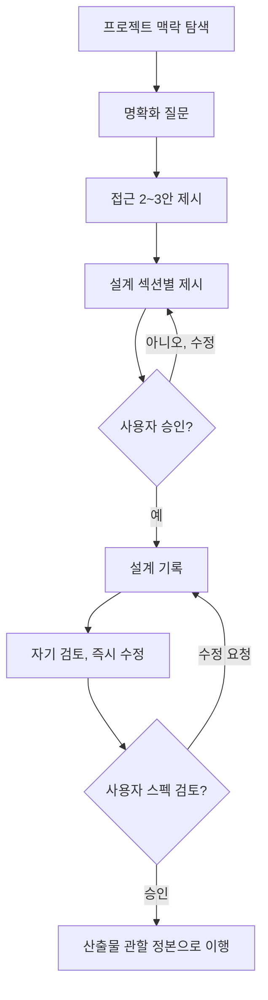

# 아이디어를 설계로

아이디어를 자연스러운 협업 대화로 완결된 설계로 다듬는다. 현재 프로젝트 맥락을 파악하는 데서 시작해, 질문을 하나씩 던져 아이디어를 다듬고, 무엇을 만드는지 이해가 서면 설계를 제시해 사용자 승인을 받는다.

**하드 게이트: 설계를 제시하고 사용자가 승인하기 전에는 어떤 구현 행위(코드 작성, 파일 스캐폴딩, 구현 스킬 호출)에도 착수하지 않는다. 단순해 보이는 작업에도 예외 없이 적용된다.**

## 원본 추적

- 원본: claude-plugins-official / superpowers / 6.1.0 / brainstorming
- 원본 경로: `~/.claude/plugins/cache/claude-plugins-official/superpowers/6.1.0/skills/brainstorming/`
- 원본 SKILL.md 해시: `b0d52b258929b75d408fa4292b3f078a1104f078`
- 대조표: `references/원본_대조.md`
- 재검토 트리거: 원본 플러그인 갱신(해시 불일치), 로컬 규범 개정, adapt-skill 재호출로 수행

## 적용 범위

이 프로젝트의 창작 작업은 셋으로 갈리고, 이 스킬은 그중 하나를 관할한다.

- **이 스킬의 관할**: 요구·설계가 열려 있는 하네스 개발 작업. 새 스킬·스크립트·검증 장치·데이터 구조의 설계 등(예시이며 이에 한정하지 않는다).
- **요구가 명확한 코드 수정**: `test-driven-development` 로컬판이 착수 절차 정본이다.

관할 안에서는 전부 이 과정을 거친다. 유틸 함수 하나, 설정 변경 하나도 예외가 아니다. "단순한" 작업이야말로 검토되지 않은 가정이 가장 큰 낭비를 낳는 곳이다. 설계는 짧아도 되지만(정말 단순하면 몇 문장), 제시와 승인은 반드시 거친다.

## 체크리스트

각 항목을 태스크로 만들어 순서대로 완료한다.

1. **프로젝트 맥락 탐색**: 파일·문서·최근 커밋을 확인하고, `기억/색인.md`의 layer-3 절을 확인해 관련 현행 노드(L)를 읽는다(CLAUDE.md 작업 착수 규범).
2. **시각 자료는 필요 시점에**: 처음부터 제안하지 않는다. 보여주는 것이 명확한 질문이 실제로 생기면 그때 mermaid 다이어그램으로 제시한다("시각 자료 활용" 절).
3. **명확화 질문**: 한 번에 하나씩. 목적·제약·성공 기준을 파악한다.
4. **접근 2~3안 제시**: 트레이드오프와 추천안·이유를 함께.
5. **설계 제시**: 복잡도에 비례한 섹션 단위로, 섹션마다 사용자 확인.
6. **설계 기록**: 초안을 임시 위치에 작성하고, 승인된 설계는 작업 산출물 인접 위치에 확정 배치한다("설계 기록" 절).
7. **자기 검토**: 플레이스홀더·모순·범위·모호성의 신속한 자가 선별.
8. **사용자 검토**: 기록된 설계를 사용자가 검토·승인.
9. **구현 이행**: 산출물 관할 정본으로 이행한다("구현 이행" 절).

## 절차 흐름

**종결 상태는 산출물 관할 정본으로의 이행이다.** 브레인스토밍에서 곧바로 구현 스킬을 호출하거나 구현에 착수하지 않는다.

## 진행 방법

**아이디어 파악**:

- 현재 프로젝트 상태(파일·문서·최근 커밋)를 먼저 확인한다.
- 상세 질문에 들어가기 전에 규모를 평가한다. 요청이 여러 독립 하위 시스템을 담고 있으면 즉시 짚는다. 분해가 먼저인 작업의 세부를 질문으로 다듬는 데 시간을 쓰지 않는다.
- 단일 설계로 다루기에 너무 크면 분해를 돕는다: 독립 조각이 무엇인지, 어떻게 연결되는지, 어떤 순서로 만들지. 그런 다음 첫 하위 작업을 통상 흐름으로 브레인스토밍한다. 하위 작업마다 각자의 설계·이행 사이클을 가진다.
- 적정 규모면 질문을 하나씩 던져 아이디어를 다듬는다.
- 가능하면 객관식 질문을 선호하되 서술형도 무방하다.
- 메시지당 질문은 하나만. 주제에 더 파고들 것이 있으면 여러 질문으로 나눈다.
- 파악의 초점: 목적, 제약, 성공 기준.

**접근 탐색**:

- 서로 다른 접근 2~3안을 트레이드오프와 함께 제시한다.
- 추천안과 그 이유를 함께 대화체로 제시한다.
- 추천안을 앞세우고 왜 그것을 추천하는지 설명한다.

**설계 제시**:

- 무엇을 만드는지 이해가 섰다고 판단되면 설계를 제시한다.
- 섹션마다 복잡도에 맞는 분량으로: 단순하면 몇 문장, 미묘하면 수백 자까지.
- 섹션마다 여기까지 맞는지 확인한다.
- 다루는 항목: 구조, 구성 요소, 데이터 흐름, 오류 처리, 검증 방식. 검증 방식은 테스트 스위트가 아니라 이 프로젝트의 검증 수단(재현 실행, hook 자동 검증, self-test 등)으로 서술한다. 스킬·문서 설계면 절차·게이트·리소스 구조가 대응 항목이다.
- 말이 안 되는 부분이 나오면 되돌아가 명확히 한다.

**분리와 명료성을 위한 설계**:

- 시스템을 각자 하나의 분명한 목적을 갖고, 잘 정의된 인터페이스로 소통하며, 독립적으로 이해·검증할 수 있는 작은 단위로 나눈다.
- 단위마다 답할 수 있어야 한다: 무엇을 하는가, 어떻게 쓰는가, 무엇에 의존하는가.
- 내부를 읽지 않고도 단위가 무엇을 하는지 이해되는가. 내부를 바꿔도 사용처가 깨지지 않는가. 아니라면 경계를 다시 잡는다.
- 작고 경계가 분명한 단위는 작업 신뢰성도 높인다. 한 파일이 계속 커지는 것은 대개 너무 많은 일을 하고 있다는 신호다.

**기존 코드베이스에서 작업할 때**:

- 변경을 제안하기 전에 현재 구조를 탐색하고 기존 패턴을 따른다.
- 이번 작업에 닿는 기존 문제(너무 커진 파일, 불분명한 경계, 얽힌 책임)가 있으면 표적 개선으로 설계에 포함한다.
- 무관한 리팩토링은 제안하지 않는다. 현재 목표에 복무하는 것에 집중한다.

## 설계 확정 후

**설계 기록**:

- 설계 초안은 임시 위치(스크래치패드 등 프로젝트 밖)에 작성해 사용자 검토를 받는다.
- 승인된 설계는 구현의 기준 문서로 쓰이도록 작업 산출물 인접 위치에 확정 배치한다(예: 대상 스킬의 `references/`, 신규 도구의 폴더). 설계 승인과 구현이 세션을 달리할 수 있으므로, 임시 위치에만 두면 승인된 설계의 영속 기록이 사라진다.
- 작문은 CLAUDE.md 작문 규칙을 따르고, 커밋은 commit-harness를 따른다.

**자기 검토**:

기록을 마친 뒤 새 눈으로 본다. 이 자기 검토는 사전 선별이고, 확정 게이트는 다음의 사용자 검토다.

1. 플레이스홀더 스캔: "미정", "TODO", 미완 섹션, 막연한 요구가 있는가. 고친다.
2. 내적 정합: 섹션끼리 모순되는가. 구조가 기능 서술과 맞는가.
3. 범위 점검: 단일 구현 단위로 다룰 만큼 집중되어 있는가, 분해가 필요한가.
4. 모호성 점검: 두 가지로 해석될 수 있는 요구가 있는가. 있으면 하나를 골라 명시한다.

발견한 문제는 그 자리에서 고친다. 재검토 루프는 불요, 고치고 진행한다.

**사용자 검토 게이트**:

자기 검토를 마치면 다음으로 넘어가기 전에 사용자에게 기록된 설계의 검토를 요청한다.

> "설계 기록을 `<경로>`에 두었습니다. 검토하시고, 구현으로 넘어가기 전에 고칠 부분이 있으면 알려 주십시오."

사용자 응답을 기다린다. 수정 요청이 오면 반영하고 자기 검토를 다시 돈다. 사용자가 승인한 후에만 진행한다.

**구현 이행**:

산출물 관할 정본으로 이행한다.

- 코드 구현: `test-driven-development` 로컬판(구현 착수 전 절차).
- 새 스킬의 생성 실행: skill-creator. 기존 범용 스킬의 각색: adapt-skill.
- 소규모라 직접 구현이 적절하면 그 사실을 사용자에게 확인하고 진행한다.

## 핵심 원칙

- **질문은 한 번에 하나**: 여러 질문으로 압도하지 않는다.
- **객관식 선호**: 가능하면 서술형보다 답하기 쉽다.
- **YAGNI를 가차 없이**: 불필요한 기능은 모든 설계에서 제거한다.
- **대안 탐색**: 정하기 전에 항상 2~3안을 제시한다.
- **점진 확인**: 설계를 제시하고 승인을 받은 뒤 넘어간다.
- **유연하게**: 말이 안 되면 되돌아가 명확히 한다.

## 시각 자료 활용

보여주는 것이 읽는 것보다 명확한 질문(구조·흐름·관계·선택지 비교)은 mermaid 다이어그램을 대화에 직접 제시한다. 렌더러 없이 마크다운 표면에서 읽히는 로컬 통용 표기다.

- 질문마다 판단한다: 사용자가 이것을 읽는 것보다 보는 것으로 더 잘 이해하겠는가. UI 주제에 관한 질문이라고 자동으로 시각 질문인 것은 아니다(개념·범위·트레이드오프 질문은 텍스트로).
- 제시 규율: 다이어그램당 선택지는 2~4개 상한. 상세도는 질문의 복잡도에 맞춘다(구조 질문에는 골격 수준, 세부 질문에는 세부까지).

화면·레이아웃 설계(UI mockup 등) 작업이 실제 발생하면, 이 커스텀본이 생략한 원본의 브라우저 기반 visual companion 리소스를 재검토한다.
