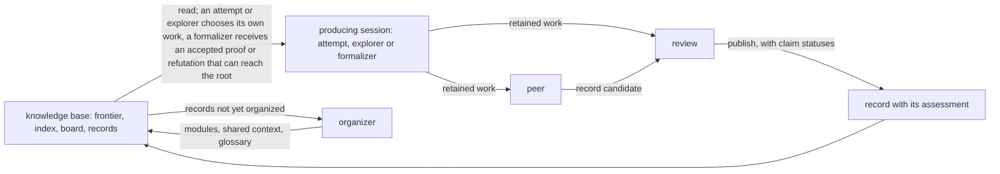

# do-math

| At a glance | |
|---|---|
| What it is | A system for autonomous mathematical research in which many AI sessions work together to prove or refute a single mathematical statement. Mathematics is produced, written up and assessed by three different sessions, and every result is published together with its assessment. |
| First run | Conjecture 6.5 of Celano, Elder, Hadaway, Harris, Martin, Priestley and Udell ([arXiv:2507.07243](https://arxiv.org/abs/2507.07243)): the maximum-displacement distribution of parking functions is unimodal for every length. Started 5 November 2026; still running. |
| State of the conjecture | *Informally proved* on 11 November 2026, a status defined below. In brief, every piece of the argument that leads to the conjecture was written up and passed review by an AI session, and every implication between the pieces was accepted by such a review. No person has refereed the work. Several steps on which the conjecture depends rest on binary64 floating-point computations whose rounding error is covered by assumed margins rather than tracked by the arithmetic. |
| Formal proof | None for the conjecture. The user who started the run paused formalization, the writing of machine-checked proofs in Lean 4, on 9 November 2026. One statement that the conjecture implies has a Lean proof; the conjecture itself remains open. |
| Evidence | The knowledge base, which holds every published record with its review, on Zenodo: concept DOI [10.5281/zenodo.24110810](https://doi.org/10.5281/zenodo.24110810); version 2 is [10.5281/zenodo.24142218](https://doi.org/10.5281/zenodo.24142218), and version 3, the latest, is [10.5281/zenodo.24165415](https://doi.org/10.5281/zenodo.24165415). |
| Full account | [docs/do-math/first-run-parking-unimodality.md](docs/do-math/first-run-parking-unimodality.md) |
| Run it | [Running do-math](#running-do-math) below; full guide in [docs/do-math/running.md](docs/do-math/running.md). |
| Cite | [CITATION.cff](CITATION.cff) for the software; the knowledge base by the DOI of the version you read. |

do-math is a system for autonomous mathematical research in which many AI sessions work together to prove or refute a single mathematical statement. The sessions have no contact with one another. Each is a new Claude Code or Codex conversation that knows nothing of the others; what a session produces is handed on as files, and what survives review is published as a record in a shared knowledge base for every later session to read. The user supplies the statement to be proved or refuted, written out exactly, and may add standing inputs, which are instructions that reach every session launched after them. The user does not launch sessions by hand. An AI conversation called the operator sets up the run from the user's statement and settings and operates it on the user's behalf. A program called the runner then launches sessions as the work requires, several at a time, for as long as the research goes on.

Every record is produced in three stages, each by a different session. First, a session works on the problem: it tries to prove or refute a statement, to understand some feature of the problem, or to turn an already reviewed proof into a formal proof in Lean 4, a proof assistant. It keeps all of its work, from definitions and computations to approaches that failed, in its own working files. Next, a second session, the peer, starts from those files. It writes the exposition that other sessions will read, completes arguments where it can, looks for what the first session missed, and decides what the record should propose to the knowledge base, such as new statements to pursue; the result is a record candidate. Finally, a third session, the review, checks the candidate against the first session's files and assesses whether each claim in it is supported.

If the review judges the work worth keeping, the candidate is published as a record with that assessment attached, and the record is never edited afterwards. If a later review session finds a mistake in a record or confirms one of its results, it issues a finding on that record, so that the original claim and what later became of it remain visible together. No session plans the work of another. A session in the first stage reads the knowledge base and decides for itself what to work on, and the runner assigns work only where it follows from what has already happened: a peer and a review for every piece of retained work, and a formalizer when a reviewed proof or refutation bears on the statement under research.

Two considerations shaped this design. The first is continuity. A run can last for days and pass through hundreds of conversations, none of which remembers the one before, so the records are the research's memory from one session to the next, and they must carry everything that later sessions will need. The second is independent judgment. Each piece of work is assessed by a session that took no part in producing it, so that no session certifies its own work. Because the assessment travels with the work, useful work that is not yet perfect can still be published, and a later session can tell an established result from a claim that still needs more work.

The first research run of this implementation began on 5 November 2026. Its statement was Conjecture 6.5 of a 2025 paper by Celano, Elder, Hadaway, Harris, Martin, Priestley and Udell ([arXiv:2507.07243](https://arxiv.org/abs/2507.07243)): for every length n, the numbers of parking functions of length n with maximum displacement 0, 1, …, n−1 form a unimodal sequence. On 11 November the conjecture reached the state that do-math calls *informally proved*. This is a technical term of the system, and it means less than the words might suggest: along the two chains of implications that lead from statements proved in earlier records to the conjecture itself, every record had passed review and every implication had been accepted by an AI review session. The two chains are not independent confirmations; both pass through one statement, as the first-run section explains.

No person has refereed the records, several steps depend on computer-assisted inputs, and there is as yet no Lean proof of the conjecture. do-math considers a run complete only when a Lean proof of the statement, or of its negation, has been recompiled by a review session, audited for the axioms it uses and matched against the exact statement; the user paused formalization on 9 November so that the sessions could finish the informal mathematics before formalization is resumed. The records and their assessments can be checked, because the knowledge base is public on Zenodo.

The rest of this document explains how the sessions cooperate, what a published result does and does not certify, the first run in outline, the layout of a published knowledge base, and the shortest path to running do-math on a statement of your own. Two longer documents hold the detail: the [full account of the first run](docs/do-math/first-run-parking-unimodality.md), with its setup, size, the two chains of reasoning that led to the result, interventions and limits, and the [running guide](docs/do-math/running.md), with every setting, command and procedure.

## How the research is organized

### Instances, roots and nodes

Each run of do-math is an **instance**: a directory with its own Git repository. It holds the statement to be proved or refuted in `root.md`, the models and scheduling in `settings.json`, a directory for every session that has run, and `knowledge/`, the knowledge base in which reviewed records accumulate. The statement in `root.md` is called the **root** of the instance. It never changes while the instance runs; to work on a different statement, you start a different instance.

The root is the first of the instance's **nodes**. A node is an exact mathematical statement that the research is trying to settle, with its objects, assumptions, domains and quantifiers all fixed. As the sessions work they find further statements worth settling, such as a lemma that would imply the root, and each of these becomes a node of its own. A node is **settled** once it or its negation, and not both, has been proved; the proof is either informal or formal, two levels of assurance that the section "What counts as established" defines. The run as a whole is finished only when the root has been settled at the formal level.

Every node other than the root enters through a **relation**, a reviewed implication between nodes. Suppose a session working on a node P proves that some statement Q implies P. Its record can then propose Q as a new node together with the relation "Q implies P", and Q is admitted once a review session has checked both the implication and the exact wording of Q. In the same way, a record that settles part of what a node asserts can propose that part and the remainder as nodes, with the relation that together they imply the whole. An implication that is merely conjectured does not create a node; it stays in the record for a later session to investigate.

### Six roles and the pipeline

Six roles share the work, and the runner starts a new session for each piece of it. Three roles produce mathematics: an **attempt** tries to settle a node, an **explorer** works to understand the problem, and a **formalizer** builds a Lean proof. Two roles process what the producing roles leave behind: a **peer** develops it into a record candidate, and a **review** assesses that candidate. The sixth role, the **organizer**, keeps the knowledge base navigable. A producing session together with its peer and its review is called a **pipeline**.

| Role | What it receives | What it leaves |
|---|---|---|
| attempt | The knowledge base, from which it chooses a node to settle | Its retained work on that node |
| explorer | The knowledge base, from which it chooses a question to understand | Its retained work on that question |
| formalizer | A node whose informal proof or refutation the review has accepted and whose outcome can reach the root | Its retained work: Lean sources, complete or partial |
| peer | One producing session's complete retained work | A record candidate: exposition, claims and proposals |
| review | The candidate and the producing session's retained work | Its assessment and feedback: claim statuses, a publication decision and any concerns |
| organizer | The published records not yet organized | Modules of records, the choice of shared context, glossary decisions, merges of nodes or questions found to be the same |

The diagram shows one pipeline and the organizer's loop. Every box except the knowledge base and the record is a session, started by the runner as a new conversation. The arrows between sessions are files passed from one to the next, and the arrows to and from the knowledge base are reads and publications; no two sessions ever converse.



What a producing session leaves behind is its **retained work**: the contents of its own directory when it ends. Those are the files it kept while it worked, together with its conversation, which the runner saves there. The files hold the definitions and assumptions it relied on, its arguments and partial results, and its computations with their code and output. They also hold the literature it drew on with the conditions under which each source applies, the approaches that failed with what each failure actually rules out, and the steps that still have to be proved.

### The choice of work: frontier, sections and leases

An attempt is handed no node and no task. The user's standing inputs may state priorities, but the choice of what to work on stays with the session. To make that choice, the attempt reads three views of the knowledge base. The **frontier** lists the current nodes with their statements, their states and the relations between them. The **index** is a guide to the published records: those selected as shared context for new sessions, the modules into which the organizer has grouped records, and recent records not yet organized, each shown with its own description and the review's short assessment beside it. The **board** shows what other sessions are working on right now. Having read these, the attempt picks a node and a **section** of it, an exact part of what the node asserts, which may be the whole node.

While an attempt is choosing, it holds the node's **lease**, so that only one session at a time can be choosing a section on that node. The lease has no time limit; it ends when the session registers its section or releases the lease, or when the session itself ends. Registering a section is how the attempt declares what it has taken on. The section counts as occupied until the resulting record is published or the review decides there is nothing to publish, because until then the work exists only in the attempt's own files, where no other session can see it, and a second attempt on the same part would repeat the work without knowing.

Sessions coordinate through information rather than enforcement. The board shows which sections are occupied; the guide that each role receives, called its **role guide**, explains how to respect that; and the sessions are trusted to follow the guide. The commands with which sessions register sections and take leases refuse only what a program can decide on its own: registering a statement identical to an existing section, registering a whole node while another session holds part of it, or leaving out the reason a new section does not overlap an existing one. Whether two differently worded sections overlap is a mathematical judgment, and the session registering the new section makes it and records its reason.

### The end of a session

An attempt has no time cap. Its session is a conversation that may continue over several CLI processes in turn, so the runner does not close the session when one of those processes exits. Instead, a separate process, the **session host**, keeps the session alive. It starts with the session, and each time a CLI process exits it resumes the conversation and asks the session to reconsider, under its role guide, whether to end; by default it does so up to three times. The session ends when it submits an explicit decision that its work is complete or that it sees no way forward, or when the limit is reached and the runner authorizes the end; otherwise it continues. The same reconsideration applies to explorers that have begun research, that is, that have taken a question and started on it, to formalizers and to peers; reviews and organizers are not asked to reconsider.

A producing session interrupted from outside, by a provider's usage limit for example, is treated the same as one that ended on its own. In either case, if the session had begun research, its retained work goes on to a peer and a review; a session that only checked for available work and found none ends without a peer or a review. An interrupted peer, review or organizer is replaced by a new session that receives the partial work.

### Peer, review and the published record

A **peer** is a new session that receives the producing session's complete retained work, including the full conversation, and develops it into a **record candidate**: an exposition written for a reader who cannot open the producing session's directory, together with a structured list of the claims the exposition makes. The peer is asked to work the mathematics itself: to complete an argument the producer left unfinished where it can, to look for a counterexample or an identity that the producer passed over, and to keep its own additions distinguishable from the producer's. It also decides what the record proposes for the frontier and the glossary: new nodes, relations, proofs of nodes, questions and terms.

A **review** is another new session. It receives both the candidate and the producer's retained work and compares them in both directions, looking for results the producer established that the candidate dropped and for claims the candidate makes without support. It gives each claim one of three statuses. A claim is *supported* when the review finds that the offered evidence establishes it, *unsupported* when the review finds that it does not, and *undetermined* when the review could not complete the assessment. Separately, the review decides whether the record has enough useful content to be published at all, and which of the record's proposals it accepts: a proposed node, relation or proof is accepted only when the claim it rests on is supported, and only accepted proposals change the frontier. A review may reason and compute to check an argument, but if accepting a claim would require a proof of an essential step that the candidate does not contain, it is asked to report the gap rather than write the proof and certify its own work.

By default, the first model listed for the peer and review roles differs from the first model listed for the producing roles. This default is part of the independent judgment described at the start, and it has a limit: each role's model setting is an ordered list with fallbacks, so a launch made while the preferred model is unavailable may end up using the same model as the producers.

When the review finds material worth keeping, the runner publishes the candidate as a **record**: the exposition, its evidence, its description and its terminology, together with the review's assessment and feedback, all committed to the instance's Git repository. The record never changes afterwards. If a later review session, whether reviewing another candidate or examining published evidence, finds a defect in it or confirms a result, it issues a **finding** on the record, kept with the review that made it, so that the original claim and what later happened to its status are both visible. The frontier, the index, the board and the shared glossary are rendered from the repository; no session writes a separate account of the current state.

### Relations, propagation and how nodes stand to the root

The runner applies each accepted relation in every direction that propositional logic allows, and the frontier shows the result. A relation's premises and conclusion are **outcomes**, that is, proofs or refutations of nodes, and the relation says that it is impossible for all of its premises to hold while its conclusion fails. So a proof of Q together with "Q implies P" proves P, and a refutation of K together with "P implies K" refutes P, without anyone having to write the contrapositive as a second relation. If accepted arguments currently support both a node's statement and its negation, the node is marked *contested*; it then counts neither as work available to attempts nor as settled, until a review locates the failure.

The frontier also marks how each node stands to the root. A **route** to the root is a chain of relations, branching where a relation has several premises, along which proving a node helps settle the root; such a node is said to be on a route. A node is a necessary condition of the root when only its refutation can contribute. Formalization is requested only for the proof of a node on a route or for the refutation of a necessary condition.

### Questions and progress

Beside its nodes, the frontier keeps **questions**: things the research wants to understand that no theorem statement captures, such as why several methods stall at the same scale, or what an object looks like at the point where every estimate loses its margin. An explorer takes up one question, with question 0 standing for the root problem as a whole, and works to understand it without any predetermined theorem to produce. Its retained work goes through a peer and a review just as an attempt's does.

Questions enter the frontier the way nodes do, through a record's proposal and a review's judgment. The operator can also place questions on the frontier directly with a runner command, without peer or review, and the frontier then shows the operator as their source. A question is resolved when a published record gives an account of it that the review judges to answer it.

The role guides describe progress as the change a piece of work makes to what is known. Work may settle something, make visible what could not be seen before, or change how the problem is approached; the guides give these as examples rather than as a complete list. Extending the range over which a statement has been checked, without any such change, does not count as progress. These descriptions inform the sessions' own choices and the reviews' judgments; the runner applies no such filter itself.

### Two documents on research and writing

Sessions in the attempt, explorer, peer, review and organizer roles receive, besides their role guides, two documents in their starting context; in the first run, which began before the documents existed, they reached the sessions as a standing input from 8 November. One is an essay on what mathematicians have sought in their work. This repository's author and an operator conversation wrote it after reading the records of an earlier instance that had worked on the first run's problem under a previous implementation, and it draws its examples from the history of mathematics rather than from that instance. The other describes the writing the author prefers and the occasions on which those preferences became clear. Both are meant to inform the sessions' judgment rather than to be followed as rules, and both are files in the skill's reference folder that a user can edit.

### Formalizers, organizers, the runner and the broker

A **formalizer** receives a node whose informal proof or refutation the review has accepted and works to build a Lean proof of the exact statement or of its negation, filling gaps or changing strategy as needed while the statement itself stays fixed. Its work goes through a peer and a review like any other, and another formalizer can continue from a published partial development; there is no cap on the number of such continuations. An **organizer** groups the published records into modules, each described the way a section of a survey would be, selects the records that every new session should see as shared context, decides which locally introduced terms enter the shared glossary, and merges nodes or questions that turn out to be the same.

The **runner** starts all of these as new CLI conversations under the user's existing authentication. When several kinds of work are waiting, it starts them in the order review, peer, formalizer, organizer, explorer, attempt; by default it runs eight sessions at a time and starts new attempts or explorers at least three minutes apart. All Lean compilation goes through one **Lean broker** per instance. The broker is a separate process that admits compile jobs within a limit on the total memory and threads they may use at once, and it keeps each job's result, so that a session can collect it even after the shell command that submitted it has stopped waiting. Sessions inherit none of the user's personal instructions, hooks or memories; their starting context is supplied by do-math and saved in the session's directory at launch.

## What counts as established

A published record is not a certificate for everything it says. Each claim in a record carries the status the review gave it. *Supported* means that the review found the offered evidence to establish the claim as stated; a claim of the form "we conjecture X, on these grounds" can be supported as a claim about the grounds while X itself remains unproved. The records also distinguish the kinds of support a proof rests on. The frontier keeps the informal and the formal level apart, and it counts a proof that includes computer-assisted steps as informal.

| Support | What it means | What it does not mean |
|---|---|---|
| Informal proof | An AI review session accepted a human-readable proof, or the runner derived the statement through accepted relations | Checked by a person or by a proof checker |
| Computer-assisted step | A step rests on a computation, and the record states its inputs, range, arithmetic, code and output | Validity beyond the range the computation covers; for a binary64 step, validity independent of the assumed error model |
| Formal proof | A Lean proof that a review session recompiled, audited for axioms and matched to the exact statement | Formal standing for what the frontier derives from it through relations, which stays informal |

### Informal proofs

A node is **informally proved** when a review accepts a human-readable proof of its statement, or when the runner derives the statement from accepted proofs of other nodes through accepted relations; it is informally refuted in the same ways for the negation. "Informal" here means that the argument is written in ordinary mathematical language, with any computer-assisted steps stated as such, and that it was checked by an AI review session reading the candidate against the producer's retained work, not by a person and not by a proof checker. An informal proof removes the node from the work that new attempts take up, and later work may use the result to the extent the review supported it. A proof that the frontier derives through relations is always informal, even when every premise has a Lean proof, because the relation itself has not been formalized.

### Computer-assisted steps

Some arguments rest on computation. A record is required to state what a computation established: its inputs, its range, its arithmetic, its code and its output. The records distinguish two kinds of arithmetic. In the first kind, every result is either exact or comes with a guaranteed range: exact integer arithmetic, interval arithmetic, and floating point with directed rounding used to compute bounds. The second kind is binary64 floating point with an error model assumed in advance: the rounding error is covered by margins added to the results rather than tracked by the arithmetic. The reviews in the first run accepted proofs with steps of the second kind as computer-assisted proofs and named the dependence in their assessments; a reader who does not accept an assumed error model should treat the results that depend on it as unproved. A finite verification proves the finite claim it covers and nothing beyond it. On the frontier, a proof with computer-assisted steps stands at the informal level.

### Formal proofs

A node is **formally proved** only after a Lean proof has passed three checks that the review session carries out itself. It recompiles the final sources through the broker, forcing the target to be compiled fresh. It prints the theorem's transitive axioms and compares them with the allowed list, by default `propext`, `Classical.choice` and `Quot.sound`, with `sorryAx` never allowed. And it compares the theorem's statement with the node, object by object and quantifier by quantifier, so that a compiled proof of a weaker or differently indexed statement does not count. The run is complete only when the root is proved or refuted at this level.

### Concerns and findings

A **concern** is a challenge to the support for a claim, reported by a review session in its assessment. A pending concern changes no status by itself. The questioned claim keeps its status, and the outcomes derived from it keep their states but are marked as resting on a questioned claim. This lasts until a review session, usually a **comprehensive review**, issues a finding that withdraws or reaffirms the claim. A comprehensive review is a review session assigned to examine published evidence and its actual uses; the runner launches one when a concern is reported, when a node becomes contested, or when the operator requests one with a runner command. A withdrawal removes every outcome derived through the claim, and a node that depended on it becomes unresolved again.

## The first run: unimodality of the maximum-displacement distribution of parking functions

Parking functions of length n arise from n cars arriving one at a time at n parking spots in a row. Each car has a preferred spot; it parks there if the spot is free, and otherwise drives on and takes the first free spot beyond it. A list of preferences under which every car finds a spot is a parking function, and there are (n+1)ⁿ⁻¹ of them. The **maximum displacement** of a parking function is the largest distance that any car had to drive past the spot it preferred. Write b(n, ℓ) for the number of parking functions of length n with maximum displacement ℓ. The root of the run is the statement that, for every n ≥ 1, the sequence b(n, 0), b(n, 1), …, b(n, n−1) is unimodal: non-decreasing up to some index and non-increasing after it. The [full account of the run](docs/do-math/first-run-parking-unimodality.md) states the problem exactly and describes the run's setup, its size, both routes to the root in outline, and every intervention by the user and the operator.

The instance was created on 5 November 2026 by the author of this repository, and on 11 November at 16:14 Korean time the root became informally proved. Two routes lead to it. A sequence fails to be unimodal exactly when it goes down at some step and up again at a later one. The first route splits that failure into four cases according to where the two steps lie relative to the middle index ⌈n/2⌉; each case has a reviewed informal proof that it cannot occur. The second route shows that a conditional form of log-concavity suffices: whenever the sequence decreases from one term to the following one, the square of that following term is at least the product of its two neighbours. Since all the counts are positive, it follows that once the sequence has decreased it cannot rise again. That property was proved directly for the steps at or beyond the middle; for the steps below it, it was derived from the fourth case of the first route, which is where the two routes meet.

Both routes pass through one statement, that the sequence never decreases over the steps below the middle, in the exact range of steps that the frontier's statements give; this statement was the last part to be proved, and its last open premise was closed by record r5909c9e7, which depends on computer-assisted inputs from earlier records: several binary64 computations with error models assumed in advance, and a finite verification that the root holds for all n ≤ 20000, carried out in interval arithmetic with integer endpoints and, for the steps below the middle, also in floating point with directed rounding.

There is no Lean proof of the root. The user paused all formalization on 9 November so that the sessions could finish the informal mathematics before formalization is resumed, and the pause is still in force. One node does have a formal proof: record r0af7f414 contains the Lean theorem `Parking.critical_increment_unconditional`, whose transitive axioms are exactly `propext`, `Classical.choice` and `Quot.sound` and whose statement the review matched to the node. The node is a necessary condition of the root: it states a limit that unimodality for every n implies, so its refutation would have refuted the root, while its proof leaves the root open. The rule that limits formalization to outcomes that can reach the root was added after this node had been formalized, as the full account explains.

The complete `knowledge/` directory of the instance is published on Zenodo under the concept DOI [10.5281/zenodo.24110810](https://doi.org/10.5281/zenodo.24110810), which resolves to the latest version. Each version is a snapshot of the directory. Version 3, [10.5281/zenodo.24165415](https://doi.org/10.5281/zenodo.24165415), the latest, was taken at 23:25 Korean time on 12 November and deposited at 00:45 on 13 November; it holds 340 records. Version 2, [10.5281/zenodo.24142218](https://doi.org/10.5281/zenodo.24142218), was taken on 12 November at 01:52 Korean time, after the root had been informally proved, and holds 300 records. Version 1, [10.5281/zenodo.24110811](https://doi.org/10.5281/zenodo.24110811), was taken on 11 November at 00:19 Korean time, while the root was still unresolved. Records are cited here by the letter r and the first eight hexadecimal digits of their identifiers; the directories in the knowledge base carry the full identifier. To check the result, open `index.md`, go to `frontier.md` for the root's two routes and the records they cite, open record r5909c9e7 with its `review/feedback.md`, and continue into the records its proof uses.

The result has limits. Every review was an AI session, and no person has refereed the records. Several records on the routes rest on binary64 computations with error models assumed in advance, and the root's informal proof depends on them, so a reader who does not accept those models should treat the root as unproved. No Lean work on the routes to the root has been published. Whether do-math's mechanisms changed the quality of the research has not been measured, and no figures were collected on cost or on how often reviews rejected or corrected claims. The research is not finished: at 23:15 Korean time on 12 November the run had launched 1,237 sessions and published 340 records, the frontier held 108 nodes, and ten pipelines were still working on nodes and questions other than the root.

Several artifacts of the run are being prepared and are not yet public.

- `[placeholder: link to the Lean formal proof of the root; none exists yet, because formalization has been paused by the user since 9 November and will resume when the pause is lifted]`
- `[placeholder: link to the proof manuscript, in Korean with an English translation; a manuscript that writes out the two routes to the root step by step from the records is being written]`
- `[placeholder: link to the expository account of the research, in Korean with an English translation; the Korean text is finished and its publication form is not yet decided]`
- `[placeholder: link to the film of the run; a 191-second rendering of the instance's nodes, questions and sessions over its first six days exists and its hosting is not yet decided]`
- `[placeholder: link to the bundle of computational evidence; the code, inputs and outputs behind the computer-assisted steps are in the records' evidence folders in the knowledge base, and a bundle collected from them will be distributed with the manuscript]`

## Reading a published knowledge base

### The top-level files and directories

A published knowledge base is the `knowledge/` directory of an instance. Its entry point is `index.md`, which lists the records that the organizer selected as shared context for new sessions, a list of modules with their descriptions, and the recent records not yet organized. Each entry shows the record's own description, written by its peer, with the review's short assessment beside it.

`frontier.md` gives, for every node, its exact statement; its state, which is unresolved, informally proved or refuted, formally proved or refuted, or contested; the proofs that support that state, with links to their records; the accepted relations with their premises and conclusions; how the node stands to the root; and any pending concern. After the nodes it lists the questions with their statements, grounds, state and source; a question that the operator placed directly shows the operator as its source instead of a reviewed record. `glossary.md` is the shared vocabulary, with each term's definition and its source record. `board.md` is the occupancy snapshot at the time the knowledge base was taken. `state.json` is a structured projection of the same evidence for programmatic inspection; its `proofs` object lists every supported proof with its claims and premises.

`records/` holds one directory per record, described below. `events/` holds one file per publication with its time, `organizations/` the organizer outputs, `questions/` the questions the operator published, and `reviews/` the comprehensive reviews, which examine already published evidence and therefore belong to no single record. The producing sessions' conversations and working files are not in `knowledge/`; they stay in the instance's `sessions/` directory, which the published knowledge base does not include.

### A record's directory

Each record is a directory under `records/` named by its identifier. `record.json` is the structured description: title, description, claims with their IDs and evidence, proposed nodes, relations, proofs, questions and terminology. `exposition.md` is the mathematical account. `evidence/` holds the code, data, logs and notes the account cites. `review/assessment.json` is the review's structured judgment, including the status of every claim and, for a formal proof, the compile job, the printed axioms and the source hashes; `review/feedback.md` is its full explanation. `provenance.json` names the producing, peer and review sessions. Concerns and findings are not written into the record they concern; they are in the assessment of the review that raised them, collected in `state.json`, and shown in `frontier.md` beside the affected node. A formal record also has `lean/` with the sources and a `review/lean-evidence/` folder with the broker's retained compile output.

## Running do-math

### Requirements and what a run does on your machine

The runtime needs Python 3.12 or later and Git, and it uses only Python's standard library. It needs the Codex CLI, the Claude Code CLI, or both, installed and logged in; it launches them as processes and does not call model APIs directly, so usage is billed or metered however those CLIs are configured. It needs Lean 4 in every case, because the Lean broker starts with the runner, and Mathlib when the proofs will draw on it. Development and live verification were done on Windows. The code that identifies and ends processes also supports Linux, but Linux has not been verified in a live run, and macOS is not supported.

Sessions run unattended with file and command access under your account: Claude Code is launched with permission prompts disabled, and Codex with its approval policy set to never and its sandbox set to full access. Their workspace boundaries are instructions, not an operating-system sandbox, and their model providers receive the material they read; the sessions also have the CLIs' built-in tools, which include web search. A run has no cap on time, on the number of sessions, or on usage, and do-math collects no usage figures. do-math itself sends nothing outside your machine; publication is a commit to the instance's local Git repository, and the only outbound traffic is the CLIs' own, together with that of any tool servers you configure for the sessions.

### Quick start

Clone this repository. Then, from Claude Code or Codex started in the repository, ask the assistant to start research on a statement with the do-math skill, a folder of instructions that these CLIs load. The conversation that handles that request is the operator: it prepares the statement and the settings, launches the detached runner and reports where the work lives. The skill is the folder `.claude/skills/do-math`, with a mirror for Codex at `.agents/skills/do-math`.

To set up an instance by hand instead, write a UTF-8 `root.md` containing the exact statement and a `settings.json` that names your Lean installation, with the command that compiles a file and the command that prints the Lean version:

```json
{
  "lean": {
    "command": ["C:/tools/lean.exe"],
    "version_command": ["C:/tools/lean.exe", "--version"]
  }
}
```

This keeps the default models: Codex first and Claude second for every role except peer and review, and the reverse for those two. With only Claude Code installed, list Claude models only, both in the `models` list and in the `roles` entries for peer and review, as the running guide shows.

Then create the instance at a path outside this repository, or under its Git-ignored `.skill-workspace/` directory, and start the runner:

```powershell
$skill = 'C:/path/to/do-math/.claude/skills/do-math'
$instance = 'C:/research/add-zero'
python "$skill/runtime/runner.py" init $instance --root C:/research-input/root.md --settings C:/research-input/settings.json
python "$skill/runtime/runner.py" start $instance
python "$skill/runtime/runner.py" status $instance
```

The runner continues after the terminal or operator conversation ends, and `knowledge/` is updated with every publication. The [running guide](docs/do-math/running.md) covers the model and scheduling settings, Mathlib, the allowed Lean axioms, standing inputs, every runner command, how to end a run, and what happens on interruption and completion; the [operating guide](.claude/skills/do-math/reference/operations.md) in the skill is the complete reference for every setting and state.

## Repository layout, verification and tests

Within `.claude/skills/do-math/`, `SKILL.md` is the operator's entry point, `roles/` holds the six role guides, `reference/` the shared and specialist guides, `resume/` the texts delivered when a session is asked to reconsider ending, and `runtime/` the runner, the coordination tools, the Lean broker and their tests. `.agents/skills/do-math/` is the generated mirror for Codex. The design and decision record of the current implementation is [docs/do-math/rebuild-design.md](docs/do-math/rebuild-design.md). The checks performed when it was installed are in [docs/do-math/rebuild-verification.md](docs/do-math/rebuild-verification.md); they included live launches of both CLIs, a complete small instance whose root was formally proved with a Lean proof that a review session recompiled and checked, and recovery after a runner restart. The [full account of the first run](docs/do-math/first-run-parking-unimodality.md) and the [running guide](docs/do-math/running.md) are in the same folder.

The runtime tests use scripted CLI processes, Git and a controlled Lean stand-in. They cover evidence propagation, occupancy and leases, questions, scheduling, glossary and index rendering, formal-evidence identity, interruption, recovery and context delivery. Run them with:

```powershell
python -B -m unittest discover -s .claude/skills/do-math/runtime/tests -v
```

On 12 November 2026 the suite had 316 tests and all passed. These tests exercise the runtime against stand-ins; they do not evaluate the mathematics that real sessions produce.

## Standalone tools and supporting skills

The repository also holds four programs that do not depend on do-math and are not needed to run it. Their READMEs are in Korean.

- [services/scholarly-mcp](services/scholarly-mcp/README.md): a local MCP server (a tool server that AI CLIs can call) that searches 49 academic sources and saves bibliographic data, abstracts, full text and supplements. The public sources need no login; some others go through one university library's login. When configured for an instance, it gives do-math's sessions literature search.
- [services/continuous-development](services/continuous-development/README.md): a multi-agent system for software development in which a Python runner dispatches Codex sessions in phases, with a manager session reading each phase's reports and writing the next.
- [services/async-development](services/async-development/README.md): a system of the same kind in which workers each get their own copy of the code and a manager merges accepted results as they arrive.
- [services/jev-cli](services/jev-cli/README.md): a command-line client for Jev, a hosted model from TypeSafe.

The repository's other skills support its development.

| Skill | What it does |
|---|---|
| graphify | Builds and queries a knowledge graph of do-math's own documents and scripts, for finding where a rule or procedure comes from |
| verify-rounds | Runs rounds in which several agents review a finished artifact and fix what they find |
| write-for-reader | Guides the design, writing and revision of text that a person or an AI will act on, and interviews the user when a decision is missing |
| grilling, grill-me | Interview the user one question at a time to stress-test a plan |
| skill-creator | Creates, improves and benchmarks skills |
| writing-skills | Explains principles for writing a skill's description, structure and tests |
| simplify | Prompts a short self-check: is this the simplest way to do what I am trying to do? |
| memory-harness | Defines the structure and rules of the working-memory graph in `기억/` |
| commit-harness | Sets out the commit procedure that pairs every commit with a memory node |
| dream-harness | On request, combines accumulated memory nodes into current principles and conventions |

## Language, roadmap, citation and license

The do-math operator and role guides, the formats of the files that sessions exchange, the runtime output and this README are in English. The supporting skills, the standalone tools' documentation and the working-memory directory are primarily in Korean. Planned work is in [ROADMAP.md](ROADMAP.md).

To cite the software, use the repository's [CITATION.cff](CITATION.cff), which GitHub renders under "Cite this repository". To cite the published knowledge base of the first run, cite the version you read by its own DOI (version 3 is 10.5281/zenodo.24165415) or all versions together by the concept DOI 10.5281/zenodo.24110810. The knowledge base is licensed CC BY 4.0 on Zenodo.

This project is licensed under the [Mozilla Public License 2.0](LICENSE). Four skill directories are adapted from third-party projects and keep their original licenses; see [THIRD-PARTY-NOTICES.md](THIRD-PARTY-NOTICES.md).
