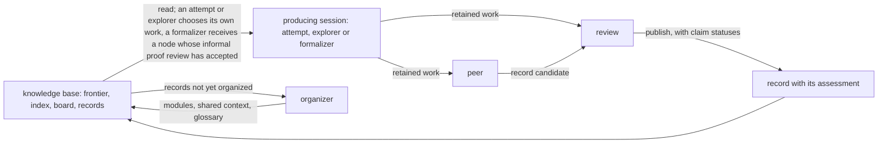

# do-math

| At a glance | |
|---|---|
| What it is | Research on one mathematical proposition by many fresh AI sessions. The session that produces a piece of mathematics, the session that writes it up for others and the session that assesses it are three different conversations, and every result is published together with its assessment. |
| First run | Conjecture 6.5 of Celano, Elder, Hadaway, Harris, Martin, Priestley and Udell ([arXiv:2507.07243](https://arxiv.org/abs/2507.07243)): the maximum-displacement distribution of parking functions is unimodal for every length. Started 5 November 2026; still running. |
| State of the root | *Informally proved* on 11 November 2026: every record and every reviewed implication on two routes to the root was accepted by an AI review session. No person has reviewed the records as a referee would. Several steps rest on computer-assisted inputs, some in binary64 with error models assumed in advance. One step relies on two monotonicity properties that are asserted and numerically checked but not proved. |
| Formal proof | None of the root. The user paused formalization on 9 November 2026. One necessary condition of the root has a Lean proof. |
| Evidence | The knowledge base on Zenodo, concept DOI [10.5281/zenodo.24110810](https://doi.org/10.5281/zenodo.24110810); version 2 is [10.5281/zenodo.24142218](https://doi.org/10.5281/zenodo.24142218). |
| Full account | [docs/do-math/first-run-parking-unimodality.md](docs/do-math/first-run-parking-unimodality.md) |
| Run it | [Quick start](#running-do-math) below; full guide in [docs/do-math/running.md](docs/do-math/running.md). |
| Cite | [CITATION.cff](CITATION.cff) for the software; the knowledge base by its DOI. |

do-math runs research on one mathematical proposition through many fresh AI sessions. The person who starts a run, called the user below, supplies the proposition as an exact statement, together with any standing inputs, which are instructions that every session launched afterwards receives; the user does this through an AI conversation, called the operator, that prepares and operates the run on the user's behalf. The mathematics is then done by the sessions. A program called the runner launches them as the work requires, several at a time, each a new Claude Code or Codex conversation that remembers nothing of the others.

What the sessions share is a knowledge base: a repository of records. A record holds mathematics that one session produced, that a second session developed into an account for others, and that a third session assessed; once published it is never changed, and the assessment stays beside it. Each session that produces mathematics reads the knowledge base and decides for itself what to work on; the sessions that develop and assess receive the work they are to process. No session plans or assigns the others' research.

The system is built this way because research that runs for days needs both continuity and judgment that does not come from whoever did the work. Continuity comes from the records. Independence of judgment is sought through the separation of roles: the session that writes a piece of mathematics, the session that turns it into a record, and the session that judges the record are three different conversations. Work that is useful but imperfect is published with its assessment, so that a later session can tell an established result from a claim that still needs more.

The first full run of this implementation began on 5 November 2026 on a conjecture from a 2025 paper by Celano, Elder, Hadaway, Harris, Martin, Priestley and Udell ([arXiv:2507.07243](https://arxiv.org/abs/2507.07243), Conjecture 6.5): for every length n, the numbers of parking functions of length n with maximum displacement 0, 1, …, n−1 form a unimodal sequence. On 11 November the root proposition reached the state do-math calls *informally proved*: every record, and every reviewed implication between statements, on two routes to the root had been accepted by an AI review session. That state comes with qualifications, set out in the first-run section below. No person has reviewed the records as a referee would. Several steps rest on computer-assisted inputs. One step relies on two monotonicity properties that a record asserts and that its review checked numerically but that no record proves. And no Lean proof of the root exists, because the user paused formalization on 9 November so that the research could finish first; do-math counts a run as complete only when a Lean proof of the root, or of its negation, has been recompiled by a review session and checked against the exact statement. The knowledge base is public on Zenodo.

The sections below describe how the sessions cooperate, what a published result does and does not certify, the first run in outline, the layout of a published knowledge base, and the shortest path to running do-math on a proposition of your own. Two longer documents hold the detail: the [full account of the first run](docs/do-math/first-run-parking-unimodality.md), with its setup, size, routes, interventions and limits, and the [running guide](docs/do-math/running.md), with every setting, command and procedure.

## How the research is organized

### Instances, roots and nodes

An **instance** is one run: a directory with its own Git repository, holding the proposition in `root.md`, the models and scheduling in `settings.json`, a directory for every session, and `knowledge/`, the knowledge base where reviewed records accumulate. The proposition in `root.md` is the **root**. It never changes during the instance; a different proposition is a different instance.

The research represents the root, and every further proposition it decides to pursue, as a **node**: an exact mathematical statement with its objects, assumptions, domains and quantifiers fixed. A node is **settled** when its statement or its negation has been proved. A proof carries one of two levels of assurance, informal or formal, and the run as a whole is complete only when the root is settled at the formal level.

Nodes other than the root enter the research through a **relation**, a reviewed implication between nodes. If a session working on P proves that Q implies P, its record can propose Q as a node together with that relation, and Q is admitted once a review session has checked the implication and the exact statement of Q. If work settles a part of what a node asserts, the record can propose the parts as nodes together with the relation that the parts cover the whole. An implication that is only conjectured stays in the record for a later session to investigate; it does not create a node.

### Six roles and the pipeline

Six roles do the work, and the runner launches a fresh session for each piece of it. Three roles produce mathematics: an **attempt** tries to settle a node, an **explorer** works to understand the problem, and a **formalizer** constructs a Lean proof. Two roles process what the producing roles leave: a **peer** develops it into a record, and a **review** assesses the record. An **organizer** keeps the knowledge base navigable. A producing session together with its peer and review is a **pipeline**.

| Role | What it receives | What it leaves |
|---|---|---|
| attempt | The knowledge base; it chooses a node to settle | Its retained work on that node |
| explorer | The knowledge base; it works to understand one question about the problem | Its retained work on that question |
| formalizer | A node whose informal proof review has accepted | Its retained work: Lean sources, complete or partial |
| peer | One producing session's complete retained work | A record candidate: exposition, claims and proposals |
| review | The candidate and the producing session's retained work | Its assessment and feedback: claim statuses, a publication decision and any concerns |
| organizer | The published records not yet organized | Modules, shared-context selection, glossary decisions, merges |

The diagram shows one pipeline and the organizer's loop. Every box except the knowledge base and the record is a session that the runner launches as a fresh conversation; the arrows carry files from one session to the next, and no two sessions converse.



What a producing session leaves is its **retained work**: the files it keeps in its own directory as it goes, holding the definitions and assumptions it used, arguments and intermediate results, computations with their code and output, literature with the conditions of its use, failed approaches with what they actually exclude, and the obligations that remain.

### The choice of work: frontier, sections and leases

An attempt receives no assigned node and no task written for it; the user's standing inputs can state priorities, but the choice of work stays with the session. It reads the **frontier**, the current list of nodes with their statements, their states and the relations between them; the **index**, a directory of published records that shows each record's own description with the review's short assessment beside it; and the **board**, which shows what other sessions are working on now. Then it chooses a node and a **section** of it: an exact part of what the node asserts, up to the whole node.

While an attempt chooses, it holds the node's **lease**, which lets one session at a time choose a section on that node; the lease has no time limit and ends when the session registers its section, releases the lease, or ends. The registered section is the attempt's declaration of what it has taken on, and the section counts as occupied until the work has been developed into a record and reviewed, because until then the work is invisible to other sessions, and a second attempt on the same part would repeat it without knowing.

Coordination between sessions works through information rather than enforcement. The board shows occupancy; the guide each role receives, its **role guide**, explains how to respect it; the sessions are trusted to follow the guide. Tools refuse only what a program can decide by itself: registering a statement identical to an existing section, registering a whole node while another session holds part of it, or omitting the reason a new section does not overlap an existing one. Whether two differently worded sections overlap is a mathematical judgment, and the registering session makes it and records its reason.

### The end of a session

An attempt has no time cap. When the CLI process of its conversation exits, the runner does not close the session at once. A separate process, the **session host**, which the runner started with the session and which lives as long as the session does, resumes the same conversation and asks the session to reconsider ending under its role guide, up to three times by default. The session either continues or submits an explicit decision that its work is complete or that it sees no way forward.

A session interrupted from outside, by a provider's usage limit for example, is treated the same as one that ended. In either case, if the session has begun research, its retained work goes on to the processing roles; a session that only checked for available work and found none ends without them.

### Peer, review and the published record

A **peer** is a fresh session that receives the producing session's complete retained work, including the full conversation, and develops it into a **record candidate**: an exposition written for a reader who cannot open the producing session's directory, together with a structured list of the claims it makes. The peer is asked to work the mathematics itself: to complete an argument the producer left unfinished where it can, to look for the counterexample or the identity that the producer passed over, and to keep its own additions distinguishable from the producer's. It also decides what the record proposes to the shared state: new nodes, relations, proofs of nodes, questions, and terminology.

A **review** is another fresh session, which receives the candidate and the producing session's retained work. It compares them in both directions, looking for results the producer established that the candidate dropped and for claims the candidate makes without support. It gives each claim one of three statuses: *supported*, when the offered evidence establishes the claim; *unsupported*, when the review has found that it does not; and *undetermined*, when the review could not complete the assessment. It decides separately whether the record has enough useful content to publish at all. Review may reason and compute to check an argument, but if accepting a claim would require an essential proof that the candidate does not contain, it is asked to report the gap rather than to write the proof and certify its own work.

By default the peer and review roles prefer a model different from the one the producing roles prefer. Each role's model setting is an ordered list with fallbacks, so a launch made while the preferred model is unavailable can use the same model as the producers.

When review finds material worth keeping, the runner publishes the candidate as a **record**: the exposition, its evidence, its description and its terminology, together with the review's assessment and feedback, committed to the instance's Git repository. The record never changes afterwards. A later review session, whether reviewing another candidate or examining published evidence, that finds a defect in it or confirms a result attaches a **finding** to the record, so that the original claim and what later happened to its standing are both visible. The frontier, the index, the board and the shared glossary are rendered from the repository, and no session writes a separate account of the current state.

### Relations, propagation and the standing of nodes

The runner applies each accepted relation in every direction that propositional logic allows, and the frontier shows the result. A relation says that its premises cannot all hold while its conclusion fails. So a proof of Q together with "Q implies P" gives P, and a refutation of K together with "P implies K" refutes P, without anyone writing the contrapositive as a second relation. A node for which accepted arguments currently support both its statement and its negation is marked *contested*; it counts neither as work available to attempts nor as settled until a review locates the failure.

The frontier also marks each node by how it stands to the root: on a **route** to the root, when a chain of relations lets a proof of the node contribute to settling the root, or a necessary condition, when only its refutation can contribute. Formalization is requested only for outcomes that can reach the root in this sense.

### Questions and progress

Beside its nodes, the frontier keeps **questions**: things the research wants to understand that no theorem statement captures, such as why several methods stall at the same scale, or what an object looks like where every estimate loses its margin. An explorer occupies one question, with question 0 standing for the root problem as a whole, and works to understand it, with no predetermined theorem to produce. Its retained work goes through peer and review like an attempt's.

Questions enter the frontier the way nodes do, through a record's proposal and a review's judgment. The operator can also place questions on the frontier directly with a runner command, without peer or review, and the frontier shows the operator as their source. A question is resolved when a published record gives an account that review judges to settle it.

The role guides describe what moves research forward by what a piece of work changes in what is known: something it closes, something it lets the research see that it could not see before, a change in how the problem is approached, and the like. Extending the range over which a statement has been checked, without any such change, is not counted as progress.

### Two documents on research and writing

Besides their role guides, attempt, explorer, peer, review and organizer sessions receive two documents in their starting context, in every instance started with the current do-math. One is an essay on what mathematicians have sought in their work, which this repository's author and an operator session wrote after reading the records of an earlier instance that had worked on the same problem under a previous implementation; it draws its examples from the history of mathematics, not from that instance. The other describes the writing the author prefers, with the scenes in which those preferences became clear. Both are given as understanding rather than as rules, and both are files in the skill's reference folder that a user can edit.

### Formalizers, organizers, the runner and the broker

A **formalizer** receives a node whose informal proof review has accepted and works to construct a Lean proof of the exact statement, filling gaps or changing strategy as needed while the statement stays fixed. Its work goes through peer and review like any other, and another formalizer can continue from a published partial development; there is no cap on rounds. An **organizer** groups published records into modules, each described the way a section of a survey would be, selects the records every new session should see as shared context, decides which locally introduced terms become shared vocabulary, and merges nodes or questions that turn out to be the same.

The **runner** launches all of these as fresh CLI conversations under the user's existing authentication. When several kinds of work are waiting, it launches them in the order review, peer, formalizer, organizer, explorer, attempt; it runs eight sessions at a time by default and launches new attempts or explorers at least three minutes apart. It compiles all Lean through one **Lean broker** per instance, a separate process that admits compiles within a limit on the total memory and threads they may use at once, and that keeps each compile's result so that a session can collect it after its shell tool has stopped waiting. Sessions inherit none of the user's personal instructions, hooks or memories; everything they read is supplied by do-math and saved in the session's directory at launch.

## What counts as established

A published record is not a certificate for everything it says. Each claim in a record carries the review's status. *Supported* means that the review found the offered evidence to establish the claim as stated; a claim that states a conjecture with its grounds can be supported as that statement while the conjectured proposition remains unproved. The records also distinguish the kinds of support a proof rests on. The frontier keeps the informal and the formal level apart and counts a proof with computer-assisted steps as informal.

| Support | What it means | What it does not mean |
|---|---|---|
| Informal proof | An AI review session accepted a human-readable proof, or the runner derived the statement through accepted relations | Checked by a person or by a proof checker |
| Computer-assisted step | A step rests on a computation whose inputs, range, arithmetic, code and output the record states | Anything beyond the range the computation covers; for a binary64 step, proof independent of the assumed error model |
| Formal proof | A Lean proof that a review session recompiled, audited for axioms and matched to the exact statement | Formal standing for what the frontier derives from it through relations, which stays informal |

### Informal proofs

A node is **informally proved** when review accepts a human-readable proof of its statement, or when the runner derives the statement from accepted proofs of other nodes through accepted relations; it is informally refuted in the same ways for the negation. "Informal" here means that the argument is written in ordinary mathematical language, with any computer-assisted steps stated as such, and was checked by an AI review session reading the candidate against the producer's retained work, not by a person and not by a proof checker. An informal proof removes the node from the work new attempts take up, and later work may use the result for the cases the review supported. A proof that the frontier derives through relations is always informal, even when every premise has a Lean proof, because the relation itself has not been formalized.

### Computer-assisted steps

Some arguments rest on computation. A record is required to state what a computation established: its inputs, its range, its arithmetic, its code and its output. The records distinguish arithmetic that controls its own rounding, such as exact integer arithmetic, interval arithmetic and floating point with directed rounding, from binary64 floating point with an error model assumed in advance, in which margins added to the results are trusted to cover the rounding error rather than tracked by the arithmetic. The reviews in the first run accepted proofs with steps of the second kind as computer-assisted proofs and named the dependence in their assessments; a reader who does not accept an assumed error model should treat the results that depend on it as unproved. A finite verification proves the finite claim it covers and nothing beyond it. A proof with computer-assisted steps stands at the informal level on the frontier.

### Formal proofs

A node is **formally proved** only after a Lean proof has passed three checks that the review session carries out itself: it recompiles the final sources through the broker, forcing the target to be compiled fresh; it prints the theorem's transitive axioms and compares them with the allowed list, by default `propext`, `Classical.choice` and `Quot.sound`, with `sorryAx` never allowed; and it compares the theorem's statement with the node, object by object and quantifier by quantifier, so that a compiled proof of a weaker or differently indexed statement does not count. The run is complete only when the root is proved or refuted at this level.

### Concerns and findings

A **concern** is a challenge to the support for a claim, reported by a review session in its assessment. A pending concern changes nothing: the claim and everything derived from it keep their standing, marked as resting on a questioned claim, until a **comprehensive review**, a review session assigned to examine published evidence and its actual uses, issues a finding that withdraws or reaffirms it. A comprehensive review is launched when a concern is reported, when a node becomes contested, or when the operator requests one with a runner command. Withdrawal removes every outcome derived through the claim, and a node that depended on it becomes unresolved again.

## The first run: unimodality of the maximum-displacement distribution of parking functions

A **parking function** of length n is a list of preferred spots for n cars that arrive one at a time at n spots in a row, each car taking its preferred spot if it is free and otherwise the first free spot beyond it, such that every car parks; there are (n+1)ⁿ⁻¹ of them. The **maximum displacement** M(α) of a parking function α is the largest distance any of its cars travelled beyond its preferred spot. With b(n, ℓ) the number of parking functions of length n with M(α) = ℓ, the root asks whether the sequence b(n, 0), b(n, 1), …, b(n, n−1) is unimodal for every n ≥ 1: non-decreasing up to some index and non-increasing after it, with a flat peak allowed. The [full account of the run](docs/do-math/first-run-parking-unimodality.md) states the problem exactly and gives the run's setup, its size, both routes to the root in outline, and every intervention by the user and the operator.

The instance was created on 5 November 2026 by the author of this repository. On 11 November at 16:14 Korean time the root became informally proved through two routes. One route splits a failure of unimodality into four cases by the positions of the offending descent and ascent around the middle index ⌈n/2⌉, and each case has a reviewed informal proof; the other shows that a conditional log-concavity suffices for the root, and that condition was settled on each side of the middle. Both routes pass through the statement that the sequence increases below the middle, which was the last part to close. The record that closed it, r5909c9e7, inherits computer-assisted inputs from earlier records: several binary64 computations with error models assumed in advance, and a certification in integer interval arithmetic that the root holds for all n ≤ 20000.

One step of those routes is known to be unproved. Record r030ffaeb reads a lower bound from a table of values that is valid only if two monotonicity properties hold. The record asserts the properties, its review checked them numerically and accepted the record as a computer-assisted proof while listing them among the points not yet rigorous, and no record proves them. The author and an operator session found the gap on 12 November while writing a manuscript from the records, and a standing input of that day asks the sessions to prove the two properties before any other work. Until a record does, the root's state rests on this step as the reviews accepted it.

No Lean proof of the root exists. The user paused all formalization on 9 November so that the research could finish first, and the pause is still in force. One node has a formal proof: record r0af7f414 contains the Lean theorem `Parking.critical_increment_unconditional`, whose transitive axioms are exactly `propext`, `Classical.choice` and `Quot.sound` and whose statement the review matched to the node. The node is a necessary condition of the root, a limit that unimodality for every n implies, so its refutation would have refuted the root while its proof leaves the root open.

The complete `knowledge/` directory of the instance is published on Zenodo under the concept DOI [10.5281/zenodo.24110810](https://doi.org/10.5281/zenodo.24110810), which resolves to the latest version. Version 2, [10.5281/zenodo.24142218](https://doi.org/10.5281/zenodo.24142218), was compressed on 12 November at 01:52 Korean time, after the root had been informally proved, and holds 300 records; version 1, [10.5281/zenodo.24110811](https://doi.org/10.5281/zenodo.24110811), was taken on 11 November at 00:19 Korean time, while the root was still unresolved. To check the result, open `index.md`, go to `frontier.md` for the root's two routes and the records they cite, open record r5909c9e7 with its `review/feedback.md`, and continue into the records its proof uses.

The result has limits. Every review was an AI session, and no person has reviewed the records as a referee would. Several records on the routes rest on binary64 computations with error models assumed in advance. One step is asserted and numerically checked but not proved. No Lean work on the routes to the root has been published. Whether do-math's mechanisms changed the quality of the research has not been measured, and no figures were collected on cost or on how often reviews rejected or corrected claims. The research is not finished: at 17:45 Korean time on 12 November the run had launched 1,227 sessions and published 337 records, the frontier held 108 nodes, and ten pipelines were active on nodes and questions beside the root.

Several artifacts of the run are being prepared and are not yet public.

- `[placeholder: link to the Lean formal proof of the root; none exists yet, because formalization has been paused by the user since 9 November and will resume when the pause is lifted]`
- `[placeholder: link to the proof manuscript, in Korean with an English translation; a manuscript that writes out the two routes to the root step by step from the records is being written, with the gap described above marked as open until the sessions close it]`
- `[placeholder: link to the expository account of the research, in Korean with an English translation; the Korean text is finished and its publication form is not yet decided]`
- `[placeholder: link to the film of the run; a 191-second rendering of the instance's nodes, questions and sessions over its first six days exists and its hosting is not yet decided]`
- `[placeholder: link to the bundle of computational evidence; the code, inputs and outputs behind the computer-assisted steps are in the records' evidence folders in the knowledge base, and a bundle collected from them will be distributed with the manuscript]`

## Reading a published knowledge base

### The top-level files and directories

A published knowledge base is the `knowledge/` directory of an instance. Its entry point is `index.md`, which lists records the organizer selected as shared context for new sessions, a directory of modules with their descriptions, and recent records not yet organized. Each entry shows the record's own description, written by its peer, and the review's short assessment beside it.

`frontier.md` gives every node's exact statement, its state (unresolved, informally proved or refuted, formally proved or refuted, or contested), the proofs that support that state with links to their records, the accepted relations with their premises and conclusions, how the node stands to the root, and any pending concern. After the nodes it lists the questions with their statements, grounds, state and source; a question the operator placed directly shows the operator as its source instead of a reviewed record. `glossary.md` is the shared vocabulary with each term's definition and its source record. `board.md` is the occupancy snapshot at the time the knowledge base was taken. `state.json` is a structured projection of the same evidence for programmatic inspection; its `proofs` object lists every supported proof with its claims and premises.

`records/` holds one directory per record, described below. `events/` holds one file per publication with its time, `organizations/` the organizer outputs, `questions/` the questions the operator published, and `reviews/` the comprehensive reviews, which examine already published evidence and therefore belong to no single record. The producing sessions' conversations and working files are not in `knowledge/`; they stay in the instance's `sessions/` directory, which the published knowledge base does not include.

### A record's directory

Each record is a directory under `records/` named by its identifier. `record.json` is the structured description: title, description, claims with their IDs and evidence, proposed nodes, relations, proofs, questions and terminology. `exposition.md` is the mathematical account. `evidence/` holds the code, data, logs and notes the account cites. `review/assessment.json` is the review's structured judgment, including the status of every claim and, for a formal proof, the compile job, the printed axioms and the source hashes; `review/feedback.md` is its full explanation. `provenance.json` names the producing, peer and review sessions. A formal record also has `lean/` with the sources and a `review/lean-evidence/` folder with the broker's retained compile output.

## Running do-math

### Requirements and what a run does on your machine

The runtime needs Python 3.12 or later and Git, and uses only Python's standard library. It needs the Codex CLI, the Claude Code CLI, or both, installed and logged in; it launches them as processes and does not call model APIs directly, so usage is billed or metered however those CLIs are configured. It needs Lean 4 in every case and Mathlib when the proofs will draw on it. Development and live verification were done on Windows; Linux is supported by the process helpers but has not been verified in a live run, and macOS is not supported.

Sessions run unattended with file and command access under your account: Claude Code is launched with permission prompts disabled, and Codex with its approval policy set to never and its sandbox set to full access. Their workspace boundaries are instructions, not an operating-system sandbox, and their model providers receive the material they read. A run has no cap on time, on the number of sessions, or on usage, and do-math collects no usage figures. do-math itself sends nothing outside your machine; publication is a commit to the instance's local Git repository, and the outbound traffic is the CLIs' own.

### Quick start

Clone this repository. From Claude Code or Codex started in the repository, ask the do-math skill to start research on a proposition; the conversation that handles the request is the operator, and it prepares the statement and settings, launches the detached runner and reports where the work lives. The skill is the folder `.claude/skills/do-math`, with its mirror for Codex at `.agents/skills/do-math`.

To launch by hand instead, write a UTF-8 `root.md` containing the exact proposition and a `settings.json` that names your Lean installation, with the command that compiles a file and the command that prints the Lean version:

```json
{
  "lean": {
    "command": ["C:/tools/lean.exe"],
    "version_command": ["C:/tools/lean.exe", "--version"]
  }
}
```

This keeps the default models, which put Codex first and Claude second for every role and the reverse for peer and review; with only Claude Code installed, give the `models` list and the `roles` entries for peer and review Claude models only, as the running guide shows.

Then create the instance at a path outside this repository, or under its Git-ignored `.skill-workspace/` directory, and start the runner:

```powershell
$skill = 'C:/path/to/do-math/.claude/skills/do-math'
$instance = 'C:/research/add-zero'
python "$skill/runtime/runner.py" init $instance --root C:/research-input/root.md --settings C:/research-input/settings.json
python "$skill/runtime/runner.py" start $instance
python "$skill/runtime/runner.py" status $instance
```

The runner continues after the terminal or operator conversation ends, and `knowledge/` is updated with every publication. The [running guide](docs/do-math/running.md) covers the model and scheduling settings, Mathlib, the allowed Lean axioms, standing inputs, every runner command, how to end a run, and what happens on interruption and completion; the [operating guide](.claude/skills/do-math/reference/operations.md) in the skill is the complete reference for every setting and state.

## Repository layout, verification and tests

Within `.claude/skills/do-math/`, `SKILL.md` is the operator's entry point, `roles/` holds the six role guides, `reference/` the shared and specialist guides, `resume/` the texts delivered when a session is asked to reconsider ending, and `runtime/` the runner, the coordination tools, the Lean broker and their tests. `.agents/skills/do-math/` is the generated mirror for Codex. The design and decision record of the current implementation is [docs/do-math/rebuild-design.md](docs/do-math/rebuild-design.md), and the checks performed when it was installed, including live launches of both CLIs, a complete small instance whose root was formally proved with a Lean proof that a review session recompiled and checked, and recovery after a runner restart, are in [docs/do-math/rebuild-verification.md](docs/do-math/rebuild-verification.md). The [full account of the first run](docs/do-math/first-run-parking-unimodality.md) and the [running guide](docs/do-math/running.md) are in the same folder.

The runtime tests use scripted CLI processes, Git and a controlled Lean stand-in. They cover evidence propagation, occupancy and leases, questions, scheduling, glossary and index rendering, formal-evidence identity, interruption, recovery and context delivery. Run them with:

```powershell
python -B -m unittest discover -s .claude/skills/do-math/runtime/tests -v
```

On 12 November 2026 the suite had 316 tests and all passed. These tests exercise the runtime against stand-ins; they do not evaluate the mathematics that real sessions produce.

## Standalone tools and supporting skills

The repository also holds four programs that do not depend on do-math and are not needed to run it. Their READMEs are in Korean.

- [services/scholarly-mcp](services/scholarly-mcp/README.md): a local MCP server (a tool server that AI CLIs can call) that searches 49 academic sources and saves bibliographic data, abstracts, full text and supplements. The public sources need no login; some others go through one university library's login. When configured for an instance, it gives do-math's sessions literature search.
- [services/continuous-development](services/continuous-development/README.md): a multi-agent system for software development in which a Python runner dispatches Codex sessions in phases, with a manager session reading each phase's reports and writing the next.
- [services/async-development](services/async-development/README.md): a system of the same kind in which workers each get their own copy of the code and a manager merges accepted results as they arrive.
- [services/jev-cli](services/jev-cli/README.md): a command-line client for Jev, a hosted model from TypeSafe.

The repository's other skills support its development.

| Skill | What it does |
|---|---|
| graphify | Builds and queries a knowledge graph of do-math's own documents and scripts, for finding where a rule or procedure comes from |
| verify-rounds | Runs rounds in which several agents review a finished artifact and fix what they find |
| write-for-reader | Guides the design, writing and revision of text that a person or an AI will act on, and interviews the user when a decision is missing |
| grilling, grill-me | Interview the user one question at a time to stress-test a plan |
| skill-creator | Creates, improves and benchmarks skills |
| writing-skills | Explains principles for writing a skill's description, structure and tests |
| simplify | Prompts a short self-check: is this the simplest way to do what I am trying to do? |
| memory-harness | Defines the structure and rules of the working-memory graph in `기억/` |
| commit-harness | Sets out the commit procedure that pairs every commit with a memory node |
| dream-harness | On request, combines accumulated memory nodes into current principles and conventions |

## Language, roadmap, citation and license

The do-math operator and role guides, the file contracts, the runtime output and this README are in English. The supporting skills, the standalone tools' documentation and the working-memory directory are primarily in Korean. Planned work is in [ROADMAP.md](ROADMAP.md).

To cite the software, use the repository's [CITATION.cff](CITATION.cff), which GitHub renders under "Cite this repository". To cite the published knowledge base of the first run, cite the version you read by its own DOI (version 2 is 10.5281/zenodo.24142218) or all versions together by the concept DOI 10.5281/zenodo.24110810. The knowledge base is licensed CC BY 4.0 on Zenodo.

This project is licensed under the [Mozilla Public License 2.0](LICENSE). Four skill directories are adapted from third-party projects and keep their original licenses; see [THIRD-PARTY-NOTICES.md](THIRD-PARTY-NOTICES.md).
