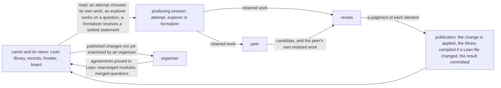

# do-math

do-math is a system for autonomous mathematical research in which many AI sessions work together to prove or refute a single mathematical statement. Each session is a new conversation in Claude Code or Codex, two AI command-line tools, and it begins with no memory of the other conversations. What a session produces is handed on as files, and the results the research keeps are added to one library written in Lean 4, a proof assistant, which every later session reads. The user supplies the statement to be proved or refuted. Before the research starts the statement is fixed in two forms, in words and as a Lean theorem whose proof is left open; an AI conversation called the operator writes the Lean form together with the user, and the user confirms it. The user may add standing inputs, which are instructions that reach every session launched after them. The user does not launch sessions by hand. The operator sets up the run and operates it on the user's behalf, and a program called the runner then launches sessions as the work requires, several at a time, for as long as the research goes on.

Every result the research keeps is an element of that library. An element is a Lean declaration, either a definition or a statement, together with a written record. The record holds what Lean cannot hold: a short description, the statement in ordinary mathematical language, an explanation and, where there is one, a proof in words. A statement can be in the library without a proof, as a conjecture or as a piece that some argument leaves open. When it has a proof, the proof is either complete in Lean, or it is written in the record while the Lean source names, one by one, the statements the argument uses and leaves the proof itself open. In both cases Lean checks that each named statement exists and is applied to objects of the right kind, so what a proof rests on is read from the compiled library by a program. In the second case that is all Lean checks; whether the argument in words is a correct argument from the statements it names is for a review to judge.

Each addition that comes out of a session's research is made in three stages, each by a different session. First, a producing session works on the problem: it tries to prove or refute a statement, to understand some feature of the problem, or to write the Lean proof that an accepted proof in words still lacks. It writes its definitions and statements in Lean as it goes, and it keeps all of its work, from computations to approaches that failed, in its own working files. Next, a second session, the peer, takes that line of work over. It reads everything the producing session left, continues the mathematics where it can, and writes the candidate, which is the proposed change to the library: new elements, new proofs for statements that are already there, and an account of the approaches that were tried and where each stopped. Finally, a third session, the review, judges the candidate. Before it judges, it has the candidate examined three times against the producing session's files, and it compiles the candidate itself. It then judges each element, above all whether its Lean statement says what its record says, whether its proof is correct, and whether a correct proof should also be accepted. The last of these is a second judgment, which is explained below. Two kinds of addition do not take this path: the definitions and proofs that the user supplies with the statement at the start, and the statements that a session called the organizer proves in Lean in order to join duplicates.

If the review finds material worth keeping, the runner publishes the candidate. It applies the change to the library, compiles the library when a Lean file has changed, and commits the result, and the review's judgment of each element stays attached to that element with its reason. A review does not send work back to be repaired: an element whose proof it could not confirm enters the library marked as such, and a later session can start from it and from the review's reason. The statement of a published element never changes afterwards. A proof or a record can be replaced by a better one, and a later review that finds a mistake in a proof issues a finding that withdraws the proof's confirmation; the element stays in the library with the finding attached. No session plans the work of another. A session that sets out to prove something or to understand something reads the library and decides for itself what to work on. The runner assigns work only where the state of the research calls for it; for example, it assigns a peer and a review to the work that a producing session leaves, and it gives an accepted proof in words to a session that is to write its Lean proof.

Three considerations shaped this design. The first is continuity. A run can last for days and pass through many conversations, none of which remembers the one before, so the library is the research's memory from one session to the next, and it must carry everything that later sessions will need. The second is independent judgment. A candidate is judged by a session that took no part in producing it. Because the judgment travels with the work, useful work that is not yet perfect can still be published, and a later session can tell an established result from one that still needs work. The third is that every result should have one name. When a result is kept in prose, it has to be set out again, notation and all, wherever it is used, and when two texts state the same fact, nothing stands for the fact itself. A result stated in Lean has one name; a proof that uses it must cite that name, and Lean checks the citation.

do-math considers a run complete only when the Lean statement fixed at the start, or its negation, is settled through a formal proof: the proof is complete in Lean and depends, through everything in the library that it uses, only on the axioms the run allows, and it has been accepted, as has a proof of every statement it rests on. Lean has then checked that the proof establishes the statement as it is written. Lean cannot tell whether the statement as written says what the user meant. That correspondence is settled before the research starts, when the user reads the Lean statement with the operator's explanation of it and confirms it, and no later step checks it. Every review is an AI session, and no person referees the work unless the user arranges for that outside do-math.

The rest of this document lists the solved problems, and then explains how the sessions cooperate, what a published result does and does not certify, how to read the results of a run, and the shortest path to running do-math on a statement of your own. The [running guide](docs/do-math/running.md) holds the detail of the settings, the commands and the procedures. What has been run to check the implementation is set out near the end, under "Repository layout, verification and tests": so far one small statement has been carried to a formal proof by real AI sessions and the real Lean compiler, and the tests replace both by stand-ins.

## Solved problems

This section lists the problems that do-math has formally proved and that have been organized into publishable form.

- **Unimodality of parking functions by maximum displacement.** For every n ≥ 1, the numbers of parking functions of length n whose largest displacement is exactly ℓ, taken for ℓ = 0, …, n − 1, form a unimodal sequence. This is Conjecture 6.5 of Celano, Elder, Hadaway, Harris, Martin, Priestley and Udell (arXiv:2507.07243). The proof is complete in Lean 4.36.0 with Mathlib 4.36.0 as the theorem `Parking.root_unimodal`, and it is in [`solved/parking-unimodality/`](solved/parking-unimodality/README.md) together with a second proof through a stronger statement, a paper that presents the first proof in ordinary mathematical language, a written record of every definition and result that the library states under a public name, a dependency map and a history of the research. The two runs that found it used an earlier version of do-math, in which results were kept as reviewed records and not yet as one Lean library; the formal proof was simplified and packaged afterwards, as that folder's README describes.

## How the research is organized

### Instances, the root and the canon

Each run of do-math is an **instance**: a directory with its own Git repository. It holds the statement to be proved or refuted, the models and scheduling in `settings.json`, a directory for every session that has run, and two folders: `canon/`, which holds the mathematics of the run, and `knowledge/`, which holds the views that the runner derives from `canon/` together with the published judgments of the reviews.

The statement is called the **root** of the instance, and it is fixed in two forms before the research starts. The first form is the file `root.md`, which states the root in words, with its objects, assumptions, domains and quantifiers. The second form is a Lean theorem whose proof is left open. It states the root in terms of Lean definitions of the objects the root is about, and it is the form in which every session works. The root never changes. The runner refuses to run an instance whose root file or whose Lean statement of the root has changed, and a different statement, or a Lean statement later found not to say what was meant, requires a new instance.

The **canon** is the body of mathematics that the sessions share. It is one Lean library with a written **record** beside each declaration, together with a small amount of written text attached to particular statements and questions, which is described under "Questions, approaches and progress". A declaration of the library together with its record is an **element**, and everything the research keeps as a result is an element. An element is either a definition or a **statement**. In Lean a statement is a `theorem`, whatever a mathematician would call it, and it can be in the canon with or without a proof, so that a conjecture and an open piece of the root's proof are both statements. The root is the statement the library starts from. A definition is referred to by its Lean name, and Lean rejects a second declaration of a name, so the canon keeps no separate glossary.

Besides the elements there is the **imported library**: the library that comes with Lean and, when the instance uses it, Mathlib, the community library of formalized mathematics. A proof may use the imported library and the elements, and it can use nothing else. Sessions therefore write what they find in Lean as they find it: only what has a Lean statement can be named by a later proof, so a result that was found and left in prose can be read by the session that takes the work over, but no proof can use it.

### Records and the two forms of a proof

What Lean has to check is in the Lean source: the statement, the proof, and the names of the statements that a proof rests on. Everything else is in the record, a Markdown file whose path follows the name of the declaration.

| Part of a record | Content |
|---|---|
| Description | What the element is, in a line or two. Lists of many elements show this part only. |
| Statement | The statement, or the definition, in ordinary mathematical language. |
| Explanation | What the statement says about its object, why a definition was chosen in this form, and how the Lean form corresponds to the mathematical one, for example where counting starts from zero. |
| Proof | The proof in words, where there is one. |
| Literature | For a result taken from the literature: the source, how much of it was read, and where in it the statement is found. |

A record also gives the element's **weight**, and there are two weights. A **unit** is a result that someone describing how the proof goes would name. A **step** is a result that lives inside one proof and exists because that proof was written in pieces. The frontier, a view described below, uses the weight to show the structure of a proof and not every lemma; a step remains an element, proofs name it, and the index of all elements lists it.

A proof takes one of two forms. Either it is complete in Lean, or it is written in words in the record while the Lean source carries a proof that names, one by one, the statements the argument rests on and then ends in `sorry`, Lean's marker for a proof that is left open. A statement proved in the second form could look like this, where `oddSum_succ` and `square_succ` are other statements of the library and the argument itself is in the record:

```lean
theorem sum_eq_square (n : Nat) : oddSum n = n * n := by
  have h := oddSum_succ n
  have k := square_succ n
  sorry
```

In both forms Lean rejects a name that does not exist and a use whose arguments do not fit the named statement. Whenever a publication changes the Lean files, the runner extracts the **structural index** again from the compiled library. The index is the file `canon/index.json`, and it gives for each declaration the text of its statement, what the statement and the proof use, whether the Lean proof is complete, and the axioms the proof depends on. What each statement rests on, and what rests on it, is therefore read from the compiled library by a program. In the second form Lean does not check the argument itself, which is prose and is judged by a review.

The canon refuses an `axiom` declaration and a definition whose body contains `sorry`. What a session wants to assume is written as a statement whose proof is left open, and it then appears as work that remains; a definition left open would give every statement that used it an unknown object to speak about.

A result taken from the literature enters the canon as an element like any other. Its statement is written in Lean in terms of the instance's own definitions, its record names the source and says how much of the source was read, and the review judges the element on what was read. A statement settled through such a result rests, to that extent, on a proof that is in the source and not in the library. If the root comes to rest on such a result, the result needs a complete Lean proof before the run is complete, as every other statement does.

### Standings and the frontier

A review makes two judgments about a proof. The first is whether the proof is correct. The second, which is made only when the proof is correct, is whether to accept it. The second judgment exists because work on a statement should sometimes continue after a correct proof of it has been found; the reasons are given under "What counts as established". Every statement of the canon has one of four **standings**, which depends on the proof the statement carries and on those two judgments.

| Standing | Meaning |
|---|---|
| no proof | The statement has neither a complete Lean proof nor a proof written in its record. |
| proof not confirmed | A proof was offered, and a review found a gap in it, could not complete its judgment, or has not judged it. |
| correct, held back | A review confirmed the proof and did not accept it, and gave the reason. |
| accepted | The proof is correct and accepted. |

The statements that have one of the first three standings are the **work that remains**. A proof that no review has judged has a standing too: it counts as accepted when it is complete in Lean and came with the root or from an organizer, and as not confirmed otherwise. Strictly, a standing belongs to a proof, that is, to the declaration that carries it. A statement can have more than one proof, because a further proof is a further declaration whose statement Lean has confirmed to be identical, and each proof has a standing of its own. A statement is **settled** when one of its proofs is accepted and every statement of the canon that the proof names is settled. A statement whose own proof is accepted can therefore still be unsettled, because something that proof rests on is not.

Being settled is a matter of the reviews' judgments. Being **formal** is a matter of Lean. A proof is formal when it is complete in Lean and depends, through everything in the canon that it uses, only on the axioms the instance allows, and a statement is formal when it has such a proof. The instance is complete when the root, or a statement that Lean has confirmed to be the negation of the root, is settled through a proof that is formal.

The **frontier** is the view of what the root rests on at present and of how much of that is settled. Nobody writes it; the runner computes it from the canon each time it is shown. It starts at the root and lists the root's proofs, lists under each proof the statements that the proof names, leaves out those that are settled, and opens each unsettled statement in the same way. The frontier shows units: where a proof rests on a step whose own proof is accepted, the frontier shows in the step's place what the step rests on. A line of the frontier gives the statement's name, the short name from its record or else its description, its standing, the beginning of the review's reason where the proof is not confirmed or is held back, the number of approaches that have been tried on it, and the number of sessions that hold a section on it, a term explained under "The choice of work: frontier, sections and leases". At the start of an instance the frontier is the root alone, with no proof. Later it could look like this, with invented names and standings:

```text
- `OddSum.sum_eq_square` — the sum of the first n odd numbers is n squared — accepted
  - `OddSum.oddSum_succ` — the sum after one more odd number — no proof · 1 approach tried · held by 1 session
```

Here the root's proof is accepted, and the root is still not settled, because one of the two statements that the proof names has no proof. The other is settled and is not shown.

A statement appears in the frontier because some proof that leads to the root names it; no session and no review admits it. The quality of the frontier therefore depends on how the sessions state what they leave open. A statement that no proof of the root reaches, such as a conjecture left as a lead, is not in the frontier. A second derived view, the **index**, which is the file `knowledge/index.md`, lists every element of the canon by module, each statement with its standing.

### Six roles and the pipeline

Six roles share the work, and the runner starts a new session for each piece of it. Three roles produce mathematics: an **attempt** chooses, among the work that remains for the root, what to take on and tries to settle it, an **explorer** works to understand the problem, and a **formalizer** gives a formal proof to a statement that is settled and not yet formal, usually by completing in Lean a proof that was accepted in words. Two roles process what the producing roles leave behind: a **peer** takes the work over and writes the candidate, and a **review** judges that candidate. The sixth role, the **organizer**, keeps the canon usable as one body while many sessions add to it independently. A producing session together with its peer and its review is called a **pipeline**.

| Role | What it receives | What it leaves |
|---|---|---|
| attempt | The root, the frontier and the list of work underway; it chooses its own work | Its retained work, including the Lean definitions and statements it wrote |
| explorer | The same, and one question to work on; the runner assigns the question about the problem as a whole when no explorer has it, and otherwise the explorer chooses | Its retained work on that question |
| formalizer | One settled statement whose accepted proof is not yet formal and names only statements that already have formal proofs. It is a statement that the root rests on, or that a settled refutation of the root rests on | A Lean proof of that statement, complete or partial |
| peer | One producing session's retained work | A candidate: the proposed change to the canon |
| review | The candidate, the producing session's retained work and the peer's | Its assessment: a judgment of each element with its reason, a decision whether to publish, an account of what the work contributed, and any concerns or findings |
| organizer | The published changes that no earlier organizer has examined | Statements, proved in Lean, that two definitions or two statements agree; rearranged modules; merges of questions that ask the same thing |

The diagram shows one pipeline and the organizer's loop. Every box except the canon and the publication is a session, started by the runner as a new conversation. The arrows between sessions are files passed from one to the next, and the arrows to and from the canon are reads and publications.



What a producing session leaves behind is its **retained work**: a report that says where everything is and what it means, the Lean files in which its definitions and statements are written and, as far as possible, compiled, its working files, and its conversation, which the runner saves. The files hold its arguments and partial results, its computations with their code and output, the literature it drew on, the approaches that failed with what each failure actually rules out, and the parts that still have to be proved. A producing session does not write to the canon, which changes only when the runner publishes a candidate or an organizer's change.

### The choice of work: frontier, sections and leases

An attempt is handed no statement and no task. The user's standing inputs set conditions on the research, and a mathematical suggestion in them remains a suggestion; the choice of what to work on stays with the session. The attempt reads the frontier and, for each statement it considers, the approaches already tried there, the review's reasons, and what the canon states about the objects the statement speaks of. It may take on a statement of the frontier as a whole, an exact part of what such a statement asserts, or a statement that it formulates itself when it judges that no piece of the frontier captures the difficulty. What it takes on is called a **section**, and it registers the section on the statement that the work is aimed at.

The canon tells a session what earlier sessions made available. It cannot tell the session what another attempt is discovering at the same moment, because that work exists only in the other attempt's files. The **board** fills this gap: it lists the producing sessions, the sections each has registered or the question each is working on, and whether each session is still running or its work is with a peer or under review. A section counts as occupied until the work is published or the review decides that there is nothing to publish, because until then a second attempt on the same part would repeat work that it has no way to read. For the same reason a registered section cannot be withdrawn.

While a session is choosing, it holds the statement's **lease**, so that only one session at a time can be choosing a section on that statement. A session forms its intended section from the board, takes the lease, checks its section once more against the sections that are registered on the statement at that moment, and registers it; other sessions that want the statement wait in order or choose another. The lease has no time limit. It ends when the session registers its section, releases the lease or turns to another statement, or when the session itself ends.

Sessions coordinate through information rather than enforcement. The board shows which sections are occupied; the guide that each role receives for its own work, called its **role guide**, explains how to respect them; and the sessions are trusted to follow the guide. The commands with which sessions take leases and register sections refuse only what a program can decide by itself. They refuse, for example, a section whose text is identical to one already registered, and a registration of a whole statement while another pipeline holds part of it. They also refuse a registration that gives no reason why the new section does not overlap an existing one, and any registration on a statement that is already settled. Whether two differently worded sections overlap is a mathematical judgment, and the session that registers the new section makes it and records its reason. A session can also leave another session a short message about how the two divide a statement. Such messages carry work status and decisions about cooperation; mathematics passes between sessions only through the canon and the files that a peer or a review receives.

### The end of a session

An attempt has no time cap. Its session is a conversation that may continue over several CLI processes in turn, so the runner does not close the session when one of those processes exits. A separate process, the **session host**, keeps the session alive. It starts with the session, and when a CLI process exits normally it resumes the same conversation and asks the session to reconsider, under its role guide, whether to end; by default it does so up to three times. The session ends when it answers such a request with an explicit decision that its work is complete or that it sees no way forward, or when the limit is reached, in which case the session host authorizes the end without a decision from the session. The same reconsideration applies to explorers, formalizers and peers. It does not apply to an attempt or an explorer that found no work to take on, a case described below.

Reviews and organizers are not asked for such a decision, because each of them ends with a definite output: a review with its assessment, an organizer with its organization, the account of what it joined, rearranged or merged. Their host resumes the conversation for a different reason. When a turn of the conversation, that is, one run of the session's CLI process, has ended and the output does not yet have the form the runner needs in order to carry it to the next stage, the host tells the session what is missing, up to the same number of times. A review on Claude Code delegates part of its work to sub-agents, as "Peer, review and publication" describes, and its turn can end while they are still at work. Without the resumption the whole review would have to be made again by a new session.

A producing session interrupted from outside, by a provider's usage limit for example, is not resumed. If it left any work, that work goes on to a peer and a review like the work of a session that ended by its own decision, and if it left none, the runner launches a new session in its place. An interrupted peer, review or organizer is replaced by a new session that receives the partial work. An attempt that only looked for available work and found none that it could take on, or an explorer that found every open question already taken, says so and ends without a peer or a review.

### Peer, review and publication

A **peer** is a new session that receives the producing session's retained work, including its conversation as far as that was captured. It is the second researcher on that line of work, and it is asked to work the mathematics itself: to complete an argument that the producing session left unfinished where it can, to look for a counterexample or an identity that the producing session passed over, and to notice whether something the producing session derived was already in the canon or in the literature. It then writes the **candidate**. A candidate can add elements, replace the proof of a statement that is already in the canon, add or replace the written account of an approach, replace the written understanding of a question, and propose new questions or the resolution of an existing one; the accounts of approaches and of questions are described under "Questions, approaches and progress". A candidate can replace the proof of a statement that is not settled only when its pipeline holds a section on that statement. Before the peer ends, it applies the candidate to a copy of the current library and compiles it, and once the peer's session has ended the candidate can no longer change.

A **review** is another new session. It receives the candidate, the producing session's retained work and the peer's. Before it judges, the same material is examined three times, each time independently and each time over every element. A review session on Claude Code delegates the three examinations to sub-agents, none of which sees another's report or the review's own first reading; a review session on Codex, which cannot delegate, makes them itself as three separate passes. Three readings are used because one reading, however careful, has one set of blind spots. The judgment remains the review's own: the review makes it from the evidence, with the three reports beside it, and does not reach it by counting them.

For each element the review judges whether the Lean statement says what its record says, whether the proof is correct, whether a correct proof is accepted, whether a proof offered as a replacement should take the place of the existing one, and whether the record describes the element accurately. The review can confirm a proof that is complete in Lean only after it has compiled the candidate again in its own session and read the axioms that the proof depends on, because a compile that succeeds can still depend on an axiom the instance does not allow. A review may reason and compute in order to check an argument. If confirming a proof would require an essential argument that the candidate does not contain, the review is asked to report what is missing, since a review that supplied the argument and then confirmed it would be certifying its own work.

By default, the first model listed for the peer and review roles differs from the first model listed for the producing roles, so that the candidate and its judgment come from a different model than the work they are about. This has two limits. The peer and the review share their default model. And each role's model setting is an ordered list with fallbacks, so a launch made while the preferred model is unavailable may end up using the same model as the producing roles.

When the review finds material worth keeping, the runner publishes the candidate. Publications are made one at a time, because each changes the one library that every session reads. The runner applies the candidate to a copy of the library, without the proof replacements that the review declined, and, when the candidate changes a Lean file, builds the library, compiling whatever has not been compiled before in the same form. It then checks again what a program can decide by itself: no statement changed in place, every declaration has a record and every record a declaration, no axiom was declared, and no definition contains `sorry`. Only then does it put the changed files into `canon/` and commit. A review can keep a candidate out of the canon only as a whole, when it finds nothing in it worth keeping. Otherwise the candidate is published, and an element whose proof the review could not confirm enters the canon with that standing and the review's reason, for a later session to repair.

Publication depends on one rule: the statement of an element is never changed in place, and neither is a definition. A candidate waits while it is reviewed, and other candidates are published in the meantime; because statements stay as they are, every statement that a waiting candidate rests on is still the statement it was. New elements are added in new modules. A proof that replaces another takes its place, under the same name and statement. A statement that supersedes another enters under a new name, and the old element keeps its name and statement; where the old statement follows from the new one, the old element's proof becomes a one-line derivation from it, at once if the old statement was not settled, and otherwise by a later candidate once the new statement is settled as well. When a record or another written text is replaced, the element's history keeps the difference between the old text and the new. A candidate that was sound when its peer finished can still fail to apply or to compile on the canon as it has become, for instance because another publication has replaced the same proof. The runner does not publish such a candidate; a new peer makes a new candidate from the same work, and that candidate receives a new review.

### Questions, approaches and progress

Beside its statements, the research keeps **questions**: things it wants to understand that no statement can hold, such as why several unrelated methods stall at the same scale, or what an object looks like in the regime where every estimate loses its margin. A question consists of a text that says what is to be understood and of the grounds on which it was asked. An explorer takes one question and works on it with no predetermined theorem to produce. A question is with one explorer at a time, with one exception: when an organizer merges two questions that each have an explorer, both explorers keep the merged question. Its retained work goes through a peer and a review just as an attempt's does. Question `q0` is always present: it is the root problem itself, taken as a whole.

Each question carries a text called its **understanding so far**, which says what is now understood of the matter the question asks about, and what is not. The mathematical assertions in it are elements, to which the text refers by name; the text itself explains the elements, connects them and interprets them. For `q0`, the understanding so far is the research's account of the problem as a whole: how the proof goes, what its parts share, and where the difficulty lies. Every session receives it in its starting context, and it is rewritten through the work of the explorers that take `q0`.

A question enters when a peer proposes it in a candidate and the review admits it, or when the operator places it directly with a runner command, without a peer or a review, in which case the frontier view names the operator as its source. An organizer merges questions that turn out to ask the same thing. A question is resolved when a review judges that the text of its understanding so far answers what the question asks; what the answer leaves to be done is carried on as exact statements or as a sharper question. `q0` is resolved only when the root is formally settled.

What a session learns about the course of the work, as distinct from its results, is kept with the statement or the question that the work was aimed at; the canon holds no account of a session as such. A statement whose proof is not accepted carries a list of the **approaches tried** on it, with one entry for each approach. An entry says what the idea was, what the approach established and where it stops, and the review's assessment of what that work contributed is added beneath it. The entries are kept one for each approach, and not one for each session, because sessions approach the same statement in the same ways and stop in the same places, so what is learned about the course of the work does not grow with the number of sessions.

Every role receives, besides its role guide, a common guide, and that guide describes progress as the change a piece of work makes to what is known. Work may settle something, make visible what could not be seen before, or change how the problem is approached; the guide gives these as examples rather than as a complete list. Extending the range over which a statement has been checked, without any such change, does not count as progress. These descriptions inform the sessions' own choices and the reviews' accounts of what a piece of work contributed; the runner applies no such filter itself.

### Two documents on research and writing

Sessions in the attempt, explorer, peer, review and organizer roles receive, besides their guides, two documents in their starting context. One is an essay on what mathematical research is for. This repository's author and an operator conversation wrote it after reading, in order, what the sessions of an earlier research run had written; its first part says what they saw there, and its second part sets out what mathematicians have looked for in their work. The other document describes the writing that the author prefers and the occasions on which those preferences became clear. Both are meant to inform the sessions' judgment rather than to be followed as rules, and both are files in the skill's reference folder that a user can edit.

### Formalizers, organizers, the runner and the broker

A **formalizer** is launched for a settled statement that the root rests on and that has no formal proof yet, once every statement that its accepted proof names has a formal proof. Formal proofs are therefore written from the bottom of the root's proof upward, and the root itself is given to a formalizer when it is settled and everything its proof names is formal. Usually the formalizer writes the Lean proof that replaces the `sorry`. It may fill gaps, add auxiliary lemmas or change the strategy, while the statement stays exactly as it is. When it changes the argument, its peer rewrites the proof in the record, so that the written proof and the Lean proof remain one argument. Its work goes through a peer and a review like any other, and another formalizer can continue from a published partial proof; there is no cap on the number of such continuations. Formalizers are not the only source of formal proofs: an attempt or a peer may write a complete Lean proof itself, and if that proof passes review, no formalizer is needed for the statement.

An **organizer** is launched after a number of publications, four by default. Because sessions add to the canon independently, the same object can come to be defined twice, the same content can be stated twice, and two questions can ask the same thing. The organizer joins what is the same by adding a statement that the two definitions or the two statements agree, with a proof that is complete in Lean; it never renames or removes one of the two. It also rearranges modules so that a proof can be put under the name of the statement it proves, and it merges questions. Nothing an organizer submits goes through a review. For what it adds to the library the research relies on Lean, since each added statement must be proved in Lean from the allowed axioms, and for the merging of questions it relies on the organizer's judgment.

The **runner** starts all of these as new CLI conversations, under the user's existing authentication. When several kinds of work are waiting, it starts them in the order review, peer, formalizer, organizer, explorer, attempt; by default it runs eight sessions at a time, starts new attempts or explorers at least three minutes apart, and requests an exploration at every launch of an attempt. Sessions inherit none of the user's personal instructions, hooks or memories; their starting context is supplied by do-math and saved in the session's directory at launch.

All Lean compilation goes through one **Lean broker** per instance. The broker is a separate process that admits compile jobs within a memory budget and a thread budget, and only while the machine itself has memory free; a job too large for the budgets is admitted when nothing else is compiling. It keeps each job's result, so that a session can collect it even after the shell command that submitted it has stopped waiting, and it keeps compiled modules, so that a module whose source and imports are unchanged is not compiled again unless a fresh compile is asked for, as a review's is.

## What counts as established

A published element is not a certificate. Publication preserves useful work together with the judgment it has received, and what an element can be relied on for depends on its standing, on what its proof rests on, and on whether its proof is complete in Lean.

| Standing or property of a statement | What it means | What it does not mean |
|---|---|---|
| No proof | The statement is in the canon as a conjecture or as an open piece of a proof | That anything about it has been established |
| Proof not confirmed | A proof was offered, and a review found a gap, could not finish its judgment, or has not judged it | That the statement is false |
| Correct, held back | A review confirmed the proof and did not yet accept it; other proofs may use the statement | That the proof is wrong, or that anything can be settled through it |
| Accepted | A review confirmed the proof and accepted it; or the proof is complete in Lean and came with the root or from an organizer, in which case no review judged it | That the statement is settled; what the proof rests on may still be open |
| Settled | One of its proofs is accepted, and so is a proof of every statement that proof rests on, all the way down | That a person checked it; or that Lean checked the argument, unless the proof is also formal |
| Formal | The Lean proof is complete and depends only on the allowed axioms | That the statement says what was meant |

### Two judgments and the reasons for holding a proof back

When a proof is correct, the review decides separately whether to accept it. Two considerations can keep a correct proof from being accepted. Both are conditions that this repository's author set for research run with do-math; each is a setting of the instance, on by default, that a user can turn off. The first is that the proof can still clearly be made simpler: the review can point to a place in the proof and say how it could be simplified there. Such a proof is held back because the research should have the simpler proof, which is the more concise one. The second is that the proof establishes part of its statement only by a large computation carried out without an understanding of why that part holds. Such a proof is held back because a statement with an accepted proof appears finished, and no session would then go on to explain why that part is true. In both cases the element is published and other proofs may use it, but the statement keeps the standing "correct, held back", stays among the work that remains, and nothing that rests on it is settled through it. This holds for the root as well: a proof of the root that is complete in Lean and held back leaves the run incomplete.

### Proofs written in words

When a proof is written in the record, Lean has checked the statement and has checked that every statement the proof names exists and fits. The argument itself has been checked neither by Lean nor by a person. Where the standing is "correct, held back" or "accepted", a review session has checked it, by reading the candidate against the producing session's retained work after the three examinations described above; where the standing is "proof not confirmed", a review found a gap or could not finish, or no review has judged the proof. A reader who wants more assurance than an AI review gives should treat a settled statement whose proof is not formal as a claim with a reviewed argument attached.

A proof is also judged as an argument from the statements it names, each taken as stated, so it is not a defect of the proof that one of those statements has no proof yet. This is why accepted and settled are distinguished: an accepted proof that rests on an open statement establishes its own statement on the hypothesis that the open statement holds.

### Formal proofs and the root check

A statement is formal when its Lean proof is complete and every axiom it depends on, followed through everything in the canon that the proof and the statement use and through the imported library, is in the instance's list of allowed axioms. The default list is `propext`, `Classical.choice` and `Quot.sound`, the three axioms on which classical mathematics in Lean and Mathlib ordinarily rests; an instance may allow more, and `sorryAx`, the axiom that stands for a `sorry`, can never be allowed. A proof that is complete in its own file is therefore not formal while a lemma beneath it is still open, and a proof that computes with `native_decide` is not formal under the default list, because `native_decide` introduces an axiom of its own.

Two facts establish that a statement is formal, and both come from Lean. The first is that the library compiles. Lean's kernel, the small program that checks every proof, checks each declaration of a module before the compile of that module succeeds, so a proof in a compiled module is a proof that the kernel has accepted. The second is Lean's own account of the axioms that the proof depends on, which is the list that Lean's command `#print axioms` prints. A compile alone does not give the second fact, because a proof that ends in `sorry` compiles, and so does a proof that rests on an axiom the instance does not allow. Whenever the runner extracts the structural index, it asks Lean for this list for each declaration of the modules it extracts, and it stores the list in the index as Lean gave it. A statement is formal when its Lean proof is complete and the stored list lies within the allowed axioms. do-math works the axioms out by no computation of its own, and no second program examines Lean's answer. In one case do-math is stricter than Lean's list: a `sorry` in a helper declaration written under the statement's name counts as the statement's own open proof, and it keeps the statement from being formal even where Lean's list for the statement is without `sorryAx`.

A formal proof that enters through a candidate and that the review confirms has passed through Lean at two points. The review compiled the candidate afresh in its own session and read the axioms that Lean reported. The runner then built the library again at publication, on the canon as it was at that moment, which shows that the candidate still fits the canon; modules already compiled in the same form are reused, so this is not in every case a second compile of the proof. From that build the runner extracted the index of the modules that changed and of every module that imports one of them, and the axioms stored there are what makes the statement formal.

A theorem also becomes formal when the last open lemma beneath it receives a complete proof, although the theorem's own file has not changed. Two things bring this about, and both were established with Lean 4.36.0. Lean stores the axioms of each declaration in the compiled module, so the compiled output of the lemma's module changes when the lemma's axioms change. And the broker compiles again every module that imports a module whose compiled output changed, so the theorem's module is compiled again and Lean works out the theorem's axioms again. The runner, which extracts the index of every module that imports a changed one, then stores the new list.

A formal settlement of the root means that a declaration is proved from the allowed axioms and that Lean confirmed its statement to be the root's statement, or the negation of the root's statement for a refutation. What then remains to be known is that the root's statement, with every definition it is built on, is still the one the instance was created with. No publication can change either, because the runner refuses a publication that changes a statement or the text of a definition in place. The canon and its index are files, however, and something other than a publication can change them. Once the root is formally settled, the runner therefore makes a comparison called the **root check**. It compares the structural index in the instance's first commit with the index as it stands. Starting at the root, it goes to every element that the root's statement names, and from a definition on to what the body of the definition names. Every element it reaches must have the same kind and the same statement in both indexes, and a definition must have the same source text as well. The statements are compared as the terms that Lean made of them and not as text. A theorem reached on the way counts by its statement alone, whatever has become of its proof. The root check reads two files and compiles nothing, and the runner repeats it whenever another proof comes to settle the root or a publication changes the library.

The `status` command reports the result of the root check under `root_check`, as `unchanged` or `changed`. `unchanged` means that the root's statement and the definitions under it are those of the first commit. `changed` comes with one sentence for each element that differs, or that is under the statement in only one of the two indexes. It means that something other than a publication changed the canon or its index, such as an edit by hand of a file under `canon/`, so that what was proved may not be what was posed. The runner then requests a comprehensive review of the proof that settles the root; a comprehensive review is a review session that examines questioned proofs, and "Concerns and findings" below describes it. The result does not alter the root's state and is reported beside it.

The root check has two limits. It compares elements, so it does not see a declaration that is not an element, such as a helper marked `private` that a definition uses. And it does not see a definition whose text is unchanged and which Lean now reads as a different term. Lean reads a declaration in the environment that its module imports, so a change in what is imported can have that effect.

### What the statement says

Lean checks that a proof proves the statement as written. Whether the statement as written says what was meant is a separate matter, and for the root nothing in do-math checks it after the research has started. The operator writes the Lean definitions and the Lean statement of the root together with the user, has Lean confirm the definitions on the small cases for which the user's material gives values, and explains to the user how the Lean statement reads; the user is the person whose statement it is, and this confirmation is the only time the user judges what the root's Lean statement means. Agreement on the checked values is evidence that the definitions denote the intended objects; it does not prove that they do. The root check described above compares the root's statement as it stands with the statement as it was fixed. It does not compare either with the user's intent.

For every element that a candidate adds, the review judges whether the Lean statement says what its record says and whether a definition denotes the intended object. Where it finds that a Lean statement does not say what was meant, it cannot repair the statement, which never changes in place; it says in its reason what the Lean statement asserts and what was intended, so that the intended statement can enter under a new name. Two kinds of element have received no such judgment: the elements that were supplied with the root when the instance was created, and the elements that an organizer adds, which its guide limits to statements of agreement and to derivations of one statement from another that agrees with it. For both, Lean's check of a complete proof takes the place of a review's judgment of the proof, and whether the statement says what was meant has been judged only by whoever wrote it.

### What a program checks and what is asked of a session

Some of the rules above are enforced by a program, and others are instructions that a session is trusted to follow. A program checks that the library compiles and that every name a proof uses exists and fits. It reads the axioms that each proof depends on, so whether a proof is formal does not depend on what a review reports. It refuses a publication that changes a statement in place, declares an axiom or leaves a declaration without a record, and it lets a candidate replace the proof of an unsettled statement only when its pipeline holds a section there. When a review confirms a proof that is complete in Lean, a program also checks that the compile the review names is the review's own fresh one.

No program checks that a review made its three examinations, that a session read what the canon already holds before it took on a statement, that a session respected another session's section in the mathematics it pursued, or that the user confirmed the root before the runner was started. Sessions also run with full access to files under the user's account, so it is their instructions, and no barrier, that keep them from writing outside their own directories.

### Results that rest on computation

Some arguments rest on computation. The record of such a statement is required to say what was computed, over which range and in which arithmetic, and the code and its output are kept among the canon's files of evidence, so that a later session can check the account and run the computation again. A finite verification proves the finite statement it covers and nothing beyond it; an observation over a range is itself a statement, and a different one from the statement about every case. A proof that establishes part of its statement by a large computation without an account of why that part holds is, by default, held back as described above. A computation carried out inside a Lean proof is formal only if the axioms it uses are allowed.

### Concerns and findings

A **concern** is a challenge to the proof of an element, reported by a review session in its assessment or opened by the runner when a finding made in the review of a candidate withdraws a confirmation without naming a concern. A pending concern changes no standing by itself. A **finding** is the judgment that changes one: it can withdraw the confirmation of a proof, restore it, or reopen a question. A **comprehensive review** is a review session assigned to examine questioned proofs and their actual uses in later proofs; the runner launches one when a concern is reported, when a statement becomes contested, or when the operator requests one with a runner command. A statement is **contested** when both it and its negation are settled. Correct proofs cannot reach opposite conclusions, so a contested statement counts neither as work available to attempts nor as finished until a comprehensive review locates the failure.

When a finding withdraws the confirmation of a proof, that proof's standing becomes "proof not confirmed" and every standing is computed again from what remains, so a statement that was settled through the proof may no longer be settled. Nothing is deleted. The element, its record, the earlier judgment and the finding all remain in the instance.

## Reading the results of a run

The results of a run are the elements of its canon, and a reader finds them in the instance's directory. Start with `knowledge/frontier.md`. Its first lines give the state of the root, and the frontier follows: the root and the statements beneath it that are not settled, each with its proofs and its standing. After the frontier the file lists the concerns that are not cleared and the questions, each with its text, its grounds, whether it is open or resolved, and its source. `knowledge/index.md` lists every element of the canon by module with its weight and its description, and each statement with its standing, including the elements that the root does not rest on. `knowledge/board.md` shows the work underway, and `knowledge/state.json` holds the same derived state in structured form.

The state of the root combines its standing with whether its proof is formal, and it is one of six. The root is *unresolved* while neither the root nor its negation is settled. It is *informally proved* when it is settled and no proof that settles it is formal yet, and *formally proved* when it is settled through a formal proof; *informally refuted* and *formally refuted* are the same two states for a statement that Lean has confirmed to be the root's negation. It is *contested* when both the root and its negation are settled. The instance is complete in the two formal states. These are the system's own names: *informally proved* means that a proof of the root and of everything beneath it has been accepted, and that no such proof is yet formal all the way down.

For an element itself, read the canon.

| Path under the instance | Content |
|---|---|
| `canon/lean/` | The library: the Lean source of every declaration |
| `canon/records/` | The record of each element, at the path that follows its name |
| `canon/approaches/` | The approaches tried on a statement whose proof is not accepted, each ending with the review's assessment |
| `canon/questions/` | The understanding so far of each question |
| `canon/history/` | What replacements left behind: the difference between a replaced text and the current one |
| `canon/evidence/`, `canon/bibliography.bib` | Files that records refer to, such as the code and output of a computation, and the sources of results taken from the literature |
| `canon/index.json` | The structural index that the runner extracts from the compiled library |
| `knowledge/changes/<id>/` | One published change: what it added and replaced, the review's assessment and feedback, the sessions involved, and the review's own compile |
| `knowledge/reviews/`, `knowledge/organizations/`, `knowledge/questions/` | The assessments of comprehensive reviews, the organizers' outputs, and the questions the operator placed |

The commands with which the sessions read the canon are available to a reader as well, and they are the convenient way to read one element, because a single view joins what Lean knows of the element with what its record says: its Lean statement, what its proof rests on with the standing of each statement, whether it is settled and formal, what uses it, the review's judgment with its reason, and the approaches tried. Two further commands work from the canon. One can be run at any time and draws a dependency map of what the root's proof rests on. The other runs once the root is formally settled and writes a paper that presents the result in ordinary mathematical language. The [running guide](docs/do-math/running.md) shows all of these. The producing sessions' conversations and working files are not part of the canon; they stay in the instance's `sessions/` directory, which the instance's Git repository does not track.

## Running do-math

### Requirements and what a run does on your machine

The runtime needs Python 3.12 or later and Git, and it imports only Python's standard library. It needs the Codex CLI, the Claude Code CLI, or both, installed and logged in; it launches them as processes and does not call model APIs directly, so usage is billed or metered however those CLIs are configured. It needs Lean 4 in every case, because creating an instance compiles the Lean form of the root. It needs Mathlib when the Lean definitions of the problem, or the proofs the sessions will write, draw on it. By default every instance also attaches scholarly-mcp, the literature search server kept in this repository under `services/scholarly-mcp`, so that server's Python environment has to be installed unless the instance's settings remove the server. Every run whose operating system is recorded was made on Windows, with Lean 4.32.0 or 4.36.0. The runtime has code for Linux as well, which no recorded run has used, and macOS is not supported.

Sessions run unattended with file and command access under your account: Claude Code is launched with permission prompts disabled, and Codex with its approval policy set to never and its sandbox set to full access. Their workspace boundaries are instructions, not an operating-system sandbox, and their model providers receive the material they read; the sessions also have web search. A run has no cap on time, on the number of sessions, or on usage, and do-math collects no usage figures. Publication is a commit to the instance's local Git repository, and the runner, the session hosts and the broker open no network connection themselves. Outbound traffic comes from the programs they start. These are the CLIs; the literature server, which queries public literature services; any further tool servers you configure; and a script that downloads the sources of example papers from arXiv, which runs when you run the command that writes a paper and those papers are not yet on the machine.

### Quick start

Clone this repository. Then, from Claude Code or Codex started in the repository, ask the assistant to start research on a statement with the do-math skill, a folder of instructions that these CLIs load. The conversation that handles that request is the operator. It works out the exact statement with you, in words and in Lean, prepares the settings, creates the instance, asks you to read and confirm what was fixed, and only then launches the detached runner and reports where the work lives. The skill is the folder `.claude/skills/do-math`, and `.agents/skills/do-math` is the copy of it generated for Codex.

Setting up an instance by hand takes the same steps. Write a UTF-8 `root.md` with the statement in English, and prepare a folder that holds the beginning of the Lean library: a module with the definitions, a module with the root as a theorem whose proof is `by sorry`, and a record for each declaration. Write a `settings.json` that names your Lean installation, with the command that compiles a file and the command that prints the Lean version:

```json
{
  "lean": {
    "command": ["C:/tools/lean.exe"],
    "version_command": ["C:/tools/lean.exe", "--version"]
  }
}
```

This keeps the default models: Codex first and Claude second for every role except peer and review, and the reverse for those two. With only one of the two CLIs installed, list that provider's models only, both in the `models` list and in the `roles` entries for peer and review, as the running guide shows. The default settings also attach the literature server, and `init` refuses when it cannot find that server's Python; the running guide gives the commands that install it, and `"mcp_servers": {}` in the settings file runs without it.

Then create the instance at a path outside this repository, or under its Git-ignored `.skill-workspace/` directory:

```powershell
$skill = 'C:/path/to/do-math/.claude/skills/do-math'
$instance = 'C:/research/odd-sum'
python "$skill/runtime/runner.py" init $instance --root C:/research-input/root.md --canon C:/research-input/canon --root-declaration OddSum.sum_eq_square --settings C:/research-input/settings.json
```

`init` compiles the library and refuses a folder that does not compile, that declares an axiom, that lacks a record for a declaration, or whose root is not a theorem with its proof left open. When it has succeeded, read what was fixed, as the running guide describes: nothing after this reading judges what the Lean statement means. Then start the runner:

```powershell
python "$skill/runtime/runner.py" start $instance
python "$skill/runtime/runner.py" status $instance
```

The runner continues after the terminal or the operator conversation ends, and `canon/` and `knowledge/` are updated with every publication. The [running guide](docs/do-math/running.md) covers the folder with the Lean library, the settings, Mathlib, standing inputs, every runner command, the commands that draw the dependency map and write the paper, how to end a run, and what happens on interruption and completion; the [operating guide](.claude/skills/do-math/reference/operations.md) in the skill is the operator's full reference.

## Repository layout, verification and tests

Within `.claude/skills/do-math/`, `SKILL.md` is the operator's entry point, `roles/` holds the six role guides, `reference/` the common guide and the specialist guides, `resume/` the texts delivered when a session is resumed, `exemplars/` the list of published mathematical papers that the paper command reads as models of writing, and `runtime/` the runner, the tools with which sessions coordinate and read the canon, the Lean broker, the commands for the dependency map and the paper, and their tests. `.agents/skills/do-math/` is the generated copy for Codex.

The design document of the current implementation is [docs/do-math/lean-canon-design.md](docs/do-math/lean-canon-design.md). It was written before the implementation and is kept as written. Where later decisions departed from it, the guides and the code describe the system as it is, and the verification document names those places. The design document builds on an earlier one, [docs/do-math/rebuild-design.md](docs/do-math/rebuild-design.md), which remains in force for what the current one does not change, in particular the earlier document's governing principles. The earlier design document describes an earlier implementation, and the checks made on that implementation are in [docs/do-math/rebuild-verification.md](docs/do-math/rebuild-verification.md).

What was run to check the current implementation, and what no run has shown, is in the verification document, [docs/do-math/lean-canon-verification.md](docs/do-math/lean-canon-verification.md). In outline:

- One small research run was made from start to finish by real AI sessions and the real Lean compiler. Its statement was that the sum of the first n odd numbers is n squared, and three of the run's six sessions took it to a formally proved root, while the other three published further results. All six used one Claude model, so the run exercised neither a Codex session nor the default arrangement in which the producing roles and the reviewing roles use different models. It launched no formalizer, organizer or comprehensive review.
- The scripted research run that the tests use was carried out once against the real compiler in place of the tests' stand-in, and it ended with the root formally proved. The document reports no run of the root check, and none in which the axioms stored in the index were the list that Lean itself reports; both were introduced after the runs it records, and a dated note in the document marks the passages that describe what they replaced.
- A research run that imports Mathlib was started on 22 November 2026. The document reports its first day, including the faults it showed and the changes made in response, and states that the quantities which decide the cost of research at that scale have not yet been measured.
- The guides and the runtime went through two rounds of review and repair. The rounds were ended after the second, which still found defects of substance, and the document gives that as a reason to expect that some remain.

The runtime tests replace the AI sessions by scripted programs and the Lean compiler by a stand-in that reads a small subset of Lean; they use real Git. The suite has 22 modules with 839 test functions. Each module passed the last time it was run, but the modules were last run at different points, and the suite has not been run as a whole since the runtime was last changed; the verification document gives the last run of each module up to the time it was written. Each module is run by itself from the `runtime` folder:

```powershell
cd .claude/skills/do-math/runtime
python -m unittest tests.test_canon
```

These tests show that the runtime does what it should with the outputs it is given. They do not show that the real compiler gives those outputs. That difference has already hidden two defects, each of which came to light only with the real compiler. Nor do the tests evaluate the mathematics that real sessions produce.

## Standalone tools and supporting skills

The repository also holds four programs that do not depend on do-math. Their READMEs are in Korean.

- [services/scholarly-mcp](services/scholarly-mcp/README.md): a local MCP server (a tool server that AI CLIs can call) that searches 48 academic sources and saves bibliographic data, abstracts, full text and supplements. The public sources need no login; some others go through one university library's login. do-math attaches it to every instance by default, started with an option under which it serves only the sources that need no login, about twenty of them, so that the many sessions of a run do not each log in to that library.
- [services/continuous-development](services/continuous-development/README.md): a multi-agent system for software development in which a Python runner dispatches Codex sessions in phases, with a manager session reading each phase's reports and writing the next.
- [services/async-development](services/async-development/README.md): a system of the same kind in which workers each get their own copy of the code and a manager merges accepted results as they arrive.
- [services/jev-cli](services/jev-cli/README.md): a command-line client for Jev, a hosted model from TypeSafe.

The repository's other skills support its development.

| Skill | What it does |
|---|---|
| graphify | Builds and queries a knowledge graph of do-math's own documents and scripts, for finding where a rule or procedure comes from |
| verify-rounds | Runs rounds in which several agents review a finished artifact and fix what they find |
| write-for-reader | Guides the design, writing and revision of text that a person or an AI will act on, and interviews the user when a decision is missing |
| grilling, grill-me | Interview the user one question at a time to stress-test a plan |
| skill-creator | Creates, improves and benchmarks skills |
| writing-skills | Explains principles for writing a skill's description, structure and tests |
| simplify | Prompts a short self-check: is this the simplest way to do what I am trying to do? |
| memory-harness | Defines the structure and rules of the working-memory graph in `기억/` |
| commit-harness | Sets out the commit procedure that pairs every commit with a memory node |
| dream-harness | On request, combines accumulated memory nodes into current principles and conventions |

## Language, citation and license

The do-math operator and role guides, the runtime output and this README are in English, and everything written inside an instance is written in English, whatever language the user speaks to the operator in. The supporting skills, the standalone tools' documentation and the working-memory directory are primarily in Korean.

To cite the software, use the repository's [CITATION.cff](CITATION.cff), which GitHub renders under "Cite this repository".

This project is licensed under the [GNU Affero General Public License v3.0](LICENSE). Four skill directories are adapted from third-party projects and keep their original licenses; see [THIRD-PARTY-NOTICES.md](THIRD-PARTY-NOTICES.md).
