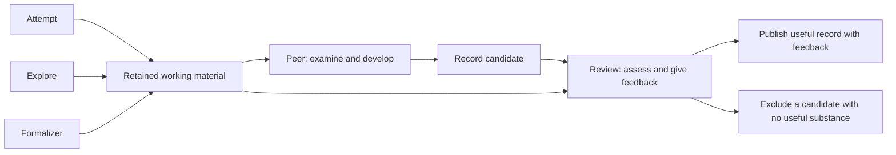

# Rebuilding do-math: research governed through shared knowledge

Design and decision record · 4 November 2026

## 1. Purpose, scope, and authority

The rebuilt do-math coordinates an unattended research instance around one mathematical problem. Fresh sessions
choose and develop mathematical work, preserve what they learn, examine one another's contributions, and carry
the problem toward a reviewed Lean proof or refutation. Cooperation happens through a repository of reviewed
records and views derived from that repository. A lightweight runner and supporting tools make execution,
publication, and shared state usable. Sessions make semantic decisions throughout their work, including how
to understand and follow the coordination instructions that let them cooperate.

This document records the shared design established in the rebuild discussion. It is intended for a reader who
has neither that conversation nor prior knowledge of do-math. It explains the governing principles, the roles,
the evidence and state they exchange, the timing of their work, and the exceptions that change those rules. It
also identifies decisions that remain open. It is a design contract for subsequent work, not a claim that the
new system has been implemented or tested.

The rebuild targets **fresh research instances only**. Legacy support and compatibility are excluded. The new
runner does not need to resume an old instance, accept old schemas or role names, migrate a plan's request
queue, or import historical research into the new protocol. Historical source material remains useful for
understanding the design; excluding compatibility does not authorize deleting that material.

The existing do-math was read in full, excluding tests and compiled caches, before the design interview. Its
instruction documents and implementation supplied concrete examples of useful governance, mathematical
guidance, publication, and execution support. The separate `v2/` draft was also read in full. It is a reference
point, not an authoritative specification. Its extra roles, thresholds, formats, and restrictions do not become
requirements merely because they appear there.

The current decisions in this document take precedence over both earlier designs and proposals superseded
during the interview. Explanations of necessary consequences are identified as such. Examples illustrate the
contract; they do not silently fix identifiers, filenames, schemas, default values, or an exhaustive catalogue
of permitted mathematics. The final sections distinguish implementation choices from genuinely unsettled
policy and record the important revisions to prevent an implementer from reviving an obsolete rule.

### Reading map

Read sections 2–4 first for the governing principles, vocabulary, and solution model. Sections 5–9 explain
what each mathematical role does and how the work becomes reviewed knowledge. Sections 10–14 explain shared
information, organization, correction, dispatch, and completion. Sections 15–18 cover the writing standards,
preservation requirements, connected examples, and decisions still to make.

- [2. Governing principles](#2-the-governing-principles)
- [3. Research objects and roles](#3-the-research-objects-and-the-six-roles)
- [4. Nodes and mathematical dependencies](#4-nodes-solutions-and-mathematical-dependencies)
- [5. Attempts and occupancy](#5-attempts-choosing-work-respecting-occupancy-and-persisting)
- [6. Exploration and its request flag](#6-exploration-understanding-freedom-and-a-single-pending-request)
- [7. Formalization](#7-formalization-complete-the-exact-mathematics-then-assess-the-outcome)
- [8. Peer](#8-peer-make-the-most-valuable-record-from-the-work-that-remains)
- [9. Review](#9-review-independent-assessment-useful-feedback-and-formal-assurance)
- [10. Repository, glossaries, and communication formats](#10-the-repository-glossaries-and-communication-formats)
- [11. Organizer and modular index](#11-organizing-the-repository-and-its-index)
- [12. Later defects and visible concerns](#12-later-defects-comprehensive-review-and-visible-concerns)
- [13. Dispatch](#13-dispatch-priority-readiness-and-capacity)
- [14. Completion](#14-completion-achieve-the-root-then-finish-the-remaining-sessions)
- [15. Writing standards supplied to sessions](#15-deliver-the-users-writing-standards-to-the-sessions)
- [16. Preservation and implementation](#16-what-to-preserve-from-current-do-math-and-how-to-use-its-implementation)
- [17. Worked scenarios](#17-worked-scenarios-that-connect-the-rules)
- [18. Remaining decisions](#18-decisions-still-to-make-and-what-implementation-may-choose)
- [Appendix A. Revisions](#appendix-a-important-revisions-and-their-final-meaning)
- [Appendix B. Decision locator](#appendix-b-decision-locator)
- [Appendix C. Source basis](#appendix-c-source-basis-and-limits-of-this-document)

## 2. The governing principles

### 2.1 Governance must improve the research

The system exists to make cooperation between separate sessions effective. A session needs enough knowledge
to understand the problem, enough tools and capabilities to work on it, and clear boundaries where its actions
affect other sessions or the reliability of the shared evidence. A governance mechanism earns its place by
meeting one of those needs.

The presence of a form, an additional role, a checkpoint, or a script is not itself an improvement. For example,
a live board that tells attempts which nodes are occupied, together with an instruction to respect that
occupancy, solves a concrete coordination problem through informed behavior. Building a strict enforcement mechanism
 that forces sessions to only work through certain tools which enables access only when occupancy rules are satisfied
does farm more harm than its alternatives. The design must provide the useful function in a way that is actually useful.

The same principle applies to simplification. Removing a planning role must not accidentally remove the
knowledge that let researchers distinguish an actual counterexample from a failed technique. Shortening
instructions must not remove conditions needed to use a theorem correctly. A smaller implementation is useful
when it still supports the intended research and preserves its evidence.

### 2.2 Sessions exercise active judgment

An attempt receives no assigned node and no pre-written task. It sees the state of the research and decides
what to pursue. Reference documents help it interpret that state, compare possibilities, understand previous
failures, and recognize useful opportunities. They provide knowledge, reasons, examples, and limitations that
strengthen its own judgment.

Following a recommendation is not, by itself, a justification for a choice. The session must consider if the
recommendation applies in the actual circumstances. Nor should a rule become a convenient excuse for avoiding
difficult thinking. A reference that discusses when a new approach might help should equip the session to
recognize those circumstances; it should not let the session mechanically substitute a change of approach for
the effort needed to understand the obstacle.

This discretion is particularly important when an effort claims additional nodes. Continuing with related work may
preserve valuable context, while leaving it available may enable another session to contribute a different
approach. The documentation must expose both possibilities and their costs. It must not bias the session into
always claiming more nodes or always leaving them to others.

Active judgment operates within substantive instructions. Respecting another attempt's occupancy, reading
only the permitted shared material, preserving the exact meaning of a node, and honestly describing evidence
remain requirements. A requirement can be followed by an informed session without being enforced by a script.
The design must not confuse trusting the session to follow a rule with making that rule meaningless or optional.

### 2.3 Delegation includes coordination and instruction following

Semantic decision-making is broader than selecting a research direction. Sessions also interpret what a
coordination rule requires in the situation, recognize the state another session has declared, and act in
accordance with their instructions. Their instruction-following capability is part of the system's design.
Where current information, useful tools, and clear instructions are sufficient, the system should trust that
capability instead of adding oversight and enforcement machinery.

One-attempt-per-node is the concrete example. Tools make current occupancy visible and provide a usable way to
record the session's own occupancy. The attempt is instructed not to occupy a node that is already occupied,
reads the information, and follows the instruction. This design does not require an exclusive-lock service,
an atomic admission arbiter, or a script that rejects every impermissible claim. The requirement is on the
cooperating sessions' behavior, supported by an informative, live board.

The runner still performs the execution work actually needed: launching sessions, keeping track of capacity,
preserving outputs, connecting follow-up stages, and rendering views from recorded information. The agreed
exploration Boolean and dispatch priority are explicit examples of simple scripted behavior. Reliable file
updates can likewise preserve data without purporting to certify that an agent followed every instruction.

The division must therefore be decided by the function a mechanism serves. Do not automatically translate
every sentence containing 'must' into a hard gate. Give sessions the information, knowledge, and tools needed
to act correctly, and use additional machinery only where a concrete need warrants it. Do not narrow this
principle to 'the agent chooses the mathematics, while the script controls all cooperation.'

The runner also does not infer from prose that two mathematical statements are identical, that an argument
proves an implication, or that a suspect premise is irrelevant to a later theorem. Sessions make those
judgments and record them clearly enough for their conclusions to be shared and their routine consequences
to be applied.

Automatic propagation is compatible with this division. If review has established a particular implication
between identified nodes, the runner can follow that recorded connection when its premises are established.
The mathematical judgment was made by review. The runner does not obtain a general license to interpret
arbitrary mathematical prose or invent additional relations.

### 2.4 Documents are part of the system's capability

The quality of the reference documents is a central requirement. They should contain the useful mathematical
and operational insights that help a fresh session act well, expressed in deliberately designed prose. Those
documents must be written in such a way that the reader encounters definitions and premises before instructions 
that rely on them. Explanations should develop in a rational order, make their scope clear, and connect guidance 
to the reasons for it.

Richness means retaining content that changes the reader's understanding or decisions: the difference between
a proof gap and a counterexample, why a particular failure excludes only one route, or how a formal theorem can
compile while expressing a weaker proposition than the intended problem. It does not mean accumulating
disconnected warnings, repeated requirements, or a catalogue of obligations with no account of their purpose.

The producing sessions also receive a useful working format. Its purpose is to improve retention and
communication beyond improvised, ad-hoc notes. A stable place to preserve an argument or an obstacle helps the
peer recover the work. The format must accommodate the mathematics and additional explanations where needed;
merely filling its sections does not establish the quality or truth of their contents.

The user's writing guidelines must also be **supplied to do-math sessions themselves**. Their prose is a
principal medium of cooperation, so those guidelines are part of the capability the system provides, not only
standards for the person rebuilding the skill. Working notes, expositions, peer records, review feedback, and
repository descriptions should receive the applicable guidance through their role context. Section 15 defines
the substantive standards and the delivery responsibility.

## 3. The research objects and the six roles

### 3.1 Objects that later sections use

An **instance** is the research run for one starting problem. Its **starting node**, also called its **root**,
is the precise natural-language mathematical statement the run intends to settle.

A **node** represents a mathematical statement whose truth is to be settled. Its objects, assumptions, domains,
and quantifiers must be well defined. It initially enters the work as an unresolved statement and remains an
identified node after a proof or refutation is obtained. A node is not a session, a broad topic, a method, or a
vague direction of inquiry.

A **session** is one execution of an AI in a particular role. A session's **working material** consists of what
it actually leaves behind: its recorded chat, mathematical notes, arguments, files, tool outputs, computations,
sources, partial results, and other artifacts. Unrecorded thoughts cannot be recovered by a later session.

A **record candidate** is the coherent mathematical account that a peer constructs from a producing session's
working material, together with the peer's own contributions. A **published record** is the retained account
after review, with the review's findings and feedback available to subsequent readers. Publication can preserve
valuable incomplete or imperfect work. It is not a declaration that every statement in the record is true or
proved.

A record's **local glossary** defines terminology introduced within that record. It is part of the record's
immutable published content. The **global glossary** is the authoritative source of shared terminology for the
instance, managed by the organizer and built from published local entries. Some entries are globally available
**global candidates** awaiting the organizer's judgment about permanent membership; **promoted** entries remain
permanently. These are glossary-placement states, distinct from mathematical proof and review states.

An **accepted informal solution** is a proof or refutation of the exact node that review finds supported, while
the required formal assurance is still incomplete. A **validated formal solution** is a Lean proof of the node
or its negation that has passed independent review of the final sources, axioms, and mathematical
correspondence. The distinction determines both what work remains and which sessions should be dispatched.

A **reservation**, also called **occupancy**, is a recorded commitment that other attempts respect while an
existing attempt's work on the node is being produced and processed. It means that a new attempt should not
take that node. The word does not prescribe an operating-system lock, lease, or script-enforced exclusion.
The **board** is the live view of those
reservations and whether the source session, its peer, or its reviewer is currently handling the work. The
**frontier** is the repository-derived
view of nodes, their mathematical state, their relationships, and the evidence or concerns relevant to choosing
work. The **index** helps readers find published records through their descriptions, review assessments, and
links. An index **module** is an organizer-maintained group of records, with a description of what the group
contains and when to consult it. A record may belong to several modules. The **general index** provides
shared-context records, the module directory, and newly published records that have not yet been filed.

These are logical objects. This document does not prescribe a separate physical file for every object or a
particular database representation.

### 3.2 Roles and their primary responsibilities

There are exactly six roles. A role can have different kinds of work within its responsibility; those kinds do
not introduce additional roles.

| Role | Primary responsibility |
|---|---|
| **Attempt** | Choose its own node or nodes from the current research state, then make its best effort to solve the mathematical work it takes on. |
| **Explore** | Develop deeper understanding and create insight, following mathematical opportunities according to that purpose. |
| **Formalizer** | Receive informal mathematics and make its best effort to produce a formal solution of the exact node. |
| **Peer** | Read all the source session's retained material, work its mathematics, fill useful unpursued opportunities, and create the most valuable record it can. |
| **Review** | Assess the candidate and original material, validate the scope actually supported, and give feedback without becoming another mathematical author like the peer. |
| **Organizer** | Improve repository organization and intelligibility, including independently resolving duplicate node identities, while preserving reviewed records. |

The runner is an execution component, not a seventh mathematical role. There is no plan role. The design does
not add separate grounding, checker, validator, alignment, or audit roles from v2. Ordinary record review,
formal verification, and comprehensive backtracking are responsibilities of review. A **comprehensive
backtracking review** investigates a suspected defect back to its source and follows its consequences through
dependent claims, distinguishing what is actually affected from what remains supported.

### 3.3 One common path from work to retained knowledge

Attempts, explorations, and formalizers all produce working material. When one of these sessions ends, a peer
reads its retained material and develops a record candidate. A reviewer then assesses that candidate and the
original material. The reviewed outcome determines publication and what work follows. This sequence handles
completed results as well as useful partial work; it is not limited to sessions that failed.



The peer and review are different sessions with different responsibilities. The peer may extend the
mathematics. Review checks what the candidate and source material support and identifies problems or omissions.
Review does not supply a substantial new proof and then treat that proof as independently validated.

A source session's own failure label does not determine the outcome of this whole path. A peer can recover
material that was never assembled into a finished report, fill a gap, or complete a proof. The reviewed final
candidate determines what enters the repository and how the relevant nodes are classified.

## 4. Nodes, solutions, and mathematical dependencies

### 4.1 Creating a node requires an established, validated connection

A speculative connection does not create a new node. After the starting node, creating a node requires an
established mathematical connection that review has validated. Speculative connections can remain in a record
to inform other sessions, but they do not change the set of nodes.

For example, an attempt working on \(P\) proves \(Q \Rightarrow P\) without solving \(P\). The peer
includes that implication and its proof in the record candidate and proposes \(Q\) as a node. Review checks
the implication, the exact statement of \(Q\), and whether \(Q\) already has a node. If review validates
the connection and \(Q\) is new, publication adds \(Q\) to the shared research. If \(Q\) already exists,
the record refers to that node instead of creating a duplicate.

What must be established at this stage is the connection \(Q \Rightarrow P\). The proposition \(Q\)
itself can remain unresolved; that is the work the new node makes available for later attempts.

If the attempt only suspects that \(Q\) would help solve \(P\), the record can describe \(Q\), why the
connection looks promising, and what remains unproved. A later attempt may investigate that lead on its own
initiative. It need not wait for \(Q\) to become a shared node before investigating the idea. Creating the
node still requires the connection to be established and validated by review.

The discussion established this implication case and the rule against speculative node creation. It did not
define every permitted kind of connection, such as multi-premise reductions or equivalences. Those details
remain to be specified; v2's entire node-operation language is not an agreed substitute. Every represented
connection must preserve the mathematics and conditions that review actually validated.

### 4.2 A solution has a polarity and an assurance level

Solving \(Q\) means establishing either \(Q\) or \(\neg Q\). A genuine counterexample can be a valuable
solution when it establishes the required negation. The system must preserve which proposition was proved.
A Boolean field that says only "solved" is insufficient for interpreting dependencies.

Informal and formal assurance are also distinct. The following are conceptual states, not prescribed storage
enum names.

| Mathematical state | Meaning | Remaining work |
|---|---|---|
| Unresolved | No currently accepted proof or refutation settles the exact node. | An attempt may choose it while respecting current occupancy. Dispatch rules separately govern when new sessions are launched. |
| Informally solved, positive | Reviewed informal evidence establishes the statement. | Obtain and independently validate its Lean proof. |
| Informally solved, negative | Reviewed informal evidence establishes the negation. | Obtain and independently validate the Lean refutation. |
| Formally solved, positive | The statement has a validated formal solution. | Preserve and reuse the supported result; no fresh attempt is needed. |
| Formally solved, negative | The negation has a validated formal solution. | Preserve the refutation and its consequences; no fresh attempt is needed. |

Concerns about an existing solution are represented alongside these states, with their evidence and review
status. A concern is not itself a new proof, a refutation, or a determination that every dependent result fails.
The correction process is defined later in this document.

An informally solved node is already outside the work that needs a fresh mathematical attempt. The remaining
need is formalization. Its exclusion from attempt selection follows from that mathematical state, rather than
from an additional artificial reservation that pretends the solution is still unknown.

### 4.3 Informal propagation and formalizer readiness are separate

When reviewed informal evidence suffices to establish a node, the node becomes informally solved. In the basic
case, review has accepted a proof of \(Q\) and the implication \(Q \Rightarrow P\). Together these establish
an informal proof of \(P\). The system should reflect that fact immediately enough to avoid sending a fresh
attempt to redo already established mathematics.

Dispatching \(P\)'s formalizer has a separate prerequisite: the formal dependencies it needs must be available
as validated Lean mathematics. If its formalization is to build on \(Q\)'s formal proof, that proof must first
be produced and independently validated. The formalizer then receives both the reviewed connecting argument
and the usable formalized dependency.

The resulting progression is:

1. Reviewed informal evidence establishes \(Q\) and \(Q \Rightarrow P\).
2. \(P\) is marked informally solved and is unavailable to fresh attempts.
3. \(Q\)'s Lean proof passes independent review.
4. \(P\)'s formalizer becomes eligible, subject to the availability of any other required dependencies.
5. Its work passes through peer and review.
6. A validated Lean proof of \(P\) makes \(P\) formally solved.

Step 3 does not itself make \(P\) formally solved. A formal proof of the premise is not the missing formal
proof of the connecting argument and the conclusion. Conversely, the need to wait at step 4 does not justify
keeping \(P\) mathematically open at step 2.

The runner follows explicit reviewed relations. It does not search arbitrary prose to decide that these steps
are valid. A review must identify the propositions and conditions sufficiently precisely for the recorded
connection to have the intended meaning.

### 4.4 Refutation changes the interpretation of a connection

From \(Q \Rightarrow P\) and a proof of \(Q\), one can obtain \(P\). From the same implication and a proof
of \(\neg Q\), neither \(P\) nor \(\neg P\) follows merely from those facts. The refutation rules out
obtaining \(P\) by proving that particular sufficient premise. It does not refute the parent statement or
invalidate the implication itself.

The dependency mechanism must therefore preserve the outcome it actually requires. It cannot replace "the
required proposition has been proved" with "the referenced node has been solved in either direction."
More elaborate propagation rules require equally explicit reviewed logical relations; the conversation did
not approve a general automatic inference engine.

### 4.5 A formal proof can arrive through any productive route

An attempt or peer may already produce a complete Lean proof while doing useful work. If independent review
validates that proof, its axioms, and its correspondence to the exact node or negation, the node can become
formally solved directly. A separate formalizer session is unnecessary when no formalization remains to be
done.

This is permission, not an obligation. Attempts and peers are not required to formalize their findings merely
because they proved something. Their responsibilities remain solving the chosen mathematical work and creating
a valuable record respectively. A formalizer supplies the dedicated continuation when formalization is still
needed. The explorer's freedom to develop a proof for understanding is similarly preserved; the assurance of
the final result depends on the actual proof and review, not on a role label substituted for evidence.

## 5. Attempts: choosing work, respecting occupancy, and persisting

### 5.1 Start with the research state

Every attempt is launched without an assigned node. It receives the problem and the state needed to orient
itself: the frontier, the live board, the full current global glossary, the general index, access to published
records and their review feedback, and reference documents that help it interpret and use this information.
There is no hidden plan-written assignment that
chooses its target while describing the choice as autonomous.

The session decides what to pursue and why. It can study established results, failed routes, unresolved
connections, and relevant literature before choosing how to work. A suggestion in an earlier record remains
material for that judgment. The fact that an author suggested proving a particular lemma does not turn the
suggestion into this session's instructions.

Its choice should reflect the actual mathematical state. A node with an accepted informal solution already has
the mathematics needed for its solution; formalization remains. A new attempt should choose unresolved work
instead of repeating that solution. A speculative lead in a published record can be explored within the work
the session takes on, even though the lead has not yet qualified as a separate shared node.

#### Understand what the chosen node actually asks

The attempt should first establish the exact question it has chosen: the objects, hypotheses, domains,
quantifiers, and the proof or refutation that would settle it. It should also understand the established
connection between that node and the larger problem. This prevents an attractive intermediate result from
being mistaken for completion of a different question.

When using an existing result, the attempt should check four things. Its definitions and assumptions must
match the present use. Its confirmed scope must cover what the new argument needs. Its evidence must be
available in the published material. Its current reviews and any visible concerns must be understood. The
global glossary helps identify terminology, but does not by itself establish every property of the object.

If the existing result assumes more than the current question provides, the missing assumptions remain proof
obligations. If it settles only a range or a special case, the rest of the node remains unresolved. If a record
contains a useful conjecture or a criticized argument, the attempt may investigate it, but must not treat its
publication as proof of the claim. It should make its own contribution and its dependence on earlier work
explicit in the retained argument.

The attempt should not weaken its chosen question merely to obtain an easier success. A weaker result may be
valuable, but its gap to the node should be stated and pursued when meaningful work remains. Similarly, a
counterexample to one proposed sufficient condition does not refute the node itself. The session must identify
which statement the counterexample actually defeats.

#### Choose methods for the uncertainty that needs to be resolved

The reference guidance should help the session choose between developing a proof, constructing or searching
for a counterexample, computing cases, studying literature, and changing the expression of the problem. The
choice should follow the actual uncertainty. A finite computation can expose a false universal claim or test
a proposed mechanism; its failure to find a counterexample is not a universal proof.

The session should consider both pursuing an approach deeply and looking beyond the current approaches.
Accumulating evidence and a clear next obligation can justify sustained focus. Repeated obstruction, or
several possible routes all depending on the same doubtful premise, can justify seeking a different
representation or connection. These considerations support judgment; there is no fixed ratio of focus to
search and no rule that a certain number of failures automatically requires abandoning a route.

One useful question is what a proposed piece of work would let the session learn or decide. A computation
whose possible outcomes would change the approach may be valuable even if it proves no general theorem.
Conversely, collecting another easy lemma can contribute little if it leaves the same central uncertainty
untouched. The session should apply that distinction to its actual mathematics rather than use 'information
value' as another unexplained label for its preference.

The attempt should judge progress by what has actually become established or understood about the problem.
A proof, a relevant counterexample, an exact excluded range, or the identification of a previously hidden
assumption can change the research. More records, more lemmas, or a narrower-looking remainder do not
necessarily resolve the difficulty. The session should ask what its partial result now makes possible and
develop that consequence when it offers meaningful progress.

When revisiting a failed approach, it should understand what changed: an input, an assumption, the method, or
the part of the argument now being attempted. Earlier failure is useful evidence about the scope tried, not
a ban on every related idea. For computations, preserve the range, method, code, inputs, and outputs needed
to interpret the result. For a claimed counterexample, confirm both that its hypotheses hold and that its
conclusion fails.

#### Use literature with the precision the intended use requires

Different literature searches need different work. To investigate whether something is already known, the
session should search broadly enough to justify the scope of its conclusion: several suitable sources and
search expressions, references cited by key works, and works that cite them. To apply a technique or theorem,
it should select relevant sources and read the definitions, assumptions, conclusion, and argument it actually
needs. An abstract or secondhand mention is not a substitute for checking the theorem being used.

The available scholarly tools and web sources should help the session find and read that material. An
unavailable source, an access error, or an empty search result must be reported for what it is. None proves
that related literature does not exist. A novelty or absence claim must be limited to the search actually
performed.

The record should let another reader understand the mathematics being imported: the definitions in the
research's terminology, the applicable theorem with its assumptions, the argument needed for the use, and
the bibliographic location. Checking that a formula was transcribed correctly and checking that a computation
using it was performed correctly are different tasks. The session should distinguish them when reporting
what it verified.

#### Preserve the work while continuing to solve the problem

The attempt should record important arguments, results, failures, and sources as they develop. This protects
them from an interruption and gives the peer the material needed to reconstruct the mathematics. Saving a
partial result is not a reason to turn the rest of the session into preparation for ending while meaningful
work remains.

Writing and formal tools should serve the chosen problem. An attempt may use Lean when it helps, but should
not divert its effort into formalizing easy peripheral results merely to produce a finished-looking package.
A session that completes its chosen node can finish that work; it is not obliged to keep claiming unrelated
nodes indefinitely. If the chosen node is a genuinely bounded mathematical claim, completing its whole stated
scope is completion. Settling a smaller range than the node asks about is a partial result, not a substitute
for that completion.

### 5.2 The occupancy rule and its means of operation

The mathematical working guidance in the preceding section applies after the session has chosen work in
accordance with the following occupancy rule.

Ordinarily, a node has at most one occupying attempt. The session learns which nodes are occupied from the
live board and follows the instruction not to take an occupied node. Tools should make reading the current
state and recording one's own occupancy straightforward. They should not require the session to reconstruct
who is working on a node from a history of unrelated logs.

This is a cooperation rule implemented through informed, instruction-following sessions. It must not be
rewritten as a requirement for an elaborate scripted admission protocol, automatic policing, or proof that
every possible race has been excluded. Tooling should support reliable shared information. The fact that two
sessions could theoretically read stale information does not, by itself, justify replacing this design with a
strict locking system.

The rule concerns solving the occupied node. Suppose A occupies \(P\) and B occupies \(Q\). A may work on
connecting \(Q\) to \(P\), for example by proving \(Q \Rightarrow P\) while treating \(Q\) as a premise.
A should not take on proving or refuting \(Q\) itself while B occupies it. Describing that effort as
"supporting work for \(P\)" does not change what A is doing.

An attempt can therefore reason about the use, scope, and consequences of another node without appropriating
the work of solving that node. The distinction is semantic. The session is expected to understand and follow
it; the runner is not expected to inspect its mathematics and enforce the distinction computationally.

### 5.3 An attempt may occupy more than one node

An attempt that occupies \(P\) may decide to take on an additional available node \(Q\). It retains \(P\)
and records the additional occupancy. This permission avoids forcing the session to discard a productive
connection or hand its work to another session merely because the mathematics now involves a second node.

The board must represent the whole set of nodes the attempt occupies, not just its latest focus. A change of
attention from \(P\) to \(Q\) does not make \(P\) free. Nor does discovering a relation between them
automatically mean the session has occupied \(Q\). Working on the connection and deciding to solve \(Q\)
are different decisions.

The guidance for expansion must present the actual tradeoff. A session already understands definitions and
arguments that may make the additional work especially productive. Continuing can avoid repeated setup and
preserve an insight that is difficult to communicate before it is developed. Conversely, an additional claim
removes an opportunity for another attempt, may reduce parallel progress, and holds the node through the
peer's preparation of the record and its review. Another session may bring an independent method that is more
useful than continuity.

The session should be able to make either decision. No standing preference for expansion or restraint was
agreed, and no maximum number of nodes per attempt was chosen. A promise to work on a node someday does not
make the cost disappear; the purpose of exposing occupancy and the state of the work is to help the session
judge whether taking it on is worthwhile now.

### 5.4 Occupancy lasts through publication

The work of an attempt is not available to ordinary later attempts merely because its author has moved on to
another node or ended the session. Its peer still has to reconstruct and develop the material, and review still
has to assess the candidate. A successor starting during that interval could repeat the same work, introduce
duplicate definitions, or miss an obstruction already discovered but not yet retained in shared knowledge.

For that reason, every node occupied by the attempt remains unavailable through **attempt → peer → review**,
until the reviewed record is published. The board must distinguish the attempt's active work from the later
peer and review stages while preserving the occupancy in all three situations. Other attempts respect
that continued occupancy even when the original session itself is no longer running.

Once the record is available, an unresolved node can be taken up again using the new knowledge. A node that the
reviewed evidence has already solved informally moves to formalization instead. A node with a validated formal
solution needs neither a fresh attempt nor a redundant formalizer.

There is a necessary operational consequence for definitive rejection. If review excludes a record candidate because
it contains no useful substance, there will be no publication to wait for. The recorded rejection must finish
the processing and allow unresolved nodes to become available again. This exception does not license releasing
occupancy early while a useful record is still being prepared or reviewed. Failure to run the peer or review
is also different from a completed rejection; recovery for execution failures must preserve that distinction.

### 5.5 Persistence and an honest stopping point

When an attempt's chosen work remains unresolved, it should stop only when it is really stuck: after making
its best effort, it sees nothing meaningful left that it can pursue. This is a judgment about the actual work,
not a form of words that the session can use to justify ending.

When an approach fails or produces only a partial result, the attempt should use what it learned to decide
how to continue solving the node. It should identify the obstacle, determine what the failed argument actually
excludes, and pursue the meaningful next steps that remain. Encountering a difficulty is not the same as
having exhausted the work the session can do.

For example, if an estimate is too weak to complete the proof, the attempt should examine where the estimate
lost information and whether retaining that information gives a useful stronger bound. If a proposed stronger
statement has a counterexample, the attempt should return to the original node and consider another sufficient
condition; disproving the stronger statement has not necessarily disproved the node. If the current expression
offers no way forward, the attempt should seriously investigate whether another representation, a different
decomposition, a revealing special case, or a relevant technique supplies one.

The purpose of these examples is to show how the session can turn an obstacle into further mathematical work.
The session must judge and develop the possibilities that actually matter in its situation. Trying one item
from each category, or listing possible approaches without developing them, does not demonstrate that it has
done its best.

The session should not end simply because no new idea comes immediately, because it has a tidy partial result,
or because a peer will later have an opportunity to continue. It should actually develop useful possibilities
when it sees them. Equally, the requirement does not demand a proof that no possible future researcher could
make progress. The stopping judgment is from this session's informed point of view after its real effort.

The retained material should make that situation understandable: what was tried, what was established, where
the arguments stopped, and which obstacles remain. That account is useful to the peer and future research.
Its existence is not itself a certificate of diligence. No fixed number of attempts, required list of every
conceivable idea, or numerical session-duration limit was agreed. External interruption remains distinguishable
from a voluntary decision that no meaningful work remains.

## 6. Exploration: understanding, freedom, and a single pending request

### 6.1 Exploration is organized around understanding

Explore develops deeper understanding of the problem and creates insight. Its work should make the problem
more familiar: what its objects do, which assumptions matter, where its difficulty comes from, and how its
different expressions or connections fit together. It is not assigned a theorem that it must produce or a
particular conclusion that would make the exploration successful.

Hard problems can require this kind of work before an effective route to a solution becomes visible. Solving
the presently visible subproblems one by one may leave the central misunderstanding untouched. Careful
exploration can reveal a different formulation, a useful connection to another area, or a reason several
apparently promising approaches encounter the same obstacle. Even without a breakthrough, a more accurate
and coherent understanding can improve the decisions made by later attempts.

#### Become familiar with the mathematics before demanding an immediate payoff

The explorer should take time to encounter the objects directly. It can work through examples, examine
definitions, derive identities, compare formulations, and study related mathematics. It should not reduce the
task to surveying the repository or listing possible techniques. Reading the existing work is preparation for
engaging with the problem, not a substitute for that engagement.

The problem, frontier, board, full glossary, and general index provide its starting context. The explorer uses
the modules and records that bear on the angles it is considering. Earlier failed routes are especially
useful when the research needs a fresh view: they show what actually broke, what assumptions the work shared,
and which parts remain unexplored. The explorer should understand those limits rather than accept a broad
label such as 'this approach failed' as a prohibition on further thought.

A connection need not have an immediately established application to the root to deserve investigation. The
explorer may follow something whose relevance is still unclear if doing so helps it understand the problem.
It should preserve that uncertainty honestly instead of inventing an immediate use to justify the work.

#### Use different angles to reveal different features of the problem

The reference guidance should give concrete ways to explore and explain what each can reveal. For example:

- Construct small cases directly, by hand or computation, to see which features repeat and which break.
  Compare the actual objects, not only a table of numbers whose meaning has not been examined.
- Restate the problem in another form and investigate what becomes easier or harder to see. An expression
  useful for computing a quantity may expose different structure from one useful for proving its sign.
- Change assumptions one at a time. Special cases can isolate a mechanism; generalizations can show which
  apparently special features are incidental and which the argument really uses.
- View an object through another area of mathematics, such as probability, geometry, algebra, generating
  functions, or bijections. Develop the proposed connection far enough to determine what is genuinely shared.
- Read related literature for ways of understanding similar objects or difficulties, then examine the
  definitions and assumptions before carrying those ideas into the present problem.
- Revisit existing results and failures to identify the feature that makes the problem difficult. A failure
  can teach something about the object even when it gives no immediate next proof step.

These examples provide ways to discover structure. They are not a closed list, a required sequence, or a quota
of approaches that the explorer must demonstrate. The session should choose and develop the angles that help
it learn something substantive.

#### Follow an interesting idea far enough to understand it

Finding an apparently promising direction is the beginning of useful exploration, not automatically its end.
The explorer should work through the questions the discovery raises. It may need to determine why a constant
appears, which assumptions are necessary, whether a boundary case changes the interpretation, or what another
expression reveals about the same relation.

If a direct substitution, a short argument, or a small generalization is available, the explorer should carry
it out rather than leave it to a later attempt solely because the result might be a theorem. That work can
confirm the original idea, change its meaning, expose a counterexample, or show that the interesting part lies
somewhere else. A completed argument should be retained in full, with the conditions under which it works.

Developing a proof is permitted when the explorer judges that it will deepen understanding or create insight.
It is not required merely because a proof opportunity exists. This permission also applies when an attempt
occupies the node concerned. The occupancy rule coordinates attempts taking on particular nodes; it does not
forbid an explorer from pursuing mathematics that serves the exploration's purpose.

The session should judge the purpose of further work, not use the length of a calculation or the presence of
a theorem as an automatic boundary. Learning an unfamiliar concept can require sustained work. A substantial
proof can reveal the mechanism behind a phenomenon. Conversely, work that would now serve only the completion
of a fixed target may be better left as a clearly explained opportunity for an attempt. The explorer makes
that judgment; the system does not force either continuation or handoff solely from the form of the result.

#### State exactly what the exploration has established

The explorer must distinguish the evidence it has from the broader interpretation it is considering. The
following distinctions should be taught in the reference guidance and preserved in its writing:

| Kind of statement | What the explorer should make clear |
|---|---|
| A proved claim | The precise statement, assumptions, and argument that establish it. |
| An exact computation | The method and the finite range or particular instance actually confirmed. |
| An observed pattern | The data or examples in which it appeared and the limits of that observation. |
| A conjecture | The statement still to be proved and the grounds that make it worth considering. |
| A hunch | The possible connection or intuition, with its lack of established support left explicit. |
| A result from literature | What the source actually states, its assumptions, and how its terms relate to this research. |

For example, an exact exhaustive computation showing no counterexample for \(n \leq 20\) establishes that
finite statement. A pattern in the resulting data is an observation. A claim that the same pattern holds for
every \(n\) is still a conjecture unless a general argument establishes it. Calling the computation exact
does not extend its range.

These distinctions concern mathematical assertions. An account of what the explorer tried or how its own
understanding changed does not need to be disguised as a theorem. But any mathematical claim inside that
account still needs its actual evidence and scope made clear. A possible connection can remain useful in the
record while being insufficient to create a new node or to serve as a proved premise.

#### Test an interpretation against the mathematics that supports it

The explorer should explain the picture of the problem that it has developed. It must also show where that
picture is an interpretation and where a mathematical relation has actually been established. An expression
that makes computation convenient does not necessarily explain the cause of the phenomenon being studied.

When another interpretation becomes plausible, the explorer should compare it with the definitions, arguments,
and examples. It should apply the same precision to its alternative that it applies when criticizing an
existing explanation. Failed cases and restrictions must remain visible even when the interpretation makes
an appealing story. A change in the explorer's understanding is valuable information; it is not by itself a
proof that the new interpretation is correct.

The later peer and reviewer are not reasons to leave checks undone that the explorer can perform itself.
Their separate examination adds another context and another judgment. The explorer still takes responsibility
for confirming what it can and accurately describing what it cannot.

#### Leave understanding that another session can take over

The exploration's record should make the resulting understanding usable without requiring a conversation
with the explorer. Its working account should preserve the understanding it started with, the angles it
actually investigated, what changed, the connections it found, the dead ends and what they taught, and the
questions that remain.

When handing on a possible direction, explain what was found, why it is worth further attention, and what
would need to be established to develop it. State its connection to the original problem as far as that
connection is known, and preserve any uncertainty about its relevance. Do not replace this explanation with
a list of technique names or an unsupported recommendation to 'try this next.'

To judge whether further exploration is useful, the session should examine what it has come to understand
and whether further genuine investigations are still changing that understanding. If it can explain the
understanding it gained and further attempts to look from other angles add nothing substantive, that is a
reason to consider finishing. Being blocked from one angle is not enough. This guidance helps the session
make the judgment; it does not require a scripted test or a claim that every possible viewpoint has been
exhausted.

The peer subsequently reads all the retained material and develops the most valuable record it can. Review
assesses the resulting claims and interpretations. Neither stage treats the exploration as unsuccessful
merely because it produced no predetermined theorem, nor treats its observations and conjectures as proved
simply because they appear in a reviewed record.

### 6.2 Only one exploration cycle may remain in progress

There is at most one exploration present at a time. Here **present** means that its cycle has not finished:
the exploration session may still be running, its peer may be processing the material, or its review may be
assessing the candidate. The exploration's own exit does not free the exploration slot.

The reason is duplication. Unlike attempts, explorations cannot readily be directed to separate mathematical
territories without compromising their purpose. A new explorer also needs the preceding exploration's
retained understanding; beginning another while the earlier material is still awaiting peer and review can
repeat work whose record is not yet available.

This rule applies to exploration regardless of which trigger requested it. Other peer and review sessions
can of course run concurrently when capacity permits. The singleton concerns the source exploration cycle,
not every peer or reviewer in the instance.

### 6.3 Two triggers set one Boolean flag

The runner maintains a Boolean exploration-request flag. The flag means that an exploration should be sent
when the scheduling and singleton conditions permit it. It is not a count of owed explorations.

There are two triggers:

1. When unresolved nodes are all occupied and spare capacity cannot be used for another attempt, request an
   exploration if none is present.
2. Every \(N\) attempt dispatches, request an exploration. This cadence ensures that exploration also occurs
   when there is plenty of available attempt work. The value of \(N\) is configurable and was not chosen.

Either trigger assigns the flag `true`. Dispatching an exploration assigns it `false`. If it is already
`true`, another trigger leaves it `true`; it does not create a second queued request. If an exploration is
present, the flag can remain `true` until that exploration's peer and review finish.

| Event or situation | Effect on the flag | Dispatch consequence |
|---|---|---|
| A trigger occurs while the flag is `false` | Set `true`. | Exploration is requested, subject to priority, capacity, and the singleton. |
| A trigger occurs while the flag is already `true` | Keep `true`. | There is still only one pending request. |
| An exploration is present and the flag is `true` | Keep `true`. | Wait for the existing explore → peer → review cycle. |
| An eligible exploration is actually dispatched | Set `false`. | The new exploration becomes the one present cycle. |
| The exploration session ends but peer or review remains | No reset merely for the session's exit. | A second exploration still waits. |

The cadence counts attempt dispatches, not exploration dispatches or record publications. The discussion did
not separately choose the counter's initial phase or whether an opportunistic exploration resets an interval
counter. Those details must be made explicit when the counter is implemented; they must not be inherited
silently from v2. Whatever representation is chosen must preserve the Boolean coalescing and the whole-cycle
singleton above.

The spare-capacity case explicitly discussed was the occupancy of unresolved nodes. A separate case can arise
when no unresolved nodes remain because all remaining nodes are informally solved and awaiting formalization.
Whether that situation also sets the spare-capacity flag was not decided. An implementation must not settle
that question accidentally through the empty-set behavior of a Boolean expression.

### 6.4 A true flag has priority over fresh attempts

When exploration is eligible, it is dispatched before a fresh attempt, after review, peer, formalizer, and
organizer work. Otherwise, a continuing supply of available nodes could let fresh attempts consume every slot
and leave the flag `true` indefinitely. The full order is given in section 13.

A true flag does not stop attempts while an existing exploration cycle is still present. The requested
exploration is not yet eligible, so the normal opportunities for other work remain. Once the starting node is
formally solved, the completion rule forbids new explorations regardless of the flag. A remaining flag is not
an instruction to prolong the run by launching forbidden work.

## 7. Formalization: complete the exact mathematics, then assess the outcome

### 7.1 The formalizer's responsibility is substantive

The formalizer receives informal mathematics and takes responsibility for producing formalized mathematics
that solves the exact node. It must make its best effort. That work can include filling gaps, developing
auxiliary arguments, changing a construction, or adapting the proof strategy when needed to obtain the formal
solution. There is no final restriction that it may repair only gaps classified as minor.

The object of the task remains fixed. Proving a weaker proposition, adding an unestablished assumption, or
changing the mathematical definitions to make Lean accept a proof does not solve the original node. The
formalizer's freedom concerns how to establish the required statement or negation, not permission to change
what the node means.

The task begins with the relevant reviewed informal mathematics and the validated formal dependencies needed
for the intended continuation. Existing Lean sources, completed lemmas, and earlier partial formalizations
should be available for reuse. A subsequent formalizer should be able to understand what remains rather than
starting again from a description that hides the actual partial work.

#### Begin from the actual objects and the existing formal mathematics

The formalizer should read the informal proof and identify the role of each needed definition and lemma. It
should reuse published formal definitions and results when they already represent the required objects.
Creating another definition for convenience can split later work between implementations whose relationship
has never been established.

If it introduces a different representation, it must establish the correspondence the node needs. For
example, defining an abstract recurrence and proving a property of that recurrence does not solve a problem
about a counting process unless their relationship has been established. Domains, indexing conventions,
boundary values, and normalization factors are part of that correspondence.

Small cases can help detect an incorrect formal definition early. The formalizer can compare the formal
construction with directly understood cases, computations from the original definition, or established
values in a source. It must distinguish that useful cross-check from a proof that the representations agree
in every case. These are practices within formalization, not a new grounding role or a requirement to delay
all informal research until initial Lean work has finished.

#### Develop and check the formal proof deliberately

A useful development method is to state the needed definitions and lemmas in Lean before investing heavily
in their proofs. Checking those statements can expose a mistaken type or assumption while it is still cheap
to correct. Temporary proof holes during development must remain visibly unfinished work; they do not make
the theorem a completed formal result.

The formalizer should break difficult work into meaningful components, preserve completed lemmas, and
isolate a difficult step when that makes experimentation clearer. It can use search and automation to find
a proof, then replace repeated expensive searches with the explicit facts or terms it found when practical.
Narrow imports and controlled automation can reduce the cost of repeated compilation. These techniques are
knowledge for choosing an effective method, not a substitute for understanding what Lean is being asked to
prove.

Compilation also consumes shared resources. The formalizer should use the compilation tools provided for
the instance, understand how to submit work and retrieve its result, and use observed costs to improve later
choices. The existing Lean broker and its reference material provide useful support for this work. Any
instructions about estimates or resource use should explain their actual purpose rather than ask for numbers
that the session cannot meaningfully justify.

The session must recover the actual result of a long-running compile. A shell tool returning before the
command finishes is not evidence that Lean succeeded or failed. Repeatedly starting the same compile can
waste resources and confuse which output belongs to which source. The session should use the available job
or process information to wait for and identify the actual result.

#### Preserve enough evidence for the next independent check

The formalizer should leave the final sources, required dependency sources or stable published references,
the relevant theorem and declaration names, and the actual compilation and axiom-check evidence. Its account
should explain which declarations implement the mathematical objects and which theorems settle the node.
The next reader must be able to compare the formal statement with the informal statement directly.

The axiom audit concerns the final theorem and its dependencies. Searching a source file for a particular
placeholder string cannot replace that audit: a dependency can carry an unfinished assumption even when the
visible final proof contains no such string. Likewise, an earlier compile of a draft does not establish that
the final published source was checked. The formalizer should make those distinctions explicit in what it
hands on.

When work remains unfinished, the partial sources should show what is complete and where proof obligations
remain. The written account should connect those obligations to the informal mathematics and explain what
blocked them. A subsequent formalizer needs a usable continuation, not just the statement that the previous
session 'could not formalize it.'

### 7.2 Formalizer work receives peer and review

The working practices above concern the formalizer's own effort. Its result still requires the following
separate examination and assessment.

Because formalization includes substantive mathematical effort, its material follows the same peer and review
sequence as an attempt's material. The peer reads the formalizer's retained work, including its chat log,
sources, compilation evidence, partial arguments, and obstacles. It may fill an unpursued opportunity or
complete something the formalizer did not finish. Review then assesses the resulting candidate and original
material.

Review of the final record candidate determines whether the node is formally solved, remains informally
solved, or needs further attempt work. A formalizer that reported failure may have left
enough material for a peer to complete a solution. Conversely, the formalizer's confidence or a successful
compile does not make a solution valid before review performs the required checks.

### 7.3 Distinguish unfinished formalization from a defective informal proof

An unsuccessful formalization has two fundamentally different interpretations.

**The informal proof remains sound.** The session may have been unable to complete the Lean development,
construct a needed component, or resolve a technical difficulty. The absence of a finished Lean proof does not
by itself invalidate the informal argument. The node remains informally solved, and a subsequent formalizer
receives the partial sources, completed components, approaches tried, and remaining obstacles. A fresh attempt
to rediscover the already accepted mathematics is not the normal continuation.

**The informal proof has a fundamental unresolved issue.** The material may reveal that an essential argument
does not hold and that the formalizer and peer could not resolve the issue through their best efforts. Review
assesses that defect and its scope. If no other accepted solution remains, the node returns to unresolved
mathematical work. A future attempt may choose it from the updated research state. The work is not dispatched
as a plan-written repair assignment.

The second outcome describes a problem in the offered proof. It does not establish that the statement itself
is false, that no alternative proof can exist, or that the problem is permanently impossible to resolve. A
genuine refutation requires its own evidence and, for formal solved status, its own validated Lean proof.

When the defect bears on evidence used elsewhere, the comprehensive review process investigates those
dependencies. Useful partial formalization and diagnostic work remain publishable with feedback. The system
should preserve which components were completed, which are drafts, and which depend on the defective step.

No fixed formalizer round limit, provider-switch policy, or escalation threshold was chosen. Continuing sound
formalization work and diagnosing an execution failure are responsibilities the implementation must support,
but v2's retry counts do not become requirements of this design.

## 8. Peer: make the most valuable record from the work that remains

### 8.1 Read the whole source session

The peer examines everything the completed source session left behind, including its full available chat log.
It reads the mathematical notes, final and intermediate outputs, artifacts, computations, sources,
and recorded attempts. The last report or a condensed transcript cannot stand in for the material as a whole.
An important observation or unfinished argument may be visible only in the source's recorded work.

This responsibility concerns material that actually exists. It does not imply access to unrecorded reasoning,
nor permission to invent what the source session must have intended. If essential material was never saved or
cannot be recovered, the peer records the resulting limit rather than filling the absence with an attributed
claim.

The source's own summary is useful orientation, but it is not an authoritative inventory of everything worth
preserving. The peer compares it with the actual work. A session that ended abruptly may have left valuable
mathematics without a polished final account or a complete output manifest.

### 8.2 The remains are material for further mathematical work

The peer's goal is to create the most valuable record it can, using the source session's remains as the
material from which that record grows. It should understand and work the mathematics itself. If it sees an
unpursued opportunity, it is encouraged to develop it and fill the gap.

That can produce a proof of a pattern the source merely observed, a counterexample to a claim, an improved
argument, a useful connection, or a clearer account of an obstruction. The source session's endpoint does not
set a ceiling on the record. There is no requirement that the peer limit itself to small editorial repairs.

The purpose is value, not compulsory novelty. A correct and useful account can emerge without a new theorem or
a criticism of the source. The peer should not manufacture disagreement to demonstrate independence or add
an unsupported generalization merely to make its record appear more substantial.

To contribute an independent understanding, the peer should work through the definitions and arguments rather
than transfer the source's explanation unchanged. It can reconstruct an example, recompute a meaningful part
of a calculation, change a parameter in an argument, or examine why a particular assumption is needed. These
actions should answer questions that arise from the mathematics. Performing one of each as a ritual would
not achieve the purpose.

For example, a proof at one parameter value may prompt the peer to investigate whether the same argument
works more generally. If it does, the peer should establish the actual larger scope. If it fails, the peer
should distinguish failure of that argument from falsity of the wider property. A small missing step that the
peer can settle should be settled, rather than passed onward merely to preserve a division of labor.

The peer should also examine the source's interpretation of its mathematics. A convenient computational
formula and an explanation of why a phenomenon occurs are different claims. If the peer proposes another
interpretation, it should test that account against the same definitions and evidence. Its alternative does
not deserve greater confidence merely because it is different or attractive.

When identifying a problem, the peer should say whether it found an actual counterexample, located a gap in
the argument, or could not determine the claim from the material. An unresolved conjecture explicitly
presented as such is not an error. Several computations based on the same recurrence are not automatically
independent checks of the recurrence. These distinctions tell review and later attempts what still needs to
be established.

If earlier responses to the same work are available, the peer should develop its own understanding before
letting those responses determine the questions it asks. Comparing its understanding with them can then
reveal a real disagreement or something it missed. Reading the current reviews of premises that the source
uses is a separate necessity: independence does not mean pretending those premises have no known standing.

The record must distinguish what the source session obtained from what the peer developed. That distinction
supports accurate attribution and independent assessment. It also lets a later reader find the actual argument
behind a result instead of assuming that a reconstruction was present in the original material.

One boundary remains open: the discussion explicitly settled attempt occupancy and the explorer's freedom,
but did not separately decide what happens when a peer's extension becomes focused solving work on a node
occupied by a different attempt. The broad permission to develop the source material should not silently be
interpreted as either an additional occupancy exception or a new prohibition. That interaction needs a policy
before the corresponding coordination behavior is implemented.

### 8.3 Construct a usable mathematical record

The record should convey definitions, assumptions, claims, arguments, confirmed scope, important failures,
remaining uncertainties, and relevant opportunities in a coherent account. It should be understandable to a
reader who has not seen the source session or spoken with either author.

Valuable content includes more than successful proofs. A failed strengthening may eliminate a route without
refuting the node. An exact finite computation may establish a bounded result and suggest a conjecture without
establishing the universal statement. A literature result may be usable only under assumptions that the
current argument still needs to verify. The peer must preserve those distinctions while improving the account.

The record's description for index generation should represent the whole useful contribution. It should not
select only the strongest success and conceal the failure that changes its significance. It should also avoid
describing a mixed record as wholly unsuccessful when it contains valid achievements. Because the description
will remain immutable after review, its accuracy and adequacy belong in the review of the candidate.

Review will independently assess the peer's additions as well as the recovered material. The peer's judgment
that an argument is correct is not a substitute for that assessment. The peer delivers its candidate with the
evidence needed to understand and check it, rather than treating the next reviewer as the person who must
complete the mathematical development or reconstruct the missing account.

#### Finish by making the developed work usable

The peer should finish with an account that another reader can understand, assess, and build on. It should
have understood the source through its own work, developed the useful opportunities it chose to pursue, and
preserved the arguments and limits needed for the record. The existence of some unanswered question does not
by itself make that account incomplete; the peer must explain what remains and why it is separate work.

If it hands on an unfinished direction, it should preserve the result that makes the direction interesting,
the precise obstacle, and the evidence or construction from which further work can start. It should not
substitute a vague suggestion for an argument it could have completed. Nor should it claim that every possible
opportunity has been exhausted. The purpose is the most valuable record it can actually produce from the
material and its own effort, with enough substance for independent review.

## 9. Review: independent assessment, useful feedback, and formal assurance

### 9.1 Read the candidate and the original material

Review assesses the record candidate and also examines the source session's original material for information.
The original material can reveal a missing condition, an exaggerated claim, a useful finding the peer omitted,
or a difference between the candidate's account and what was actually done. The reviewer should not assume
that the peer's selection contains everything relevant merely because it is well written.

The peer has the explicit responsibility to read all the source's retained material. Review has the
responsibility to examine original material as part of its assessment; the conversation did not require review
to duplicate the peer's entire examination or follow a fixed universal reading order. Its reading must be sufficient for its
actual judgments, and its feedback must make important limits of verification visible.

The review must assess both recovered and peer-developed claims. A peer's criticism is not automatically
correct, and a peer's affirmation is not sufficient evidence. The reviewer evaluates the definitions,
assumptions, scope, and arguments of the claims themselves.

#### Judge the whole contribution, not just the first conspicuous claim

The review should identify the mathematical claims the record actually makes, including important claims in
its prose, interpretations, descriptions of failed approaches, and open questions. A result list can help
locate them, but a claim does not leave the scope of review merely because it was written outside that list.
The reviewer should continue after finding one defect so that valid contributions and other problems are
also identified.

For each claim, review first fixes what is being asserted and then checks whether the evidence supports it.
It should actively examine places where the argument could fail: missing hypotheses, boundary cases, domains,
quantifier order, the dependence of a witness on earlier choices, and conclusions stronger than the argument
establishes. At a suspicious step, a small calculation or test case can clarify whether there is a real
counterexample or a missing justification. Neither confidence in the prose nor an unexplained feeling that
something looks wrong is enough for a verdict.

The reviewer must distinguish an omitted explanation recoverable directly from context from an essential
missing argument. A difference in notation or order of exposition is not itself a mathematical defect.
Likewise, a criticism of an existing result needs to identify what the result really claimed; a counterexample
outside its assumptions does not refute it.

#### Compare the account with its sources in both directions

Review should check that the candidate preserved important definitions, conditions, evidence, and findings
from its sources. It should also check that the claims it makes do not exceed those sources. These are two
different checks. A faithful-looking summary can omit the restriction that made a theorem true; a complete
quotation of the source can still be applied to the wrong object.

For a computation, review should reproduce or otherwise examine the method sufficiently for the claim being
made, using the published inputs and code where relevant. For literature, it should check the actual cited
statement and its assumptions against the use in the record. File existence, a working link, and a successful
format check do not establish mathematical support. If a necessary source could not be read or an execution
could not be completed, the resulting limit belongs in the feedback.

The record description also needs review as an introduction to the whole work. It can mislead by omitting a
failure that limits the main achievement, by presenting a finite check as a universal solution, or by making
a mixed record look wholly unsuccessful. Review should identify those problems in its feedback and short
index-facing assessment while preserving the original description as required.

#### Form a judgment from the evidence before adopting another review's conclusion

When the same material has earlier reviews, a useful practice is to form an initial judgment from the
material before comparing the earlier verdicts. The reason is to avoid making another review's conclusion
the premise of one's own assessment and overlooking the same defect. Afterward, disagreements should be
examined against the actual definitions, claims, and evidence.

This guidance does not pretend that a review investigating a known concern is unaware of it, or that a
reviewer should ignore the standing of evidence on which the target relies. The point is to conduct the
assessment rather than inherit a verdict. A later review's conclusion must have substantive grounds; its
date or its agreement with other models is not a substitute for those grounds.

#### Separate terminology problems from mathematical errors

Review must check which objects a claim actually concerns. A familiar name does not establish that the
definition, domain, normalization, or boundary conventions agree with those of the intended node or premise.
If the argument transfers a theorem between different objects without establishing the connection, that is
a mathematical problem in the use of the evidence.

A naming problem can have a different consequence. A record may consistently prove a result about its own
clearly defined object while using terminology that does not follow the current shared convention. Review
should explain the naming problem without pretending that it has disproved that mathematical result. It
must still check whether the result is a solution of the node it claims to solve.

Historical names also require care. A later merge can make an older name an alias without changing the older
record's mathematics. Review should use the actual definitions and the recorded correspondence to understand
that work. It should not retroactively treat a previously used name as a false mathematical claim merely
because the current primary name is different. New writing follows the primary-name rule; interpreting an
existing record requires preserving what that record meant.

### 9.2 Verification is different from becoming another peer

Review contributes judgment and feedback. It can inspect an argument, reproduce a computation, check a
suspicious case, identify a counterexample to a claimed assertion, or locate an omitted assumption. These are
ways of assessing the offered mathematics.

Review does not take on the peer's goal of developing the work into the most valuable mathematical record it
can create. If validating the offered claim would require review to invent a substantial new proof, that need
is a gap to report. The reviewer must not supply the missing research and then certify its own new argument
as though it were independent verification of the candidate.

This distinction is based on the purpose and substance of the work, not a rule that a reviewer may never
calculate or reason. Restoring an immediately recoverable omitted step while checking a proof is different
from creating the essential argument that the candidate lacked. The instructions should explain that judgment
with examples and scope, rather than attempt to police it through a numerical limit on calculations or lines
of proof.

### 9.3 Publication preserves value with its limitations

An imperfect record can still be valuable. When it contains useful mathematics, information, or insight, it
should be published with the review's feedback attached and available to future attempts. A defect does not
automatically require a peer revision and another review before any part of the work can be retained.

The published account must let readers distinguish what is supported, what has an identified issue, what was
not confirmed, and what remains conjectural. Publication is a decision to preserve useful work after review;
it is not blanket acceptance of every mathematical statement in that work. Later attempts can use the
feedback to investigate an obstacle, repair an argument, revisit an interpretation, or develop an unfinished
opportunity.

A record candidate containing no useful substance need not be added. The discussion described this as a false
**discovery**, not a discovery that a mathematical statement is false. A baseless claim of being able to go
back in time and solve world hunger illustrates the former: the asserted accomplishment has no established
substance. A correct counterexample, an informative failed proof, or an exact obstruction illustrates useful
work that should not be discarded simply because it defeats a proposition or an approach.

The distinction depends on the actual material. A mistaken claim may still leave a valuable diagnosis or
partial result. An attractive claim may have no support. Review should give the reasons for its disposition,
not substitute the word 'false' for an explanation of what is wrong and what remains useful.

Review also supplies a short **index-facing assessment** as part of its feedback. The index shows this
assessment alongside the record's immutable description, with a link to the full feedback. A reader can then
see the supported scope and relevant limitations while deciding whether to open the record. This assessment
is the reviewer's own account of its judgment, not a new summary written by the organizer or inferred by the
runner from the prose.

The assessment should be compact enough to serve discovery while retaining qualifications that change the
meaning. It must not suggest that a useful record is wholly proved, or that one defect erases its valid
contributions. No fixed word limit was selected. Later concerns and review judgments are displayed separately
with their sources; neither the original description nor the historical assessment is silently rewritten.

### 9.4 Independent formal checks apply to every node

Every formal solution requires the same independent checks, whether it concerns an intermediate node or the
starting node and whether the proof originated with an attempt, explorer, formalizer, or peer.

1. **Compile the final sources intended for publication.** Review performs the compilation itself in the
   applicable environment. Earlier compilation reports are supporting evidence, not a replacement for this
   check. A peer may have changed the sources since an earlier successful compile.
2. **Check the target theorem's axiom dependencies.** Review establishes that the proof uses only the allowed
   axioms. Successful compilation alone is insufficient: an unfinished proof or a declared assumption can
   otherwise be mistaken for a completed result. The check must concern the actual theorem and its
   dependencies, not merely the appearance of its source text.
3. **Check mathematical correspondence.** The Lean theorem must establish the node's exact statement or its
   negation, with the same objects, definitions, hypotheses, domains, quantifier order, and conclusion.

For example, a theorem of the form \(\forall x\,\exists y\) does not establish a claim of the form
\(\exists y\,\forall x\) merely because the words and variables look similar. A proof about a convenient
recurrence does not automatically establish a statement about an originally defined combinatorial object.
The link between those objects must be supported. A proof under an additional hypothesis does not settle the
unconditional node until that hypothesis is established or removed.

The existing do-math uses `#print axioms` to inspect the target theorem's transitive dependencies. This is a
concrete available technique for carrying out the agreed audit. The exact allowed-axiom configuration and its
default were not newly selected in this discussion. The requirement is that a completed proof genuinely meets
the applicable allowed set and that review checks it independently. An unfinished placeholder is not made
into a completed proof merely by accepting a compiler exit code.

A source error, a missing mathematical argument, and a failure to run the compiler have different meanings.
An environmental failure can leave a proof unverified without refuting it. Review must report the actual
scope checked and the reason for a non-confirmation. The final formal solved status depends on successful
verification, not a reinterpretation of an unperformed check as a favorable verdict.

### 9.5 Review concludes the assessment stage without making itself infallible

Review's findings determine publication and the supported mathematical status for that cycle. There is no
mandatory recursive peer-and-review cycle for every review judgment; that would never complete the assessment.
Later evidence can nevertheless challenge an earlier judgment. The comprehensive review process provides a
way to investigate such a challenge while retaining the original records and judgments.

## 10. The repository, glossaries, and communication formats

### 10.1 Publication creates a stable shared object

A reviewed record is immutable in its entirety. This includes its mathematical text, retained evidence, and
the description used for index generation. The organizer may not rewrite that description to improve a later
narrative, and a new review may not silently edit the original claim to make it match a revised judgment.

Later corrections, judgments, identity mappings, and organizational relationships must be represented
separately and linked to the relevant original material. A derived view can show the current standing of a
record next to its original description. That changes what the reader knows about the record without changing
what the record originally said.

The discussion did not prescribe whether review feedback is physically bundled with the record at publication
or stored in a separately linked immutable assessment. Either arrangement must preserve an unambiguous
association between the material reviewed and the judgment made. Review feedback must remain available to
ordinary readers of the published work.

### 10.2 Ordinary attempts use published knowledge from other sessions

An attempt obtains other sessions' mathematical work through published records and their review feedback. It
does not inspect another session's unpublished notes, raw working folder, or chat log to obtain additional
mathematics. The designated peer and reviewer have the access to original material required for their roles.

The live board supplies coordination information: which nodes are occupied, who occupies them, and whether
the source session, peer, or reviewer is currently handling the work. It is not an alternate publication channel through which an
attempt treats another session's unfinished claims as shared mathematical evidence.

This boundary concerns work produced by other sessions. It does not forbid an attempt from consulting
external literature, making computations, or using tools for its own research. Nor does it prohibit thinking
about a conjecture found in a published record, provided that the conjecture's status is retained accurately.

The access boundary is another instruction the sessions are expected to understand and follow. Its existence
does not, by itself, require an operating-system sandbox, surveillance of reads, or a new enforcement service.
The design should provide clear locations and instructions that make the intended use straightforward.

### 10.3 A published record must support its later readers

Because an ordinary attempt cannot recover missing mathematics from someone else's unpublished material, the
record must contain the account and evidence needed for its intended use. A citation that only points into a
private working folder is not a completed handoff. The peer must bring the relevant mathematical account,
sources, data, and reproducibility information into the published material or link stable published evidence.

For a proof, readers need the definitions, hypotheses, statement, and argument, including the steps on which
the conclusion depends. For a computation, they need the range, method, inputs, outputs, interpretation, and
limits needed to understand or reproduce the claimed result. For literature, they need the applicable
statement and assumptions, the connection to the current objects, and the actual source location. A link can
support verification but cannot replace the explanation necessary to understand the claim.

Important failed routes must remain intelligible too. The record should make clear what was attempted, what
failed, and how much that failure excludes. A failure to run a tool does not establish a mathematical
counterexample. A failure of one candidate does not exclude all candidates. These distinctions help a later
session use the work productively without repeating it or overgeneralizing it.

### 10.4 Provide a format with a real communicative purpose

Producing sessions receive a shared working format. They are not left to improvise every handoff from
scratch. The format should help them retain information while researching and help peers find and connect
what remains afterward.

The following is an **information design for that format**, not an agreed list of literal headings or machine
fields. It explains what each part needs to accomplish so that a later concrete template can be designed
without losing the reason for it.

| Information to retain | Why a subsequent session needs it |
|---|---|
| The mathematical question, chosen nodes, and current focus | To understand what the work was trying to establish and how it relates to the shared research. |
| Definitions, notation, and assumptions actually used | To distinguish the same object under another expression from a different object that happens to share a name. |
| The developing argument and completed intermediate steps | To recover the mathematics, not merely the author's confidence or final status label. |
| Sources and dependencies, with their exact use | To check applicability and trace consequences if a premise is later questioned. |
| Computation and formalization evidence | To find the actual code, inputs, outputs, final sources, and verification results. |
| Established results and their confirmed scope | To distinguish a complete proof, a bounded result, an observation, and a conjecture. |
| Failed approaches and precise obstacles | To know what has been excluded, why work stopped there, and what remains possible. |
| Unresolved questions and unpursued opportunities | To let the peer and later attempts develop promising material without inventing the missing context. |
| An intelligible map to artifacts | To make the retained evidence discoverable instead of leaving it buried in arbitrary filenames or logs. |

The format should support additional sections or a different local organization when the mathematics needs
them. It should not force a proof into fragments that conceal its logical flow. The producing session still
needs to record its actual mathematics as it works; the peer cannot reconstruct an argument that was never
saved. The peer then owns creating the coherent record, and review assesses its actual content and evidence.

An incomplete working report is a reason for careful recovery, not an automatic reason to lose the work. The
peer's examination and record preparation exist in part to recover material from imperfectly finished sessions. Exact handling of a launch
failure with no mathematical material, malformed transport data, or interrupted publication remains an
implementation matter; such execution failures must not be mistaken for mathematical verdicts.

### 10.5 Local terminology and authoritative shared terminology

The global glossary is the definite, authoritative source of shared terminology for the research. Its purpose
is to prevent confusion and establish uniformity: sessions should recognize the same mathematical object
under one shared name and avoid applying a result to a different object that happens to have the same label.
The organizer manages that shared vocabulary.

Each session records terminology it introduces in a local glossary associated with its output. This applies
to all six roles; a session that introduces no terminology has no entries to add. The requirement does not
ask a reviewer or organizer to invent mathematical terms merely to fill a glossary.

For an attempt, exploration, or formalizer, the working glossary goes to the peer with the other retained
material. The peer prepares the local glossary of the record candidate, covering terminology introduced in
that record by the source work and by the peer's additions. If review introduces notation needed to explain
its assessment or verification, that notation is explained with its review output. Any local glossary in an
organizer's output likewise belongs with that output; it does not require a separate research narrative or
an additional peer/review cycle. The physical arrangement of these output components is not prescribed here.

The published record's local glossary lets a reader interpret the terminology introduced in that record.
It has an enduring explanatory purpose and remains part of the immutable record whether or not any entries
become global. It is not merely a queue of possible global terms.

The local glossary includes **only terminology introduced within its record**. It does not have to repeat the
definitions of every global term the record uses or maintain a complete inventory of all inherited terminology.
The resulting cost of following terminology into other published sources is accepted. It must not be avoided
by quietly imposing a new requirement that every record copy the whole relevant global glossary or carry a
snapshot of every term it used.

The distinction has a practical consequence. The local glossary tells a reader what the record introduced
and meant by those expressions. The global glossary tells current writers which shared terminology to use.
Neither changes an older record's original mathematics. Source definitions and provenance remain necessary
when comparing objects across records.

### 10.6 Global insertion begins with a reviewed local entry

An attempt or peer may flag local entries for global use when it judges them sufficiently important. The
flags in the peer-prepared record candidate are the ones that review assesses before publication. They
express a judgment about the value of sharing the terminology across the research and do not require an
organizer's prior approval.

Exploration and formalization use the same route: their local terminology goes to their peer, which can flag
entries in the record candidate. A producing session can leave recommendations about global use in its
working material, but a private recommendation does not itself append anything to the global glossary.
Publication of the approved local glossary remains the point at which the candidate record's flags take
effect. This gives all three producing roles a clear path without inventing an extra approval stage or a
scripted prohibition on their proposing terminology.

The following sequence is fixed:

1. The source work and peer candidate retain the record's local terminology, with the selected global flags.
2. Review assesses the local glossary. Its approval includes checking globally flagged entries against the
   existing global glossary for conflicting names and duplicate objects.
3. The reviewed record is published with its immutable local glossary and review feedback.
4. If review approved that local glossary, the globally flagged entries are automatically appended to the
   current global glossary as candidates.

There is no insertion from a still-running attempt's private notes. The insertion point is publication of the
reviewed record. Nor does the automatic path equate publication of any useful record with approval of its
local glossary: useful records can contain issues, and glossary approval is the condition for this automatic
append operation.

Review's consistency check is a semantic responsibility. A locally clear definition can still misuse an
existing global name, and two differently written definitions can describe the same object. The reviewer
must inspect the meanings and context. A strict naming-police script is not the chosen means of making this
judgment. The shared glossary and source information equip the reviewer to follow the rule.

### 10.7 Available candidates and permanent promoted entries

An automatically appended entry is already available for global use while the organizer evaluates whether
to retain it permanently. **Candidate** here describes the pending decision about its place in the shared
glossary. It must not be read as a statement that its local definition bypassed review.

The organizer may promote a candidate, keeping it permanently, or refuse it and pop it out of the current
global glossary. If sessions used the term during its candidate period, that use is part of the organizer's
judgment about whether to keep it. Actual use matters as evidence; no rule was agreed that a single use must
force promotion or that a particular numerical usage threshold determines the decision. Merely providing the
full glossary to every session does not by itself demonstrate that a term was useful in the mathematics.

The organizer also has positive promotion authority. It can promote local entries from published records by
its judgment even when the attempt or peer did not flag them. That authority also permits restoring a
previously refused candidate through promotion. An earlier refusal does not permanently prohibit the term
from acquiring a useful shared role.

Once an entry is promoted, its global membership is **permanent**. It cannot subsequently be popped out as
though it were still a pending candidate. Merging remains possible under the alias rule below. This is the
distinction that reconciles refusal of a candidate with the requirement never to remove promoted terminology.

| Situation | Current place of the term | Organizer's relevant action |
|---|---|---|
| A local entry has not been flagged or otherwise promoted | It remains in its published local glossary. | The organizer may promote it when warranted. |
| A globally flagged entry has been appended after local-glossary approval and publication | It is a globally usable candidate awaiting the organizer's disposition. | Promote it permanently, refuse it, or reconcile duplicate terminology through the permitted alias operation. |
| A candidate is refused | It is popped out of the current global glossary; its published local definition remains unchanged. | The organizer may later promote the local entry, including reconsidering a previous refusal. |
| An entry has been promoted | It remains permanently in the shared vocabulary. | It can participate in a merge through aliases; its membership is not subsequently revoked as an ordinary refusal. |

Refusal therefore does not mean retaining a disapproved entry in the current glossary under a permanent
"refused" marker. That was an earlier interpretation that the discussion corrected. The source record still
preserves the local definition. Previous glossary history may also be retained separately, but sessions do
not use that history as their working glossary or a required path for understanding the current vocabulary.

The published local glossary and its original flags are historical content and remain immutable. Current
candidate disposition, promotion, and alias relationships must be represented without editing that original
record. Reconstructing the current glossary must respect those dispositions rather than repeatedly re-adding
a refused candidate solely because its old source flag still exists.

### 10.8 Merge through aliases; write with the primary name

The organizer merges equivalent terminology by retaining a primary entry and appending the other names as
aliases. It does not use this power to rewrite the mathematical definition or freely rename an entry into a
newly authored object. The shared identity must be justified by the actual meanings, including domains,
boundaries, and conventions, rather than by a superficial resemblance of names or formulas.

**Everyone uses the primary name in new writing.** Aliases are for understanding what was already written
under those aliases. They are not interchangeable naming options for new prose. Explaining that an earlier
record's alias refers to the current primary term serves that interpretive purpose; continuing to use the
alias as one's own preferred name does not.

The original records and local glossaries are not rewritten after a merge. Their old names remain readable
through the alias relationship and their own definitions. As with occupancy, the naming convention is an
instruction that informed sessions follow. The design does not call for a script to police each occurrence
of a name in a mathematical argument.

### 10.9 Keep entries complete, focused, and inexpensive to construct

The agreed focus of a global entry is:

- Its **primary name and symbol**.
- Its **complete mathematical definition**, retaining domains and any conditions necessary to understand it
  correctly.
- Its **aliases**, when there are historical names to interpret.
- Its **source reference**, identifying the published local definition from which it came.

These are substantive information requirements, not a prescribed spelling of JSON keys or a fixed Markdown
table. The candidate or promoted state and the organizer's dispositions also need to be representable for
curation. Their exact storage and rendering remain implementation choices.

Extensive proofs, research history, applications, and developing mathematical context stay in linked records.
Their omission from the glossary entry must not remove a defining condition. If a definition needs a
qualification to be meaningful, that qualification belongs with the definition; a short entry that changes
the object is not an efficient entry.

Efficiency has three main sources. Sessions first consider whether existing shared terminology or an existing
expression already communicates the object clearly. New terminology earns its place through usefulness, not
just the novelty of a label. The glossary entries then concentrate on the complete definition and its source,
rather than repeating whole arguments or histories. Finally, the global glossary is constructed by reusing
approved local entries and the organizer's explicit dispositions, rather than asking sessions to rewrite the
whole glossary repeatedly.

No fixed word limit, byte cap, or compulsory copy of v1's seven-field global template was adopted. The
permanence of promoted entries makes selection and meaningful merging important, but does not authorize
truncating definitions, deleting permanent entries, or hiding required terms to satisfy an arbitrary budget.

### 10.10 Supply the full glossary, then encourage deeper investigation

Every session receives the **full current global glossary upfront**. That includes the entries currently
available as candidates as well as the permanent entries, with the information needed to understand their
placement. Refused candidates are no longer part of that current glossary. A compact overview with only
on-demand access to complete entries was considered and not chosen.

The full glossary provides a shared vocabulary and makes the existence of concepts visible. It is not the end
of the reader's investigation. Sessions should be encouraged to look deeper into terms they are actually
considering using: follow the source and relevant reviewed records to understand the construction, properties,
assumptions, limits, and any formal correspondence.

This deeper reading can happen while deciding whether a concept is useful, not only after committing to it.
It should inform active judgment. It is not a ritual requiring every session to open every source for every
entry it was supplied. Nor does being globally named certify every property attributed to the object or every
proposed Lean implementation of it.

The source link locates the introduction of the term, while the index helps readers find subsequent results,
applications, failed uses, and formalization elsewhere in the repository. The two resources serve related
but distinct purposes: the full glossary establishes shared terminology; the modular index supports selective
discovery of the accumulated work.

## 11. Organizing the repository and its index

### 11.1 Make the research intelligible through its organization

The organizer should strive toward an intelligible shared picture of the research. The chosen means is to
improve the repository and the relationships through which its information is found and understood. It does
not write a separate, independently maintained research-status narrative alongside the repository.

The frontier, index, and other shared state documents must be directly derived from repository content. This
keeps their assertions connected to the records and judgments that support them. It also prevents the research
from depending on a second authored account that can drift away from its evidence.

This decision does not require a counts-only presentation or prohibit semantic judgment by the organizer.
The organizer can reason about identity and organization. The derived views can contain the mathematical
statements, original descriptions, relationships, and feedback necessary for understanding. The prohibition
would not be satisfied by placing an independent organizer essay in a metadata field and then calling the
rendered copy a derived view.

The organizer also does not assign the next mathematical targets to attempts. Its organization helps a new
session understand and find the available material; the attempt remains responsible for choosing its work.
Its glossary responsibilities are defined in section 10, and its node and index responsibilities below.
Further organizational operations must be designed within these bounds, not assumed from v2's operation list.

### 11.2 Prevent duplicates in review; reconcile them in organization

Before adding a node, review checks whether the statement is already represented. When it is, the existing
node should be used. This comparison is mathematical: identical-looking words are not enough when definitions
or domains differ, and different wording does not necessarily imply different mathematics.

If duplicate nodes nevertheless appear, the organizer may identify and merge them by its own decision. A
separate review of the organizer's identification is not required. The organizer's judgment is one example
of semantic coordination entrusted to a session.

Because reviewed records and their descriptions are immutable, a merge must preserve the meaning of their
references. Original node IDs can remain as aliases of the common node, or another representation can provide
the same ability to resolve old references. The organizer must not rewrite historical records to make it
appear that they originally used the surviving ID or description.

### 11.3 Existing attempts survive a merge

Two duplicates may already have active attempts when their identity is recognized. In that case, both attempts
are allowed to continue. The merge is not a reason to terminate one, force a swap of targets, or discard its
work.

The board should show both existing occupancies against the merged identity. New attempts should respect
that occupancy rather than treat one old alias as an available extra node. The existing reservations retain
their usual duration through peer and review. This is a specific exception for work already underway when
duplicates are merged; it does not remove the ordinary instruction against taking an occupied node.

### 11.4 Organize after a batch of new publications

The organizer's normal trigger is a configurable batch of newly published records. Its work is thus connected
to the arrival of material that may need organization. The numerical batch size was not selected.

When due, organizer work is dispatched after formalizers and before eligible exploration and fresh attempts.
This gives publication and formalization priority while preventing a constant supply of fresh research from
postponing repository organization indefinitely.

The discussion did not impose v2's restriction that the organizer read only the newest batch, or its fixed
thresholds and document-size gates. The organizer must obtain the context needed for its actual judgments.
The implementation still needs to define how its batch is counted, how concurrent arrivals are carried
forward, and how organizing outputs are kept from creating a self-triggering maintenance loop.

### 11.5 Organize the record index into modules

Sessions receive a general index that leads into organizer-maintained modules. They can open the relevant
modules and records according to what they are considering. The entire collection of record descriptions is
not supplied upfront in the way the full global glossary is.

The organizer chooses groupings that help readers find material they need together. An approach, a
mathematical object, a node, a formal development, or a collection of related failures may provide a useful
organizing principle. These are examples, not an exhaustive taxonomy or required set of modules. The
organizer should judge the arrangement by how a session would actually discover and use the material.

A record may appear in **multiple modules**. One producing session can contribute mathematics relevant to
several nodes or areas, and different readers may need to encounter the same record through different routes.
Every listing refers to the same immutable record and description. Multiple placements do not create copies
of the mathematical work or separate publications with independent standing.

Module placement concerns discovery. It does not increase or reduce a result's mathematical assurance. A
result in a specialized module has the same evidential status as it would have in the general index. A module
can also contain useful incomplete or criticized records with their actual review feedback visible.

The organizer should distinguish what every new session benefits from knowing exists from what is useful
mainly to readers pursuing a particular line. That distinction helps it choose shared-context records and
specialized modules. A record's importance within one approach does not necessarily make its whole description
useful in every session's initial context.

The groupings should follow plausible reading paths. If a reader usually needs a set of records together,
their grouping should make that set easy to find. If a module combines unrelated material, the organizer
should consider separating it or explaining the different paths more clearly. If sessions repeatedly miss
an existing result, the organizer should consider whether the index lacks the connection that would have
led them to it. These are judgments about helping readers, not automatic partition rules based on dates,
record counts, or role labels.

### 11.6 Module descriptions are editable organizational metadata

The organizer may write and revise a module's description. That description explains what the grouped records
contain and when a reader should consult them. Its function is to let a session judge whether opening the
module will help, rather than requiring it to open every module merely to discover what each is about.

The description is stored with the module's membership as repository organizational metadata. The general
index renders that metadata. This is explicitly permitted and is distinct from the separately maintained
research-state narrative excluded in section 11.1.

The description should remain grounded in the grouped material and its actual scope. It should help readers
interpret the grouping, not claim new mathematical results or silently overrule the records' reviews. The
user's writing guidelines apply to this prose too: clear purpose, meaningful scope, sufficient explanation,
and no misleading compression.

Record descriptions have a different owner and lifecycle. They are part of the reviewed records and remain
immutable. The organizer can select, arrange, and connect those records, but cannot rewrite their descriptions
to make a module's story smoother. Likewise, the renderer should not silently substitute a new paraphrase
for a record's published description.

### 11.7 The general index has three parts

The general index contains:

1. **Shared-context records.** The organizer deliberately selects and arranges records that provide common
   orientation for the research. Their original descriptions appear unchanged. These records can also appear
   in specialized modules under the multiple-membership rule.
2. **The module directory.** This identifies the available modules and renders their organizer-maintained
   descriptions, so sessions can choose which collections to open.
3. **Unfiled records.** Newly published records appear here immediately, before the next organizer batch.
   They remain discoverable while organization is pending, and the organizer later places them.

"Unfiled" describes a processing state, not a judgment that the record is important to every reader. It
must remain distinguishable from the deliberately selected shared-context records. A record chosen for common
orientation is an organized placement; lack of an additional specialized placement need not make it appear
unprocessed. The precise metadata representation of those placements is an implementation choice.

Immediate visibility matters because publication and organization occur at different times. A record should
not disappear from discovery until enough other records arrive to trigger the organizer. Its descriptions,
feedback, and references become usable on publication, while its eventual organization can improve how it is
found.

### 11.8 Show the original description and the review's assessment together

An index entry shows the record's immutable description and the short assessment supplied by review, with
links to the record and full feedback. The reader can then distinguish what the record presents from what
review found supported, limited, defective, or unconfirmed.

This is especially important for useful imperfect records. Their publication does not guarantee that every
claim in the original description is accepted. The index-facing assessment lets the reviewer communicate the
qualifications needed to use the description responsibly, without editing it or requiring the organizer to
invent a replacement.

The same record should be presented consistently wherever it appears. Later concerns and applicable review
findings are generated annotations linked to their sources, as described in section 12. They do not erase the
original description or the historical assessment. The general index and modules are navigation and
interpretation aids; using a result as mathematical evidence still requires examining its actual record and
the relevant review, not treating the index text alone as the proof.

## 12. Later defects: comprehensive review and visible concerns

### 12.1 One review investigates the connected problem

A later assessment may find a defect in a result that existing records used as evidence. For example, record
A supplies a lemma, record B uses that lemma in a proof, and a later reviewer questions an essential boundary
step in A. The existence of the dependency does not by itself establish that B is false. B may avoid the
defective case, have independent support, or depend on exactly the part that failed.

The response is one comprehensive backtracking review. It investigates the suspected problem back to its
source and follows the relevant consequences through dependent claims. The intended unit is the connected
investigation, rather than a fan-out of separate review sessions for every dependent record.

The reviewer must identify the actual claims and uses at issue. It distinguishes a citation used as
mathematical evidence from a reference that merely explains history or suggests a direction. It determines
which results lose support, which remain supported, and which cannot yet be judged. The investigation may
require the original materials behind the records, consistent with review's access and assessment role.

This remains review work. It does not become a campaign to invent replacement proofs for every affected
result. When repairing an argument requires new mathematical development, the review identifies that need so
that subsequent producing sessions can address it.

The exact handling of several simultaneous or overlapping defect reports was not chosen. The requirement of
one comprehensive investigation should guide that implementation; it should not be silently replaced with a
separate reviewer per dependent record or an unbounded series of duplicate investigations.

### 12.2 A concern informs sessions without deciding all their work

Other sessions need to see the concern while the investigation is running. The information should name the
questioned claim, explain the reason and evidence, identify possible dependency relationships, and point to the
review in progress. A directly questioned argument and a possibly affected downstream use must be distinguishable.

The previous record and review remain available. A concern does not automatically rewrite their historical
judgment, establish a refutation, or declare every dependent result invalid. It tells the current reader that
there is something substantive to assess.

A session can inspect the issue and determine what it means for its own work. It may establish the needed
fact independently, proceed conditionally, change direction, or explain why its particular use does not touch
the disputed step. For example, an objection confined to a boundary case does not automatically invalidate all
uses in another range. But merely naming another range is not enough: the session must check whether its
argument actually avoids the defective step.

The guidance should support that judgment. A warning is not an excuse to abandon work without understanding
the issue, and an older favorable review is not an excuse to ignore it. The output should make relevant
dependence and remaining uncertainty explicit.

### 12.3 Automatic state changes wait for the relevant judgment

Automatic propagation cannot perform that contextual assessment. The working arrangement discussed with the
concern display is therefore narrower than a general research shutdown: a status change that relies on the
questioned evidence waits for a review judgment establishing that the relevant use is sound. Unrelated work
continues.

A review can establish that one particular use is unaffected before the whole comprehensive investigation
finishes. Conversely, discovering a dependency is not itself sufficient to conclude that the dependent theorem
fails. The substantive decision remains with review, and the runner follows the recorded judgment. This does
not authorize a script to infer mathematical invalidity from a generic warning flag or to police every step
of a session's reasoning.

### 12.4 Display the concern where it affects a reader's decision

The accepted display uses existing repository-derived views. There is no separately maintained organizer or
incident narrative that becomes a second source of truth.

| Location | What appears there | What stays unchanged |
|---|---|---|
| The affected node's frontier entry, alongside its status | The questioned evidence or possible dependency, the source review, and the investigation's current state. | The node's mathematical statement and the original evidence remain identifiable. |
| The affected record's index entry | A separate generated annotation linking the concern and investigation. | The record's immutable index description remains exactly as published. |
| The live board, beside active work on an affected node | A compact indicator linking to the frontier entry. | The board remains primarily a coordination view, not a duplicated investigation report. |

The following is an illustrative rendering, not a prescribed filename or field schema:

```text
P
[Existing statement and status]

Potentially affected: its proof uses Q from record R12, claim c3.
Concern: review R31 questions the boundary argument for Q.
Effect on P: not yet determined.
Comprehensive review: V7 — running.
```

The substantive explanation lives in the review that raised the concern. The displayed indicators derive from
that review, recorded dependencies, and the investigation's state. When the comprehensive review finishes, the
annotations show its conclusions and links: which claims remain supported, which are defective, and which
remain uncertain. The original record and earlier review are not rewritten.

The board makes this information available to already-running sessions when they read it. The design does not
claim that a rendered annotation automatically reaches a session that never reads the updated state. A precise
refresh or notification mechanism remains to be designed in accordance with the same principle of useful
information and trusted behavior.

## 13. Dispatch: priority, readiness, and capacity

### 13.1 The full order

When capacity is available, the agreed priority order is:

**review → peer → formalizer → organizer → eligible explore → attempt**

| Priority | Work | Relevant readiness condition |
|---|---|---|
| 1 | Review | A candidate or comprehensive investigation is awaiting assessment. |
| 2 | Peer | A producing session's retained material awaits examination and development into a record candidate. |
| 3 | Formalizer | An informally solved node needs formalization and the formal dependencies required for that continuation are validated and available. |
| 4 | Organizer | The publication batch has made organization due. |
| 5 | Explore | The flag is `true` and no exploration cycle remains in explore → peer → review. |
| 6 | Attempt | New mathematical work can be pursued, the starting node is not formally solved, and the preceding dispatch conditions permit it. The session chooses its own node. |

This is a launch order. It does not require terminating an already-running session when higher-priority work
arrives. Running sessions continue, and their presence consumes capacity. The distinction between a waiting
session and a running one matters: running peers and reviewers do not, by themselves, forbid a fresh attempt
once their waiting queue is empty and capacity remains.

### 13.2 The explicit condition on fresh attempts

A fresh attempt is sent only when there is empty capacity **and no peer or review waiting**. Waiting peer and
review work must not be bypassed to start more attempts. Formalizers, due organizers, and eligible explorations
also precede attempts in the agreed order.

The reason for prioritizing peer and review is tied to the publication contract. Their backlog keeps new
knowledge unavailable and keeps nodes occupied after the source work has ended. Processing that work exposes
the results and frees unresolved nodes for meaningful continuation. Formalization then turns accepted informal
solutions into formal results that can support further formalization. Organization keeps newly accumulated
knowledge navigable, and the eligible exploration flag prevents fresh attempts from starving exploration.

The runner should distinguish this scheduling responsibility from assigning a mathematical target or enforcing
the attempt's behavior. It can provide the current board and frontier and launch according to the agreed
conditions. The attempt reads those views, chooses its work, and respects occupancy using its instructions.
Nothing in the priority table reinstates an exclusive-claim arbiter or a plan-written assignment.

### 13.3 Readiness is not the same as priority

A formalizer whose necessary Lean dependency is not yet available cannot perform the intended continuation
merely because formalizers have high priority. An exploration whose preceding cycle is still present is not
eligible merely because its flag is `true`. These are readiness conditions; the order chooses among work that
can actually be dispatched under its contract.

The explicit prohibition on bypassing waiting peer or review work remains a separate condition on fresh
attempts. The discussion did not specify provider-limit exceptions, alternate-model behavior, or a rule for
skipping a higher-priority job whose infrastructure is unavailable. Those policies must be made explicit
without silently weakening that condition.

No total session-cap value, separate reserve of processing slots, per-provider cap, or per-role concurrency
number was selected, apart from the whole-cycle exploration singleton. The implementation must not copy v2's
numbers into the contract as user decisions. Similarly, a fixed launch delay, an exploration budget, or a
maximum number of concurrent formalizers is not implied by the priority ordering.

## 14. Completion: achieve the root, then finish the remaining sessions

The instance's mathematical goal is achieved when the starting node has a validated formal solution, positive
or negative. An accepted informal solution is insufficient for that final condition. Neither a favorable
description, successful formatting, nor a source session's own claim of completion substitutes for independent
formal review.

Once the starting node is formally solved, the runner stops dispatching new attempts and new explorations.
It continues running until no sessions remain. Existing sessions are allowed to continue, and the remaining
peer, review, formalizer, and organizer follow-ups can be dispatched as needed under their ordinary priority.

This is a finishing phase, not an immediate termination of every process. In particular, the outputs of an
attempt that was already running still need their peer and review if they are to become useful retained
knowledge. Stopping all new roles at the instant of root completion would abandon that processing, which is
not the agreed behavior.

A transient instant with no active process between two stages is not the end of the run if eligible follow-up
work remains. The runner processes the completed stage and its resulting work before deciding that it has
finished. Requests for forbidden fresh attempts or explorations do not keep the instance alive merely because
their counters or flags remain recorded.

The user-facing state should distinguish **the root is formally solved** from **the runner has finished all
remaining sessions**. Finishing may take time, especially when a formalizer still has meaningful work or a
comprehensive review is processing existing evidence. No rule authorizing cancellation of those sessions to
make the exit prompt was agreed.

Some boundary policies remain open: what happens if a later judgment removes the root's only accepted formal
solution during this phase; whether an already-running attempt may expand its set of nodes after the root is
solved; and what stops repeated continuation of a sound but persistently unfinished formalization. Those cases
must not be silently decided by importing an old sticky-completion flag or an arbitrary retry cap.

## 15. Deliver the user's writing standards to the sessions

### 15.1 Writing quality is a shared capability

The writing guidelines supplied by the user must be part of the context delivered to do-math sessions. The
requirement applies to the prose through which they retain mathematics and cooperate: working notes,
expositions, descriptions, peer records, review feedback, and organizational explanations where the role permits
them. Telling a session merely to 'write clearly' does not convey the developed guidance.

The instructions must make the applicable standards available at the time of writing. They must not depend on
the operator's global instructions, memory, or hooks happening to be loaded by a particular CLI. An implementer
should be able to identify the actual common writing guidance and role-specific references delivered to each
role, just as it can identify the mathematical task context.

This delivery requirement fits the broader governance principle. Good instructions and accessible examples
increase the session's ability to produce good prose. Compliance is not established by a script counting
headings or by treating a style-check receipt as proof that a reader understands the mathematics.

### 15.2 The quality hierarchy

Three requirements are prerequisites for the writing:

- **Accuracy:** the account preserves the relevant facts, source mathematics, and observed results without
  distortion.
- **Fidelity:** it serves the user's purpose and the decisions actually made, without inventing new goals,
  permissions, or constraints.
- **Coherence:** its statements fit together and agree with the current contract and the evidence it invokes.

When these conflict in a draft, the writer must resolve the conflict through the sources and the actual
decision, rather than quietly sacrificing one. Among expressions that satisfy them, prefer **clarity,
sufficiency, simplicity, and conciseness, in that order**. Shortness must not remove a necessary assumption,
exception, argument step, or explanation. Simplicity should make the substance easier to understand rather than
replace it with an unsupported summary.

The writer should take the time and effort needed to develop the content carefully. The user explicitly
rejects prose written as if the author must rush and cut away meaning to finish quickly. A long piece should
begin from an intentional structure based on a sound understanding of its purpose. Its parts should read as
one coherent account rather than pieces forced together after the fact.

### 15.3 Structure the explanation for its actual reader

The writer first considers who will read the text, what that reader already knows, what the reader needs to
understand or decide, and what context the reader will actually receive. A future attempt cannot be expected
to know the private history of the session whose work it is reading.

Terms need definitions before those terms carry an important argument. Definitions must identify the objects
and scope actually intended. Use the same name for the same concept and make different meanings distinguishable.
Let each paragraph develop one topic and each sentence carry one principal point. Make the actors, actions,
conditions, and objects explicit where ambiguity would change the reader's interpretation.

The order of the prose should build understanding steadily. Give the reader the purpose and the central
relationship before burying them in supporting details. Explain why a step or choice matters when that reason
is needed to follow it. Transitions should show how one paragraph leads to the next. Conditions and exceptions
belong where the reader uses the corresponding rule or result, not in a distant appendix that silently changes
its meaning.

The amount of explanation should follow the importance and difficulty of the content for that reader. A
familiar background fact can be brief. A non-obvious connection, a decisive obstruction, or a proof step at
which the argument could fail needs enough development to be assessed. A reference can provide supplementary
material; it cannot replace essential information that the current reader needs to understand the claim.

### 15.4 Mathematical prose must expose its actual argument

A proof bottleneck is a step where the argument could fail or where a skeptical reader needs substantive
justification. Such a step should not disappear behind phrases such as 'a standard argument' or 'one easily
checks' when the missing reasoning is what makes the result work. Explain the obstacle, the idea that addresses
it, the actual reasoning, and the scope in which that reasoning applies.

If the writer cannot supply a required step, it must describe the work at its actual level: complete proof,
proof outline with an identified gap, conjecture with supporting grounds, or computation within a stated range.
A smooth exposition must not hide a mathematical uncertainty. Conversely, a change in notation or exposition
order does not alone make an otherwise supported argument defective.

Research records can give substantial space to failures and changed understanding when those affect future
work. Their arrangement should help the next reader see what was learned and what that changes. They need not
reproduce every activity in chronological order. The raw material remains available to the designated peer
and reviewer; the record's job is to make the resulting mathematics understandable and usable.

### 15.5 Apply the standards according to role and purpose

| Writing situation | How the guidance applies |
|---|---|
| An attempt's working account | Preserve actual arguments, assumptions, evidence, and obstacles while research continues. Clear organization helps retention; polishing must not become an excuse to leave meaningful mathematics unfinished. |
| An exploration's account | Explain how understanding developed, what connections were examined, and the status and limits of the resulting insights. Do not force the account into the shape of a completed theorem paper. |
| A formalizer's account | Connect the mathematical statement to declarations and proof components, distinguish completed Lean from drafts, and explain the actual remaining obstacle with usable sources. |
| A peer's candidate | Build a coherent account a new reader can follow, preserve the important content recovered from the source, distinguish additions, and provide a representative description of the whole record. |
| Review feedback | Identify the claim and evidence, explain the judgment and its scope, separate error from non-confirmation, and make the next reader able to act on the feedback. |
| Glossary entries | State the complete definition and its conditions clearly, use the shared primary terminology, and provide an accurate source. Keep extensive development in the linked record without omitting what defines the object. |
| Module descriptions and derived views | Explain the group and its relevance accurately. Preserve original record descriptions, show review's own index-facing assessment, and keep the separately maintained research-state narrative excluded by section 11. |

The restriction on a separate organizer narrative concerns accounts of an instance's evolving research state.
It does not exclude role instructions, reference knowledge, working formats, or the writing guidance itself.
Those are part of the support the system intentionally provides.

### 15.6 Use the existing guidance as source material, with explicit delivery

The repository already contains the user's substantive writing standards and the
[write-for-reader skill](../../.claude/skills/write-for-reader/SKILL.md). Relevant sources include its guidance
on [clear prose](../../.claude/skills/write-for-reader/references/명료한_산문.md),
[AI-facing context](../../.claude/skills/write-for-reader/references/AI_프롬프트.md),
[emphasis and mathematical exposition](../../.claude/skills/write-for-reader/references/경중_배분.md), and
[communication between agents](../../.claude/skills/write-for-reader/references/에이전트_채널.md). The quality
contract and deliberate-writing requirements are also stated in the writing section of
[the repository's agent guidance](../../.agents/AGENTS.md).

These sources should be used substantively, with the relevant guidance incorporated or referenced through
paths and reading instructions that the do-math session actually receives. General guidance must be applied
in the context of this design: a generic handoff template must not accidentally reinstate an assigned node,
close exploration to one predetermined question, or require a separate organizer narrative.

The conversation fixed the delivery and quality requirements. It did not prescribe that every working note
launch a separate independent-reading subprocess, import all global hooks, or add extra do-math roles.
Packaging the shared guidance, choosing the role reading map, and integrating any useful writing-review
mechanism remain implementation work. Those choices should support the established peer/review chain and
the principle of trusting instruction-following sessions when that is sufficient.

## 16. What to preserve from current do-math, and how to use its implementation

### 16.1 Preserve the useful content, with new ownership

Removing planning changes where responsibilities live. It does not make the existing mathematical insights
and communicative safeguards unnecessary. The following content was identified in the full source reading as
valuable to the rebuild. It should be reconstructed for the new roles and information flow, rather than copied
with obsolete plan-task language or reduced to a short list of slogans.

| Useful content | Function in the new design |
|---|---|
| Definitions, domains, assumptions, and quantifier order must match the actual use of a result. | Attempts judge whether published knowledge applies; peers preserve the precise claim; review checks the correspondence and evidence. |
| A failed method excludes only its tested scope; a failed strengthening is not a refutation of the original problem. | Records retain informative failure without misleading later autonomous choices. |
| A finite computation, an observed pattern, a conjecture, and a general proof have different standing. | Useful records can contain all of them while showing what has actually been established. |
| Literature must be checked against its source, with the assumptions and application made explicit. | Sessions can reuse externally obtained mathematics without relying on a title, abstract, or unsupported transcription. |
| Search failure is not evidence of the absence of literature or of a new result's novelty. | Reports state the actual search scope and limits. |
| A theorem's acceptance by Lean, its correspondence to the intended mathematics, and satisfaction of the target are different judgments. | Review performs all the checks needed for a formal solution of the exact node. |
| A source summary can omit crucial limitations as well as invent unsupported claims. | Peer and review check both what important source content was lost and whether the resulting claims exceed their evidence. |
| A fresh session needs current, navigable information with recoverable provenance. | The repository-derived frontier, board, index, definitions, and review links provide context without a separate planner narrative. |
| Shared notation must not silently change mathematical identity. | Records preserve local definitions and provenance; organization makes correspondences findable without rewriting history. |
| Existing evidence may later be questioned, and effects depend on actual use. | The comprehensive review and visible concerns distinguish invalidated support from unaffected or still uncertain results. |
| Persistence and exploration have different purposes, both essential to hard mathematics. | Attempts pursue their chosen questions tenaciously; explorers develop understanding without a compulsory target theorem. |
| Verification must report what actually ran, what failed, and what was not confirmed. | Review feedback and formalizer handoffs avoid turning environmental failure into mathematical rejection or missing evidence into success. |

These are preservation requirements at the level of meaning and function. They do not reinstate a plan role,
make every former instruction binding verbatim, or impose v1's former obligation to formalize in the same
research session. In particular, the delivery of rich guidance should augment the sessions' ability to
interpret and act; the rebuild must not turn those explanations into a larger scripted system of behavioral
enforcement.

### 16.2 Existing code is a resource, not a compatibility obligation

The existing implementation provides concrete resources for the mechanical work still needed. They include
session launch and process tracking, recovery of outputs after an interrupted runner, durable publication,
derived indexes, CLI integration, and the Lean broker's compilation support. The code and its documents also
record limits and operational distinctions that are useful when choosing what to retain.

The Lean broker is particularly relevant as an existing way to share compilation resources, preserve results
of long-running commands, and reuse compiled dependencies. Independent formal review can use such a tool;
independence concerns checking the final source and theorem, not requiring every reviewer to reinvent process
management. The exact broker changes and integration contract remain implementation work.

Durable updates and recoverable publications have a practical purpose: mathematical work should not disappear
or be published inconsistently because a process ended at an inconvenient time. This purpose is different from
building a script that certifies whether a session obeyed every research or coordination instruction. An
ordinary reliable file update does not imply that exclusive occupancy must become a transactional lock system.

Fresh-instance scope permits removing compatibility code and obsolete execution branches. Reuse should follow
the new contract and the actual value of a component, not a requirement to preserve the old program's shape.
Likewise, the v2 draft's proposed replacements are not automatically improvements over the current source.
The implementation must be read and assessed directly rather than assumed to match a historical description.

### 16.3 Keep tools useful and interfaces proportionate

The needed tools should help sessions obtain the current research state, record occupancy, preserve material,
locate evidence, run appropriate verification, and express the judgments that downstream work needs. Their
interfaces should make the intended actions understandable and straightforward.

Machine-readable structure is useful when a consumer actually needs it. A scheduler needs a role and a
readiness signal; a derived view needs identifiers and links; automatic propagation needs an explicitly
reviewed relation. It does not follow that every mathematical explanation, reason for choosing work, or act of
following an instruction needs a machine-verifiable certificate.

The concrete formats, commands, paths, and update mechanisms should be chosen during implementation with
that distinction in mind. A proposed mechanism should explain what real uncertainty or coordination problem it
addresses, how the sessions will use it, and why the simpler combination of knowledge, instructions, tools,
and trust is insufficient if additional enforcement is proposed.

## 17. Worked scenarios that connect the rules

These scenarios illustrate the current contract. The letters and identifiers are examples, not a required
naming scheme or an exhaustive list of allowed situations.

### 17.1 A failed attempt produces a useful next node

The instance starts with unresolved \(P\). Attempt A is launched without a target. It reads the frontier,
checks the live board, chooses \(P\), and records that occupancy. It works hard but cannot prove or refute
\(P\). It does establish \(Q \Rightarrow P\), with the definitions and argument saved in its material.

A's peer reads the full retained work and constructs a candidate preserving the reduction, its proof, the
other useful work, and the unresolved \(Q\). Review checks both the candidate and the originals. It confirms
the reduction and checks for a preexisting \(Q\) node. If none exists, review can accept \(Q\) as a new node
on that evidence, and the published result adds it to the shared research.

After publication, future attempts can choose \(P\) or \(Q\) as appropriate to the actual state and existing
occupancy. A did not write a task assignment for them. The recorded reduction equips their judgment. If the
connection had remained only a conjecture, the candidate could still preserve it as a lead, but it would not
have justified adding \(Q\).

### 17.2 An attempt expands its work without releasing unpublished progress

A occupies \(P\). It finds that an existing, available node \(Q\) is worth pursuing directly. The board
and reference guidance let A assess both its advantage from existing context and the cost of making \(Q\)
unavailable to another attempt. A decides to take \(Q\), updates its recorded occupancy, and continues.

Both nodes remain occupied through A's peer and review. A later session can see that A is focused on \(Q\)
while still retaining unpublished work on \(P\). It does not treat the change of attention as release of
\(P\). If B had already occupied \(Q\), A would instead respect that occupancy and could develop the
connecting argument without taking on solving \(Q\) itself.

The example is realized by informed sessions following the rule and maintaining visible state. It does not
require a script to inspect A's proof, reject its choice, or enforce a per-session quota of nodes.

### 17.3 The exploration flag coalesces repeated triggers

An exploration is running. The attempt-dispatch cadence reaches its trigger, so the flag becomes `true`.
Further triggers occur before the exploration finishes; the flag stays `true`. The exploration then ends,
but its peer and review are still active or waiting. A new exploration is not sent during that interval.

Once the cycle finishes, the pending exploration is eligible when capacity permits. Review, peer, formalizer,
and organizer work still take precedence. The eligible exploration takes precedence over fresh attempts,
and its actual dispatch sets the flag `false`. The multiple earlier triggers have produced one pending
exploration, not a backlog of repeated explorations.

### 17.4 Informal progress avoids duplicate attempts while formalization waits

The repository contains a reviewed proof of \(Q\) and a reviewed reduction \(Q \Rightarrow P\).
Neither is assumed formal merely because review accepted its informal mathematics. The combined evidence
makes \(P\) informally solved, so a fresh attempt does not repeat it.

\(Q\)'s formalizer produces Lean sources, its peer develops the record, and review validates the final proof.
With that dependency available, \(P\)'s formalizer can formalize the connecting argument and use the existing
proof of \(Q\). Its own peer and review must still finish before \(P\) is formally solved. If \(Q\) had
instead been refuted, the recorded implication would not establish either outcome for \(P\).

### 17.5 A peer completes a proof, and a formalizer is unnecessary

An attempt leaves useful partial material. Its peer finds an unpursued opportunity and produces a complete
Lean proof of the node while creating the candidate. Review independently compiles the final sources,
audits the target theorem's axioms, and confirms that its statement is exactly the node or its negation.

The node is formally solved through that review. There is no reason to send another formalizer merely to
obtain a proof from a session with that role name. This outcome does not create an obligation for every peer
or attempt to formalize its work.

### 17.6 Formalization fails in two different ways

In the first case, the informal proof is sound, but the Lean work is incomplete. The peer and review preserve
the completed components and the precise technical obstacle. The node remains informally solved, and another
formalizer can continue from those sources.

In the second case, the source and peer material reveal a fundamental mathematical gap that remains
unresolved. Review identifies why the offered proof does not establish the node. If no other accepted
solution remains, the node becomes unresolved work available to future attempts. If later results relied on
that proof, one comprehensive review investigates the connected consequences. The failed formalization is
not treated as a refutation unless an actual refutation was established and validated.

### 17.7 A merge reveals existing overlap

Two reviewed records introduced the same statement under different node IDs despite the review-stage
duplication check. Two attempts subsequently took those nodes. The organizer recognizes their identity and
merges them using its own judgment.

Both existing attempts continue. The board shows the common identity and both reservations, and future
attempts respect that occupancy. Old records still contain their original references and descriptions; the
repository's identity mapping makes those references understandable without rewriting them.

### 17.8 A useful record contains a defect

A peer candidate includes a valid partial identity, a promising but unproved generalization, and an argument
with a faulty boundary step. Review can assess those parts differently and publish the useful record with
feedback. The generalization is not certified as a theorem simply because the record is published, and the
boundary defect does not erase the valid identity.

If the defective step had already supported other records, the concern appears beside their relevant
frontier and index entries, with compact board pointers. A comprehensive review determines the actual impact.
Ordinary sessions assess the visible concern in their own work, while dependent automatic status changes
await the relevant judgment. The original description remains unchanged alongside the new annotation.

### 17.9 The root is solved while other work remains

Review validates a formal proof or refutation of the starting node. The runner stops sending new attempts and
explorations. An attempt that was already running still finishes its work, and its peer and review can still
turn that work into a record. Remaining formalizer and organizer work follows the same agreed finishing policy.

The runner exits when this remaining work has no sessions or eligible follow-ups left. It does not dispatch a
new exploration merely to clear a flag, and it does not abandon a peer handoff just because the source session
ended at a moment when no process happened to be running.

### 17.10 A term becomes shared, is evaluated, and remains interpretable

Record R1 introduces a term T in its local glossary and flags it for global use. Review approves the local
glossary, including the compatibility check against existing global terminology. At publication, T appears
in the full global glossary as an available candidate. A later session learns of T there, follows R1 to
understand it more deeply, and uses T in its work. Its own local glossary need not repeat T, because it did
not introduce that term.

The organizer considers that actual use when deciding whether T should become permanent. If it promotes T,
T remains in the shared vocabulary. If it refuses T while it is still a candidate, T is popped out of the
current global glossary; R1 still preserves the original definition, and the later record remains unchanged.
The organizer can subsequently promote T from that local entry if it judges that T now warrants a permanent
shared place. Sessions do not need to treat a previous refusal as an irrevocable ban.

If another entry uses a different name for the same object, the organizer can merge the terminology by
appending that name as an alias to the primary entry. Readers can then understand existing records under
either historical name. New writing uses the primary name, and the organizer does not rewrite the old records
or their local glossaries.

### 17.11 A record is immediately discoverable and later organized for several readers

A useful but imperfect record is published with its original description and review's short assessment.
It appears immediately in the general index's unfiled section. The review's assessment makes clear which
claim remains unsupported and which contributions are usable, with a link to the full feedback.

At the next organizing stage, the organizer finds that the record belongs both with a collection about a
particular node and with material about a method used elsewhere. It places the same record in both modules
and may also select it for shared context if every new session benefits from knowing it exists. The module
descriptions explain those reading purposes. The record's own description is unchanged in every location.

A reader can discover the record through either module, then inspect its mathematics, local definitions,
and review. Organization improves the path to the evidence; it neither duplicates the source record nor
changes the mathematical standing of its claims.

## 18. Decisions still to make, and what implementation may choose

The conversation establishes a substantial behavioral contract, but it does not select every operational
detail. This section makes that boundary explicit so a reader can reconstruct the agreement without filling
the remaining blanks with v1 behavior, v2 proposals, or assumptions disguised as user decisions.

### 18.1 Implementation choices within the settled contract

The implementer can choose concrete data structures, identifiers, directories, commands, and tool interfaces
that faithfully realize the design. Those choices must preserve immutable records, meaningful links, the
declared lifecycle, and the user's delegation of semantic coordination to sessions. A familiar implementation
pattern is not sufficient justification for adding enforcement or an extra role.

The producing-session template and the packaging of shared writing guidance also need concrete design. The
purpose, required substance, quality standards, and role boundaries are settled. The glossary's local scope,
global lifecycle, substantive entry content, and upfront delivery are also settled, as are the index's three
general sections, overlapping modules, and description ownership. Their literal headings, machine fields,
reference layout, and working-file conventions are not. Those details should be developed for the reader and
consumer, with examples showing how the structure improves retention and communication.

The choice of how to preserve and render recorded feedback is similarly open at the storage level. Ordinary
review supplies the short index-facing assessment and the full feedback. Concern-related feedback additionally
has the agreed placement in the frontier, separate index annotations, and compact board pointers, grounded in
the source review. The implementer should not introduce a separate authored state narrative or rewrite
original descriptions to make the rendering convenient.

### 18.2 Matters needing an explicit policy before the relevant behavior is implemented

| Matter | What is settled | What remains to be decided, by whom and when |
|---|---|---|
| Exploration cadence | Every \(N\) attempt dispatches sets the Boolean request; the entire exploration cycle is a singleton. | The run configuration needs \(N\), the initial counter phase, and its interaction with opportunistic exploration. The implementer should propose coherent semantics and expose values for the operator before use. |
| Spare capacity with no unresolved nodes | The agreed spare-capacity trigger covers unresolved nodes that are all occupied. | Decide whether it also applies when all remaining nodes are informally solved and awaiting formalization. This must be a deliberate scheduling policy, not an accidental empty-set interpretation. |
| Organizer batching | New publications trigger organization after a configurable batch. | Define which publication kinds count, the batch value, treatment of arrivals during a run, and prevention of self-triggering. Decide during scheduler design; expose the operational value before use. |
| Capacity and model configuration | The relative dispatch order and the explicit no-waiting-peer/review condition on fresh attempts are fixed. | Total capacity, per-provider behavior, model choices, and any extra role caps or reserves need a configuration and rationale. No v2 defaults were adopted. |
| Blocked infrastructure | A failure to run or verify is not a mathematical verdict. | Retry, provider-limit, unavailable-model, and operator-escalation behavior must be specified before unattended operation, including how it interacts with priority. |
| Formalizer continuation | Sound informal mathematics remains informally solved; partial Lean work continues with formalizers. | Decide continuation and escalation when repeated efforts make no formal progress. Do not silently insert v2's fixed round cap or reopen sound mathematics merely to escape the problem. |
| Mathematical relation representation | Established connections can admit nodes and propagate solutions; speculation cannot. Polarity and conditions matter. | Choose the supported relation representation and treatment of multi-premise or alternative proofs. The implementer must expose any new mathematical policy for agreement rather than infer a full graph calculus from one example. |
| Formal dependency readiness | Formalizers wait for the validated Lean dependencies required for their continuation. | Specify how those dependencies are recorded and updated when alternative proofs are available, and how redundant formalizer dispatches are avoided. |
| Allowed axioms and environment | Every formal solution gets an independent compile, axiom audit, and semantic correspondence check. | Specify the allowed-axiom configuration, defaults, toolchain access, and evidence packaging before formal verification is implemented. Existing practice is reference material, not an unstated new choice. |
| Unexpected occupancy races | Sessions read a live board and obey occupancy rules; strict scripted exclusion is not required. Existing attempts on merged duplicate nodes both continue. | Choose simple ways to represent and communicate conflicting observations or accidental overlapping declarations. Do not equate this implementation work with permission to add a mandatory lock arbiter. |
| Peer development overlapping another attempt | Peer develops useful missed opportunities; the other-attempt occupancy rule and exploration's broader permission are explicit. | Clarify what happens when a peer's extension becomes focused solving of a node occupied by a different attempt. No general peer exception or prohibition was separately chosen. |
| Other roles' access to unpublished work | Ordinary attempts use published/reviewed mathematics; designated peers and reviewers access the originals needed for their work. | The conversation did not separately define every cross-role access case for exploration, formalizers, and organization. Specify the required contexts and any additional access explicitly rather than infer unrestricted access or an unspoken universal prohibition. |
| Empty or interrupted production | Retained mathematics is processed by peer and review; useful imperfect records can be published. | Define minimal recovery for missing material, failed launches, malformed transport data, and interrupted publication without conflating them with rejection of mathematics. |
| Multiple concern investigations | One comprehensive review handles the connected defect and its consequences. | Specify how simultaneous or overlapping reports are combined and how findings are attached without multiplying redundant reviews. |
| Current-state delivery | Frontier, index, and board expose current evidence and concerns. | Choose refresh and notification mechanics that actually reach sessions when needed. Visibility alone must not be reported as proof of delivery. |
| Root solution questioned during finishing | No new attempts or explorations are dispatched after the root is formally solved; remaining sessions continue. | The user did not decide what happens if later review removes the only formal solution during this phase. Obtain that policy before implementing this branch. |
| Existing attempts after root completion | Their sessions are allowed to continue. | The user did not decide whether those sessions may expand to additional nodes while the run is finishing. Clarify before treating either permission or prohibition as part of the contract. |

The unresolved rows do not undo the settled design or authorize implementing arbitrary alternatives. They
identify the next decision point and prevent an implementation from appearing complete by concealing a policy
choice. Low-level choices can be made within the agreed purpose. Choices that change the user's goals,
authority, resource commitment, or meaning of completion need to be resolved explicitly at the appropriate stage.

## Appendix A. Important revisions and their final meaning

This appendix is historical clarification. The current rules are stated in the main body. An earlier proposal
listed here must not be implemented as a second, competing rule.

| Earlier proposal or possible interpretation | Final understanding |
|---|---|
| Removing planning means sessions choose research while scripts enforce all cooperation. | Sessions also interpret and follow coordination instructions. Provide knowledge and tools, and trust instruction-following capability when sufficient. |
| One-attempt-per-node necessarily requires atomic claim admission or a strict lock service. | Occupancy is visible on a live board; sessions are instructed to respect it. Mandatory scripted exclusion was explicitly rejected as a misrepresentation. |
| Changing focus means releasing \(P\) and swapping into \(Q\). | An attempt may add \(Q\) and retain \(P\). Its occupied nodes remain unavailable through the peer/review cycle. |
| Additional node claims should be generally encouraged or generally discouraged. | Expose their actual costs and benefits, with no standing bias toward either choice. |
| An exploration slot frees when its own session exits. | The whole explore → peer → review cycle must finish before another exploration is sent. |
| Every exploration trigger creates another queued exploration. | Triggers set one Boolean; repeated triggers coalesce, and actual dispatch clears it. |
| Attempts have priority over an exploration whose flag is true. | Eligible exploration precedes fresh attempts, so the flag is not starved by continuing attempt work. |
| A peer merely summarizes or extracts what the source already completed. | It reads all retained material and develops the most valuable record it can, including encouraged pursuit of useful missed opportunities. |
| Every defect requires repairing and resubmitting a candidate before publication. | Useful imperfect material is published with review feedback. A wholly baseless discovery with no useful substance need not be retained as a record. |
| Discovering that a statement is false makes the discovery unpublishable. | A genuine refutation or informative failure is valuable. A false discovery means an unsupported claimed accomplishment. |
| Every mathematical gap immediately sends formalization back to an attempt, or only minor gaps may be repaired. | The formalizer makes its best effort, including filling gaps and adapting the argument. Its final reviewed outcome distinguishes unfinished Lean from a fundamental unresolved defect. |
| Any failure to complete Lean reopens the node for attempts. | Sound informal mathematics remains informally solved and formalization continues. A fundamental unresolved proof defect can return the node to attempts if no other solution remains. |
| A formalizer's output goes directly to review. | It receives peer and then review, because the formalizer's work includes substantive mathematical development. |
| A formal proof of \(Q\), together with \(Q \Rightarrow P\), automatically makes \(P\) formally solved. | \(P\)'s own formal solution still needs to be produced and reviewed. |
| \(P\) must wait for \(Q\)'s validated Lean proof before even being marked informally solved. | Reviewed informal evidence marks \(P\) informally solved. Dispatch of its formalizer separately waits for the required Lean dependencies. |
| A formal solution must always come from a session named formalizer. | A complete Lean proof from an attempt or peer can solve the node directly after the same independent checks. Such production is optional. |
| The organizer's lack of a separately authored status document means no interpretive effort or only counts. | It strives for intelligibility through repository organization and derived views. It may identify and merge duplicate nodes by its own judgment. |
| The organizer may improve immutable descriptions used by the index. | Reviewed records, including those descriptions, remain unchanged. New annotations and organization are separate. |
| Merging occupied duplicate nodes requires stopping one attempt. | Both existing attempts continue; their common occupancy remains visible to later attempts. |
| Root completion stops every new role immediately. | It stops new attempt and explore dispatch; other remaining sessions and follow-ups continue until the runner finishes. |
| Fresh-instance scope still needs v1 compatibility adapters. | Legacy support and compatibility are dropped. |
| Writing guidelines apply only to rebuilding the skill's documents. | The relevant guidelines must also be explicitly supplied to do-math sessions so that their own prose meets the standards. |
| Publication of a flagged local entry is already permanent global promotion. | Publication after local-glossary approval makes it a usable global candidate; the organizer's promotion makes membership permanent. |
| The organizer can remove an already promoted global entry. | A promoted entry remains permanently. The organizer can refuse a candidate before promotion, or merge terminology through aliases. |
| A refused entry remains in the global glossary with a permanent disapproved status. | Refusal pops the candidate out of the current global glossary. Its immutable local source remains, and the organizer can later promote it. |
| Refusal can never be reconsidered. | The organizer has general promotion authority over local entries, including previously refused candidates and entries never flagged by their authors. |
| Every alias is an equally acceptable name for new work. | New writing uses the primary name. Aliases serve interpretation of already-written material. |
| Local glossaries must copy or inventory every shared term a record uses. | They contain only terminology introduced within the record; the associated lookup cost is accepted. |
| A compact glossary overview is sufficient upfront, with complete entries fetched only on demand. | Every session receives the full current global glossary. Relevant deeper mathematics is then explored through source records and the index. |
| Index records must have exactly one home module. | The organizer may place the same immutable record in multiple modules. |
| The general index is only a directory or inbox. | It contains organizer-selected shared-context records, the module directory, and immediately visible unfiled publications. |
| Only the record's own description appears during discovery. | Review supplies a short index-facing assessment alongside that unchanged description, with a link to full feedback. |

## Appendix B. Decision locator

This locator provides a compact way to find each major part of the agreement without using the interview as
an external specification. The explanations and exceptions in the cited sections remain part of the rule.

| Decision | Main location |
|---|---|
| Practical governance; preserve capabilities and useful insights; avoid formalism | 2.1, 16.1–16.3 |
| Active judgment and guidance that cannot excuse lazy decisions | 2.2, 5.1, 5.3, 5.5 |
| Semantic delegation includes coordination; trust when sufficient | 2.3, 5.2, 10.2, 16.3 |
| A deliberate reader-oriented document structure and rich reference content | 2.4, 15.1–15.6 |
| Exactly six roles, with no plan role or v2's additional roles | 3.2 |
| A precise natural-language node and one starting problem | 3.1, 4.1 |
| New nodes through peer-prepared, reviewed records and established connections | 4.1, 17.1 |
| Speculative connections remain leads rather than automatically admitted nodes | 4.1, 6.1 |
| No assigned node for a new attempt | 5.1, 13.1–13.2 |
| One attempt per node through visible occupancy and instruction following | 5.2 |
| Connecting an occupied \(Q\) to \(P\) is allowed; solving \(Q\) belongs to its occupant | 5.2 |
| Additional available nodes may be occupied without releasing earlier ones | 5.3, 17.2 |
| Expansion costs and benefits must be exposed without bias | 2.2, 5.3 |
| Occupancy remains through peer and review until publication or definitive rejection | 5.4 |
| Genuine best effort and genuine stuckness govern an unresolved attempt's stopping | 5.5 |
| Explore pursues understanding and insight; a proof is optional even on an occupied node | 6.1 |
| Spare-capacity and every-\(N\)-attempt exploration triggers | 6.3 |
| One Boolean request and one exploration cycle through review | 6.2–6.4, 17.3 |
| All three producing roles receive peer and review | 3.3, 7.2 |
| Peer reads all retained source material, including recorded chat | 8.1 |
| Peer is encouraged to develop missed opportunities and maximize record value | 8.2–8.3 |
| Review reads candidate and originals, gives assessment and feedback, and does not become a peer author | 9.1–9.2 |
| Useful imperfect records are published with feedback; false discovery differs from false proposition | 9.3, 17.8 |
| Solving means proving the statement or its negation; preserve polarity | 4.2, 4.4 |
| Informal status propagates before Lean; formalizer dispatch waits for required Lean dependencies | 4.3, 17.4 |
| Formalizer makes its best effort, including gap filling and adapted arguments | 7.1 |
| Sound informal proof plus unfinished Lean differs from a fundamental proof defect | 7.3, 17.6 |
| Review independently compiles, audits axioms, and checks correspondence for every formal node | 9.4 |
| Optional direct formal solutions from attempts or peers can skip a redundant formalizer | 4.5, 17.5 |
| Reviewed records and their index descriptions are immutable | 10.1 |
| Ordinary attempts use published/reviewed mathematics from other sessions | 10.2–10.3 |
| Provide a useful communication format without unnecessary rigidity | 10.4 |
| Organizer improves repository-derived understanding without a separate narrative | 11.1 |
| Review checks for preexisting nodes; organizer can independently merge duplicates | 11.2 |
| Both attempts continue when a merge reveals occupied duplicates | 11.3, 17.7 |
| Organizer is triggered by a configurable batch of publications | 11.4 |
| One review comprehensively investigates a defect and its dependencies | 12.1 |
| Visible concerns support session judgment; dependent automatic changes need a relevant assessment | 12.2–12.3 |
| Concerns appear in the frontier, index, and board with the substantive explanation in review | 12.4 |
| Final priority: review, peer, formalizer, organizer, eligible explore, attempt | 13.1 |
| Fresh attempts require capacity and no peer/review waiting | 13.2 |
| Root completion stops new attempts/explores while the remaining work finishes | 14, 17.9 |
| Explicit delivery of the user's writing guidelines to sessions | 15 |
| Local glossary is part of its immutable record and contains only newly introduced terminology | 3.1, 10.5 |
| Global glossary is authoritative and managed by the organizer | 10.5–10.8 |
| Approved, flagged local entries are automatically appended at reviewed publication as usable candidates | 10.6–10.7 |
| Review checks global name conflicts and duplicate definitions before approving the glossary | 10.6 |
| Candidate use informs organizer judgment; promotion creates permanent membership | 10.7 |
| Candidate refusal pops it out; organizer may later promote it or an unflagged local entry | 10.7 |
| Merge by aliases, with primary names mandatory for new writing | 10.8 |
| Full global glossary upfront; focused complete entries with source references | 10.9–10.10 |
| Encourage deeper investigation of terms being considered for use | 10.10 |
| Organizer-maintained modules and editable module descriptions | 11.5–11.6 |
| Multiple module membership for the same immutable record | 11.5 |
| General index contains shared context, module directory, and immediately visible unfiled records | 11.7 |
| Review-authored index assessment accompanies the immutable record description | 9.3, 11.8 |
| Fresh instances only; no legacy support or compatibility | 1, 16.2 |
| Unsettled details remain identified rather than invented | 18 |

## Appendix C. Source basis and limits of this document

The conversation and the user's corrections are the source of the agreed redesign. The existing files were
read to understand the current system and identify substantive guidance and capabilities worth preserving.
They are not additional hidden requirements a reader must reconstruct to understand this document.

The full current-source reading covered these 17 non-test files under
[`.claude/skills/do-math/`](../../.claude/skills/do-math/):

- Entry and operation: [SKILL.md](../../.claude/skills/do-math/SKILL.md),
  [RUNTIME.md](../../.claude/skills/do-math/RUNTIME.md),
  [CLI.md](../../.claude/skills/do-math/CLI.md), and [LEAN.md](../../.claude/skills/do-math/LEAN.md).
- Shared and role contexts: [common.md](../../.claude/skills/do-math/common.md),
  [protocol.md](../../.claude/skills/do-math/protocol.md),
  [plan.md](../../.claude/skills/do-math/plan.md),
  [research.md](../../.claude/skills/do-math/research.md),
  [explore.md](../../.claude/skills/do-math/explore.md),
  [peer.md](../../.claude/skills/do-math/peer.md), and
  [review.md](../../.claude/skills/do-math/review.md).
- Implementation: [runner.py](../../.claude/skills/do-math/runner.py),
  [check.py](../../.claude/skills/do-math/check.py),
  [cli_adapter.py](../../.claude/skills/do-math/cli_adapter.py),
  [knowledge_index.py](../../.claude/skills/do-math/knowledge_index.py),
  [glossary.py](../../.claude/skills/do-math/glossary.py), and
  [lean_broker.py](../../.claude/skills/do-math/lean_broker.py).

The Codex mirror was compared with that source. Tests and compiled caches were excluded from the requested
full reading. This is evidence of the scope read, not a new execution test of the current system.

The reference reading covered all 19 files in [`v2/`](../../v2/):
[DESIGN.md](../../v2/DESIGN.md), its ten role documents, and its eight reference documents. Its proposed
architecture and descriptions of historical runs were treated as reference material. The conversation did
not adopt them wholesale, and this documentation work does not independently validate their performance
measurements or analyses of historical runs.

The writing-guideline sources used for the additional delivery requirement are identified in section 15.6.
This document records that requirement and its intended substance. It does not claim that those guidelines
have already been wired into a rebuilt runner or that the new role prompts have been implemented.
