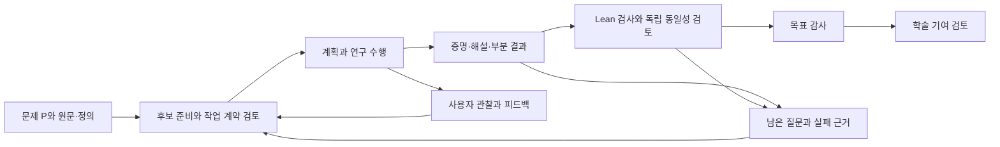

# do-math 후속 연구 준비

이 문서는 선정 문제 P를 이후 do-math 연구로 이어받기 위한 준비 문서다. 이번 사용자 승인은 **문제 선정과 선행연구 준비**에 한정된다. 실제 풀이 실행, 인스턴스 생성과 지속 운전은 시작하지 않았다. 여기의 단계와 목표는 후속 실행 요청에서 사용할 입력이며, 이 문서를 읽었다는 이유로 실행 권한이 생기지 않는다.

## 1. 확정한 연구 내용

목표 명제와 정의는 [문제와 선정 근거 §1](문제와-선정-근거.md)이 소유한다. 모든 n에 대한 최대 변위 개수열의 단봉성 P를 증명하거나 반증한다. 방법 변경과 보조문제의 연구는 가능하지만, 원 목표를 작은 경우·인접 문제로 바꾸어 완료하지 않는다. 시간·비용은 이번 문제의 난도 기준으로 사용하지 않았다.

최종 성과에는 엄밀한 해결과 기존 연구에 비추어 독창적이고 가치 있는 설명이 필요하다. 기초 개념으로 필연성을 드러내는 접근은 선호다. 연구 중 얻은 정확한 부분 결과는 보존하되 P의 해결과 구별한다. 수학적 해결과 학술적 기여 판정의 세부 기준은 [문제와 선정 근거 §5](문제와-선정-근거.md)에 있다.

## 2. 입력의 우선순위와 정보 상태

현재 사용자 결정이 연구 목적과 허가 범위를 정한다. do-math의 보편 의미는 [통합 설계](../../docs/do-math/통합-설계.md), 실제 명령·상태·기록 형식은 [CLI 실행 계약](../../.agents/skills/do-math/references/CLI-실행-계약.md)이 소유한다. 이 디렉터리의 연구 문서는 그 계약을 대체하지 않는다.

후속 준비자는 README, 문제와 선정 근거, 선행연구와 시작 자료, 이 문서 순으로 읽는다. 실제로 사용할 수학 주장은 S1·S2의 원문과 지정 좌표를 확인한다. 해설의 요약과 원문이 충돌하면 원문을 대조하되, 확인한 원문 오기는 [독해 교정](선행연구와-시작-자료.md)의 근거와 함께 처리한다. 수학의 참·거짓은 문서의 권위만으로 결정하지 않는다.

| 입력 | 현재 지위 | 후속 처리 |
|---|---|---|
| 문제 P와 사용자 선정 기준 | 확정된 연구 준비 내용 | 실행 시 헌장 목표·범위에 정확하게 연결 |
| S1의 추측 6.5 | 미해결로 제시된 외부 주장 | 연구 후보 F의 질문으로 취급 |
| S1 식 (4), S2 정리 3.7 | 원문을 읽고 공개 수치를 대조한 기존 결과 | 사용할 가정·정의·결론을 명시하고 필요한 형식화·검토 수행 |
| `published-counts.json` | 문헌 표의 45개 값 | 계산 재현의 기대값. 전 범위 증명의 근거로 승격하지 않음 |
| 접근 후보 | 아직 검증하지 않은 연구 제안 | 준비·계획 활동이 근거를 대조해 선택 |
| 현재 K | 없음 | 이번 작업에서 Lean 정본을 만들거나 인증하지 않음 |

자료 URL과 해시는 `evidence/source-catalog.json`에서 회수한다. 다른 컴퓨터에서 로컬 원문이 없으면 지정 source의 `fetch`로 다시 확보하고 판본과 해시를 확인한다. 불일치하면 새 판본을 대조한 뒤 사용할 좌표를 갱신한다.

## 3. 통합 설계에서 시험할 실제 흐름

이번 준비는 아래 흐름의 입력을 만든 것이다. 앞으로 이 흐름을 실행했는지, 어떤 결과를 얻었는지는 실제 기록으로 판정한다.

| 연구에서 확인할 효과 | 통합 설계의 소유 절 | 관찰할 증거 |
|---|---|---|
| 선행 정리와 현재 질문의 차이를 이해하고 과제를 준비하는가 | 5절, 9.1~9.2.1절 | 원문·가정·현재 미해결 지점이 연결된 후보와 검토된 계약 |
| 실패나 반례가 다음 선택을 바꾸는가 | 1.5절, 7.3절, 9절 | 어떤 접근이 왜 막혔고 다음 접근이 무엇을 재사용하는지 드러나는 기록 |
| 원 수학과 형식 표현이 같은가 | 11.1~11.6절 | 정확한 Lean 판본·해설·동일성 판정. 누적 A를 b로 잘못 바꾸지 않았는지 포함 |
| 실제로 원 문제를 해결했는가 | 11.7절 | 모든 n의 증명 또는 정확한 반증을 현재 P와 대조한 독립 목표 감사 |
| 새로운 기여를 설명하는가 | 9.4절 | 현재 해결 근거에 연결된 선행연구 대조와 구조적 설명의 검토 |
| 사용자가 연구를 살펴보고 피드백할 수 있는가 | 12절, 16.6절 | 현재 결과·근거·막힌 일·다음 행동과 해당 원자료로 가는 링크 |

한 문제의 성공은 통합 설계 전체의 모든 고장·복구 경로나 일반적인 연구 능력을 입증하지 않는다. 이번 연구에서 실제로 거친 흐름과 관찰한 효과를 별도로 보고한다.

## 4. 착수 시 준비할 첫 작업

아래는 후속 연구 시작 시 후보 준비자가 사용할 순서다. 지금 새로운 풀이를 수행하라는 지시가 아니다.

1. **정의 대응:** 주차 알고리즘, PFₙ, 최대 변위 M, 누적 A, 정확 개수 b와 단봉성 P를 같은 표기로 정리한다. n=1과 c=0 같은 경계도 포함한다.
2. **원문 현재성:** S1의 최신 판본과 후속 해결 문헌을 재확인한다. 이미 해결된 결과가 발견되면 독창성 기준과 충돌하므로 사용자에게 사실과 후속 선택을 제시한다. 더 작은 문제를 자동으로 선택하지 않는다.
3. **기존 결과의 연결:** S2 정리 3.7과 S1 식 (4)를 P에 사용할 준비를 한다. `verify_reference.py`의 기존 범위 통과를 수입 확인으로 사용하고, 필요한 증명과 형식화 의무를 작업 계약에 적는다.
4. **첫 연구 선택:** 마지막 차 분해를 우선 후보로 두되, 어떤 부등식 또는 대응을 얻으면 P에 가까워지는지 명시한다. 계획자는 다른 접근의 근거가 더 좋으면 변경할 수 있다.
5. **검토와 환류:** 보조명제·증명·반례가 나오면 주장 범위와 근거를 남기고 설계의 검토 경로에 연결한다. 실패한 보조명제를 P의 반증으로 간주하지 않는다.

## 5. 형식화할 때의 목표 경계

최종 실행은 수학 목표에 해당하므로 현행 CLI의 `goal-kind mathematical`을 사용해야 한다. 통합 설계 1.1절에서 `mathematically_solved`는 Lean 형식 결과·해설 동일성·목표 감사를 요구한다. 자연어 초안이나 문헌 조사 과제의 완료로 이 상태를 대신하지 않는다.

형식 목표는 최소한 PFₙ의 유한 집합과 b의 정확한 개수를 정의하고 P의 양화를 표현해야 한다. 직접 주차 정의 대신 점화식으로 수열을 정의하면 **그 수열이 원래 PFₙ의 최대 변위 개수와 같다는 연결**도 증명·검토해야 한다. 원문에 인용됐다는 이유만으로 핵심 등식을 공리로 넣어 원 문제의 해결로 보고하지 않는다.

반증 경로도 가능하다. 단봉성의 부정은 한 행에서 감소가 일어난 뒤 다시 증가가 일어남을 보이면 된다. 계산에 의한 증명이라면 정확 정수 계산의 완전성과 해당 행의 개수 동치가 Lean 검사와 해설 검토에 포함되어야 한다. 더 강한 로그오목성의 반례만으로 P를 반증할 수는 없다.

## 6. 사용자가 관찰할 내용

새로운 주요 결과, 접근의 실패, 검토 쟁점, 다음 접근의 변경이 생길 때 현재 상태를 간단히 설명하고 원자료로 연결한다. 연구 수행자의 비공개 사고 과정 대신 **시도한 명제·방법, 사용한 근거, 실제 산출, 검증 결과, 다음 행동의 이유**를 남긴다.

보고에서는 ‘작업이 끝남’, ‘명제가 증명됨’, ‘원 문제가 해결됨’, ‘독창성과 가치 검토가 끝남’을 구별한다. 사용자는 예시 계산부터 수학 해설까지 원하는 깊이로 내려가고, 그 근거를 지정해 피드백할 수 있어야 한다. 현재 CLI의 status/query/read/input 사용법은 [운영 안내](../../.agents/skills/do-math/README.md)를 따른다. 별도의 보고 원장을 중복 생성하기보다 같은 연구 상태와 산출물을 사람이 읽는 순서로 제공한다.

유용한 피드백의 예는 ‘누적 개수와 정확 개수를 혼동했는지 확인’, ‘이 보조정리가 원 목표에 어떻게 기여하는지 설명’, ‘기존 논문과 같은 결과인지 대조’다. 이런 정보 요청은 목표 변경과 다르다. 실행 정지·범위 변경은 해당 사용자 제어 절차로 처리한다.

## 7. 실제 운전 전에 정할 값

문제 선정과 연구 입력은 확정했다. 다음은 실제 운전을 요청할 때 사용자와 실행 환경이 정할 값이며, 이번 준비의 미완성 수학 내용은 아니다.

| 항목 | 결정할 주체와 시점 | 그 전의 처리 |
|---|---|---|
| 풀이 실행 시작과 지속 허가, 정지 조건 | 사용자, 실제 시작 요청 때 | 인스턴스를 생성·운전하지 않음 |
| 작업·운영 자원, 기간·용량, 대화 소실 시 계속/정지 | 사용자, 실제 시작 전 | 무한 예산이나 지속 실행 허가를 추정하지 않음 |
| 모델·노력과 실제 호출 가능한 프로필 | 승인 범위 안에서 운영자, 시작 전 | 문제 난도 선정과 분리 |
| Lean·Mathlib 판본과 허용 공리·명령 | 운영자가 설치 환경을 확인, 시작 전 | 검증되지 않은 형식 보증을 표기하지 않음 |
| 독립 검토 구성·실행 한도, 학술 기여 검토의 구현 설정 | 현행 설계와 사용자 허용 범위에 따라 운영자, 배정 전 | 이 문서로 임의의 검토 횟수·새 권한을 만들지 않음 |
| 외부 전송·공개·유료 자원·연구자 연락 | 사용자, 해당 행동 전 | 이번 문헌 검색 승인을 외부 연락·공개 허가로 확대하지 않음 |

착수 시 현행 구현이 이 입력과 목표를 실제로 소비하는지 확인한다. 설정 예시를 그대로 복사해 실행 권한을 생성하지 않는다. 준비 문서의 완료와 실제 운전의 승인·검증은 별개다.
