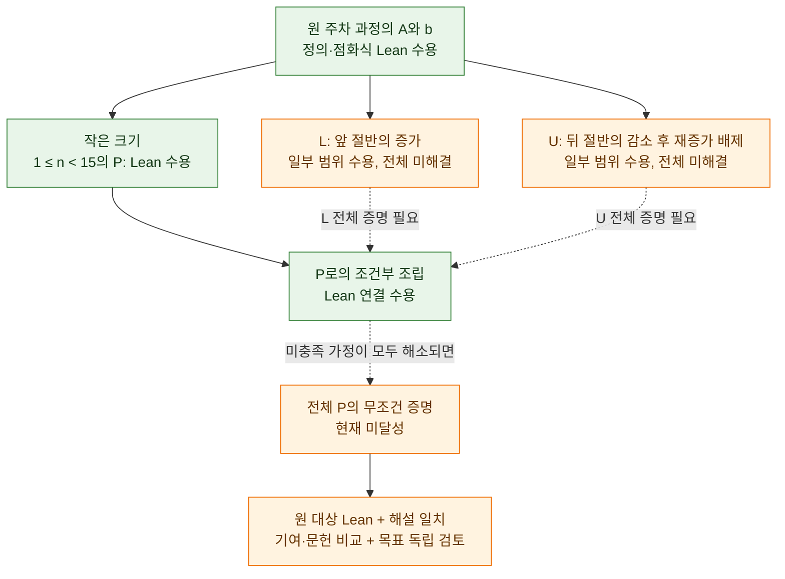
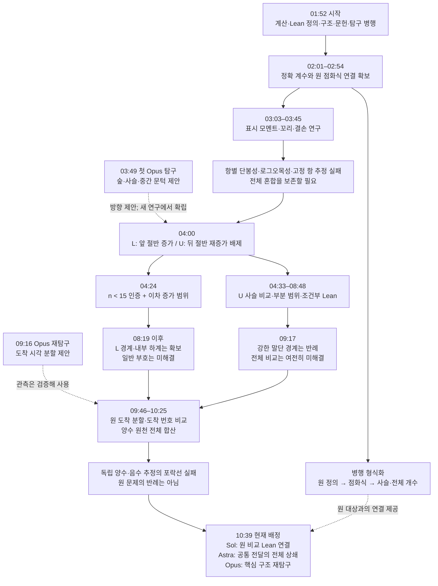
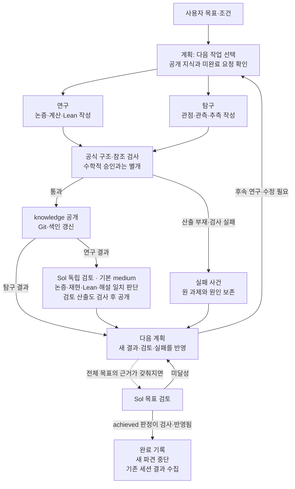

# 주차 함수 최대 변위의 단봉성 — 무엇을 알아냈고, 무엇이 남았는가

**기준 시각: 2026년 10월 23일 10:57 KST.** 이 문서는 새 인스턴스 `parking-unimodality-fresh-20261023-014524`의 공개 기록 59개를 기준으로 작성했다. 출발점은 [공개 색인][index]과 [최신 용어 정본][glossary]이며, 중요한 성과와 한계는 연구의 해설 및 독립 검토 원문으로 확인했다. 이후 진행되는 연구는 이 문서에 자동 반영되지 않는다.

현재 전체 문제는 **미해결**이다. 다만 원래 주차 과정을 정확히 세는 일반 점화식을 Lean으로 증명했고, **크기 1부터 14까지의 단봉성**, **일반 크기의 일부 증가 구간**, 여러 분해와 조건부 증명 연결을 독립 검토까지 마쳤다. 지금 막힌 곳은 계산식의 부재가 아니다. 그 식 안의 양수·음수 기여를 함께 비교하여 **모든 크기에서 한 번 감소한 뒤 다시 증가하지 않음**을 증명하는 단계다.

아래에서는 먼저 문제와 현재 성과를 설명하고, 이어 연구가 어떤 이유로 방향을 바꿨는지 시간순으로 따라간다. 마지막에는 실제 작업 흐름과 남은 의무를 도표로 연결한다. 세부 기록을 빠짐없이 찾으려면 [공개 기록 전체 목록](공개-기록-목록.md)을 보면 된다.

**1. 무엇을 풀고 있는가**

자리 $1,\ldots,n$에 차 $1,\ldots,n$이 번호 순서로 들어온다. 차는 자신이 선호한 자리부터 오른쪽으로 가서 처음 빈자리에 주차한다. 모든 차가 성공하는 선호 목록을 주차 함수라고 한다. 선호한 자리와 실제 자리 사이의 거리가 그 차의 **변위**이고, 한 목록에서 가장 큰 변위를 $M$이라 한다.

예를 들어 선호 목록 $112$는 변위가 $(0,1,1)$이므로 $M=1$이다. $121$은 같은 숫자로 이루어졌지만 변위가 $(0,0,2)$여서 $M=2$다. 따라서 선호 목록을 정렬하거나 도착 순서를 바꿔서 다른 문제로 만들면 안 된다.

연구는 최대 변위가 **정확히** $0,1,\ldots,n-1$인 주차 함수의 개수를 차례로 놓았을 때, 그 수열이 한 번 올라갔다가 내려가는지 묻는다. 예를 들어 $n=4$에서는

$$
(b_{4,0},b_{4,1},b_{4,2},b_{4,3})=(24,51,34,16)
$$

이므로 $24\le51\ge34\ge16$이다. 꼭대기가 평평하거나 처음부터 감소하는 경우도 허용한다. 질문은 예시 몇 개가 아니라 **모든 $n\ge1$**에 관한 명제 P다. [목표와 완료 기준][goal]

| 기호 | 읽는 뜻 | 이 연구에서 하는 일 |
|---|---|---|
| $PF_n$ | 모두 주차에 성공하는 순서 있는 선호 목록 | 처음부터 끝까지 유지해야 할 원 대상 |
| $M(\alpha)$ | 목록 하나의 최대 변위 | 분포를 만들 통계량 |
| $A_{n,\ell}$ | 최대 변위가 $\ell$ **이하**인 목록 수 | 점화식으로 계산하기 좋은 누적 개수 |
| $b_{n,\ell}$ | 최대 변위가 $\ell$과 **같은** 목록 수 | 단봉성을 증명할 실제 수열 |
| $\Delta_{n,\ell}$ | $b_{n,\ell+1}-b_{n,\ell}$, 단 $\ell\ge1$ | 양수면 증가, 음수면 감소 |
| $T_n$ | 전체 주차 함수 수 | 제한이 사라지는 경계값 |
| $b^{(t)}_{n,\ell}$ | 최대 변위를 마지막으로 달성한 차가 $t$번인 목록 수 | 최근 연구에서 사용하는 더 세밀한 분할 |

누적 개수와 정확 개수는

$$
b_{n,\ell}=A_{n,\ell}-A_{n,\ell-1}
$$

로 연결된다. 따라서 $\ell\ge1$에서

$$
\Delta_{n,\ell}=A_{n,\ell+1}-2A_{n,\ell}+A_{n,\ell-1}.
$$

$A$가 증가한다는 쉬운 사실만으로 $b$의 단봉성은 나오지 않는다. 누적값의 **증가량이 어떻게 바뀌는지**까지 알아야 하기 때문이다. 용어 정본은 $\Delta_{n,0}$을 정의하지 않으므로 첫 차이 $b_{n,1}-b_{n,0}$는 별도로 다룬다. 또 빈 목록은 $A_{0,\ell}=1$, 음수 문턱은 $A_{n,-1}=0$으로 처리하며 $b_{0,\ell}$를 새로 정의하지 않는다. [용어 정본 §§1–11, 25, 36, 146–147][glossary]

**2. 결과의 어느 부분까지 믿어도 되는가**

공개된 기록이라고 해서 모두 증명으로 인정된 것은 아니다. 이번 연구의 네 가지 상태를 구별해야 한다.

| 상태 | 이 문서에서의 의미 |
|---|---|
| **Lean 수용** | 독립 검토가 실제 재컴파일·허용 공리 확인을 마치고 `accepted`, 해설과의 일치를 `matches`로 판정했다. 정리에 적힌 범위와 가정 안에서 수용한다. |
| **비형식 수용** | 독립 검토가 수학적 논증을 `supported`로 판정했다. 그 전체 논증의 Lean 증명이 있다는 뜻은 아니다. |
| **계산 재현** | 특정 유한 범위의 정확 계산을 확인했다. 모든 크기에 대한 결론으로 확대할 수 없다. |
| **탐구** | 관측·추측·방향 제안이다. 문서 안에 ‘증명’이라는 표현이 있더라도, 탐구 자체를 독립 수용된 연구 결과로 사용하지 않는다. |

특히 “조건을 만족하면 P가 성립한다”는 Lean 정리가 있어도 **그 조건 자체가 미증명이라면 P는 미해결**이다. 현재 여러 조건부 연결이 바로 이 상태다. 큰 숫자 계산, 모듈 수, 정리 수, 용어 수를 완료율로 바꿀 근거도 없다.

기준 시각의 59개 기록은 **계획 20개, 연구 18개, 독립 검토 19개, 탐구 2개**다. 이는 증명 59개라는 뜻이 아니다. 용어 정본의 **173개 항목** 역시 연구 중 도입한 대상·표기·보조함수를 구별하는 사전이다. 정의가 실렸다는 사실과 그 대상에 관한 주장이 증명됐다는 사실은 다르다.

**3. 지금 확보한 것과 아직 없는 것**

| 항목 | 현재 확보한 범위 | 아직 없는 것 |
|---|---|---|
| 원 대상과 점화식 | 원 주차 알고리즘, $A,b$, 마지막 차량 분해와 일반 점화식의 **Lean 수용** | 그 점화식에서 전체 단봉성을 끌어내는 부호 비교 |
| 작은 크기의 P | **모든 $1\le n<15$**에 대한 원 단봉성 **Lean 수용** | $n\ge15$ 전체 P |
| 별도 유한 계산 | **$n\le18$**의 정확 계수를 독립 재계산하여 단봉성을 확인 | 이 계산을 무한 범위의 증명으로 일반화하는 논증 |
| 증가 구간 | $n\ge3$의 $b_{n,0}<b_{n,1}$, $k\ge1, n\ge4(k+1)^2$의 $b_{n,k}<b_{n,k+1}$: **Lean 수용** | 아래 절반 전체의 증가 |
| 감소·재증가 배제 | 끝부분 감소, 일정 꼬리 범위, 위 절반의 두 부분 범위에 대한 **비형식 수용** 및 조건부 Lean 연결 | 봉우리 주변을 포함한 위 절반 전체의 재증가 배제 |
| 전체 개수 | $T_0=1$, 그리고 $n\ge1$에서 $T_n=(n+1)^{n-1}$을 원 $PF_n$에 대해 **Lean 수용** | 이 기존 전체 개수 공식만으로 분포의 모양은 결정되지 않음 |
| 도착 번호 분할 | $b=\sum_t b^{(t)}$의 원 연결은 **Lean 수용**; 고정 $n,\ell$에서 $b^{(t)}\le b^{(t+1)}$는 **비형식 수용** | 후자의 일반 원 과정 Lean 연결, 그리고 $\ell$ 방향 부호로의 확장 |
| 문헌·기여 | 원 추측과 목표 P의 일치, 조사 범위에서 해결 문헌 미발견은 **비형식 수용** | 일부 출판 원문 대조, 최종 결과의 새로움·기여 평가 |

근거는 각각 [원 점화식 검토][rec-review], [작은 크기·이차 범위 검토][left-review], [유한 계산 검토][count-review], [첫 증가·꼬리 연구 검토][deficit-review], [위 절반 부분 범위 검토][upper-part-review], [전체 개수 검토][cayley-review], [도착 분할 검토][arrival-review], [도착 번호 비교 검토][latest-review], [문헌 추가 검토][lit-review]다.

탐구에는 $n\le300$의 단봉성 관측과 더 큰 크기의 수치 실험도 있다. 위 표의 $n\le18$은 **전용 정확 계수 연구와 독립 검토가 확인한 범위**를 뜻하며, 연구에서 계산해 본 최대 크기를 뜻하지 않는다. 반대로 더 큰 실험이 있다는 이유로 그것을 $n\le14$의 Lean 인증과 같은 수준으로 적지도 않는다.

**4. 첫 단계: 정확하게 세는 방법을 원 과정에 연결했다 — 01:52~03:19**

연구는 문헌 조사, 직접 계수 계산, 일반 구조 연구, Lean 정의, 자유 탐구를 병행하며 시작했다. 직접 계산은 작은 입력을 모두 주차시켜 본 결과와 점유 자리집합을 상태로 삼는 동적 계획을 대조했다. $n\le7$에서는 선호 목록 873,612개를 전수 조사했고, $n\le18$에서는 전체 계수행을 계산했다. 이로써 이후 유도할 식을 대조할 기준표를 마련했다. [계수 연구][counts]

동시에 마지막 차가 주차하는 자리를 기준으로 한 분해를 연구했다. 마지막 차가 들어오기 직전 그 자리는 비어 있다. 따라서 앞서 온 차들은 그 빈자리를 넘어가서 주차할 수 없고, 좌우에 있던 차들을 도착 순서를 유지한 두 작은 문제로 나눌 수 있다.

그 결과, 크기 $n+1$의 누적 개수는 다음과 같다.

$$
A_{n+1,\ell}
=\sum_{j=0}^{n}\binom nj\min(j+1,\ell+1)
A_{j,\ell}A_{n-j,\ell}.
$$

각 항의 의미는 명확하다. $\binom nj$는 마지막 차보다 먼저 온 $n$대 중 왼쪽에 둘 $j$대를 고르는 수이고, 두 $A$는 왼쪽·오른쪽의 성공 목록 수다. $\min(j+1,\ell+1)$은 마지막 차의 허용 가능한 선호 선택 수다. 빈 왼쪽이나 오른쪽도 빠뜨리지 않기 위해 $A_{0,\ell}=1$이 필요하다.

중요한 진전은 이 식을 그럴듯한 계산 규칙으로 채택한 데 그치지 않고, **분해와 역조립을 원 주차 목록 사이의 동치로 Lean에서 증명했다**는 것이다. 이후 증명은 이 재귀를 쓰더라도 원래 문제와의 연결을 잃지 않는다. 다만 이 점화식은 문헌에도 있는 결과이므로, 이번 형식화 성과와 학술적 새 발견은 구별한다. [분해·점화식 연구][recurrence] · [독립 검토][rec-review]

일반 부호 연구는 여기서 두 방향을 시도했다. 하나는 전체 목록을 더 작은 구간으로 분해하는 방법, 다른 하나는 큰 변위를 낸 차를 표시해 세는 방법이다. 후자는 여러 차가 동시에 큰 변위를 내는 중복을 보정하여 오른쪽 꼬리의 감소를 얻었다. 그러나 봉우리 부근에서는 그 보정이 커져 같은 추정만으로 전체 부호가 결정되지 않았다. [구조 연구][structure] · [표시·모멘트 연구][moments]

이때부터 드러난 장애가 있다. 전체 분포가 단봉이라고 해서 **각 순열·각 작은 구성요소의 분포까지 단봉일 필요는 없다**. 실제로 그런 강한 조건들이 실패했다. 전체 로그오목성도 실패했다. 따라서 성분마다 좋은 모양임을 보인 뒤 단순히 합치는 방식은 그대로 사용할 수 없었다.

**5. 두 번째 단계: ‘증가하는 쪽’과 ‘다시 올라오지 않는 쪽’을 분리했다 — 03:45~04:37**

첫 Opus 탐구는 숲·생성함수·사슬 표현과 $n/2$ 근처의 구조를 제안했다. 계획은 그 주장을 그대로 전제로 삼지 않고, 검토된 원 점화식에서 필요한 표현을 다시 도출하는 연구를 배정했다. 04:00 계획에서 선택한 증명 경로가 아래의 **L과 U**다. [분할 계획][split-plan]

| 과제 | 정확한 질문 | 쉬운 설명 |
|---|---|---|
| **L** | 모든 $n\ge15, 0\le k<\lfloor n/2\rfloor$에서 $b_{n,k}\le b_{n,k+1}$인가? | 수열의 앞 절반은 내려가지 않는가? |
| **U** | 모든 $n\ge15, \lfloor n/2\rfloor\le i<j<n-1$에서 $b_{n,i+1}<b_{n,i}$이면 $b_{n,j+1}\le b_{n,j}$인가? | 뒤 절반에서 감소가 나타나면 이후에는 다시 올라가지 않는가? |

U는 “뒤 절반이 전부 감소한다”는 말이 아니다. 봉우리가 뒤 절반 안에 있어도 된다. 또한 단순히 “다음 차이가 0 이하”만 보이면, 나중에 음수 → 0 → 양수로 바뀔 가능성이 남는다. 과거에 감소가 있었다는 사실까지 기억하는 조건이 필요한 이유다.

**작은 크기의 P + L + U이면 전체 P**라는 연결은 Lean으로 수용됐다. L은 U 및 작은 크기 결과와 함께 P를 보장하려고 선택한 **추가 조건**이다. 원 P 자체가 봉우리를 반드시 뒤 절반에 두라고 요구하는 것은 아니다. 따라서 L이 실패하더라도 그것만으로 P가 반증되지는 않는다. [조건부 조립 연구][left]

이 단계의 가장 분명한 전진은 다음 두 가지다.

- $1\le n<15$의 원 단봉성을 표와 점화식의 일반 동일성에 연결하여 Lean 커널에서 검증했다.
- $k\ge1, n\ge4(k+1)^2$에서의 엄격한 증가를 일반 정리로 증명했다.

그 결과 L에서 남은 범위는 정확히

$$
k\ge1,\qquad \max(15,2k+2)\le n<4(k+1)^2
$$

다. $k$ 하나를 고정하면 확인할 $n$은 유한하지만, **$k$ 자체에는 상한이 없으므로 전체는 무한히 많은 경우**다. 이를 두 경계 $n=2k+2,2k+3$와 그 밖의 내부 $n\ge2k+4$로 나눠 연구했다. [이차 범위와 유한 인증][left] · [그 검토][left-review]

[그림 PNG](diagrams/01-proof-dependencies.png) · [확대용 SVG](diagrams/01-proof-dependencies.svg) · [Mermaid 원본](diagrams/01-proof-dependencies.mmd)

실선은 작업의 논리적 연결이고, 점선은 아직 증명해야 할 의존성을 뜻한다. 각 상자의 문구가 확보 여부를 나타낸다. 이 그림은 현재 선택한 L/U 경로를 보여 준다. 직접 P를 증명하거나 정확한 계수 반례를 찾는 다른 경로도 허용된다.

**6. 세 번째 단계: 경계·내부·위 절반을 연구하면서, ‘상계가 좋다’와 ‘차분 부호가 좋다’의 차이를 확인했다 — 04:33~09:17**

L의 두 경계에서는 전체 개수에서 빠지는 양 $E_{n,\ell}=T_n-A_{n,\ell}$을 다뤘다. 더 계산하기 쉬운 선형 상계 $\mathcal L_{n,\ell}$를 만들고, 언제 정확히 일치하고 처음 어디서 보정이 필요한지 증명했다. 일부 보정식과 유한 전개는 Lean으로 수용됐다. 하지만 **함수값의 상계는 그 함수의 이차 차분 부호까지 보장하지 않는다**. 같은 항별 부호를 요구하거나 고정된 수의 항만 남기는 접근도 실패했다. [경계 연구][boundary] · [검토][boundary-review]

L의 내부에서는 특정 폭을 가진 선호 선택들을 표시하고, 그 가중치를 조정한 모멘트 하계를 만들었다. 실제 원 $b$에 대한 하계의 Lean 연결까지 확보했지만, 그 하계의 분자가 항상 비음수임은 증명하지 못했다. **하계식을 증명한 성과**와 **그 하계가 양수임을 증명하는 남은 과제**를 나눠 읽어야 한다. [내부 연구][interior] · [검토][interior-review]

U에서는 원 점화식을 큰 성분의 크기가 차례로 줄어드는 **사슬**의 합으로 바꿨다. 사슬은 경우의 수를 세는 표현이고, 여기서 말하는 **커널**은 한 단계의 기여가 이후 크기로 얼마나 전달되는지를 기록한 계수다. 이 문맥의 커널은 Lean 검증기의 커널과 다른 뜻이다.

사슬 표현에서는 차분을 양의 가중 기여와 경계 손실로 분리할 수 있었다. 그러나 전달 계수가 양수라는 사실만으로 입력의 부호 변화 횟수가 줄어들지는 않는다. 그런 보존을 뒷받침할 수 있는 강한 성질, 예를 들어 TP₂라는 2×2 소행렬식의 비음수성은 실제로 실패했다. 개별 사슬만 떼어 보면 재증가하는 경우도 있었다. [사슬 연구][upper-chain] · [검토][upper-chain-review]

그래서 모든 사슬을 합친 비교식, 해당 원문 번호 **(23)**을 목표로 삼았다. U에서 다루는 국소 영역은 $n\ge15,\ \lfloor n/2\rfloor\le k\le n-3$이다. $d=n-k-1$을 오른쪽 끝까지 남은 거리로 놓으면 $2\le d\le k$이고, 다음 두 범위에서는 그 비교를 **비형식으로 수용**했다.

- $2\le d\le12$: 각 $d$에 대해 허용되는 모든 $k$를 다루는 기호 다항식·유리 계수 증명서가 있다.
- $d\ge2, k\ge3d^2(d+2)$: $d$도 커질 수 있는 일반 부분 범위를 부등식으로 증명했다.

따라서 이 비교식의 잔여는 $d\ge13, d\le k<3d^2(d+2)$다. 이 결과는 큰 범위의 무반례 실험보다 강하지만, **해당 논증 전체가 원 $b$에 대한 Lean 정리로 완성된 것은 아니다**. [부분 범위 연구][upper-part] · [검토][upper-part-review]

계속된 연구에서 더 강한 보조 경계식 **(30)**은 $k=d=4000, n=8001$에서 실패했다. 같은 점에서 실제 목표 비교식 (23)은 성립했고, 원 $b$의 관련 차분도 양수였다. 따라서

> (30)을 모든 경우에 증명하는 우회 경로는 막혔다. (23), U 또는 P가 거짓이라는 결론은 나오지 않았다.

이 구별 때문에 계획은 실패한 경계식을 반복해서 증명하려 하지 않고, 전체 가중합의 상쇄와 원 감소 상태를 직접 연구하는 쪽으로 방향을 바꿨다. [말단 경계 반례 연구][terminal] · [검토][terminal-review]

병행한 Lean 작업은 원 $T_n$의 Cayley 공식, 실제 $T$를 사용하는 사슬·응답의 연결을 확립했다. 이로써 여러 가정이 줄었지만, **정본의 명시적 사슬 열 합 전체와 구현의 일반 동일성**, 미증명 부등식의 전체 원 적용은 여전히 남았다. 조건부 U 정리가 수용됐다는 사실로 이 잔여를 덮을 수는 없다. [원 사슬 형식 연결 검토][chain-lean-review] · [전체 개수·구현 연결 검토][cayley-review]

**7. 네 번째 단계: 최대 변위를 낸 차의 도착 번호로 다시 나눴다 — 09:16~10:39**

두 번째 Opus 탐구는 순열이나 사슬 길이를 고정하는 대신, **최대 변위를 마지막으로 달성한 차가 언제 도착했는가**를 보자고 제안했다. 이 분할은 원 과정의 순서를 그대로 보존한다. 예를 들어 한 목록에서 2번 차와 5번 차가 함께 최대 변위를 냈다면, 그 목록은 5번 성분에 정확히 한 번 들어간다.

따라서

$$
b_{n,\ell}=\sum_{t=1}^{n}b^{(t)}_{n,\ell}
$$

이다. 이 원 사건 분할은 후속 연구에서 새로 확립해 Lean으로 수용했다. 탐구가 보고한 일부 작은 범위의 봉우리 순서 관측은 후속 검토에서 $n=3,5$에 실패함을 확인했으므로, 그 관측을 일반 사실로 사용하지 않는다. 유효한 새 분할과 잘못된 관측을 분리한 것이다. [도착 분할 연구][arrival] · [검토][arrival-review]

이를 계산하기 위해 **혼합 문턱 개수** $B^{\mathrm{mix}}_{n,j,\ell}$를 쓴다. 앞의 $j$대에는 변위 $\ell$까지 허용하고 뒤의 차에는 $\ell$보다 작은 변위만 허용한다. $j$를 하나 늘릴 때 추가되는 목록이 바로 $b^{(j)}_{n,\ell}$다. 모두 약한 제한으로 바꾸기까지의 증가량을 합하면 원 $b$가 나온다. [용어 정본 §§146–160][glossary]

최근 연구는 여기서 새로운 일반 명제를 얻었다.

$$
b^{(t)}_{n,\ell}\le b^{(t+1)}_{n,\ell}
\quad(n\ge2,\ \ell\ge0,\ 1\le t<n).
$$

**같은 $n,\ell$에서 최대 변위를 마지막으로 달성하는 차의 번호가 뒤로 갈수록 해당 목록의 수가 줄지 않는다**는 뜻이다. 두 이웃 차가 채울 두 빈자리와 나머지 선호를 고정한 뒤 가능한 선호 수를 비교하는 비형식 증명으로, 독립 검토가 수용했다. 기준 시각에는 국소 계수 비교만 Lean으로 검증됐고 일반 원 과정 연결은 Sol이 작성 중이다. [도착 번호 비교 연구][latest] · [검토][latest-review]

여기서 비교하는 축은 **도착 번호 $t$**다. 원 문제에서 비교해야 하는 축은 **최대 변위 $\ell$**다. 새 단조성이 중요한 도구인 것은 맞지만, 그것만으로 원 수열의 단봉성을 얻지는 못한다.

이 표현은 허용 거리를 늘렸을 때 생기는 양수 기여와 사라지는 음수 기여를 같은 전달식 안에서 비교하게 해 준다. 실제 차분보다 작거나 같은 하계 $Z^1$의 합을 만들었고, 더 계산하기 쉬운 **포락선**—여기서는 보수적으로 잡은 하계—으로 다시 추정했다. 그러나 강화한 포락선조차 $(n,\ell)=(413,12)$에서 음수가 됐다. 같은 점의 실제 $\Delta_{n,\ell}$는 양수였다.

이 실패가 뜻하는 것은 명확하다. 양수 쪽은 작게, 음수 쪽은 크게 **따로** 추정하다가, 실제로는 함께 상쇄되는 양을 너무 많이 잃었다. 그렇다고 $Z^1$ 자체의 합이 음수라고 밝혀진 것은 아니다. **포락선의 실패, $Z^1$의 부호, 원 $\Delta$의 부호는 서로 다른 질문**이다. 그래서 현재 Astra는 같은 전달 커널 안에서 양수·음수 원천과 버린 양을 함께 유지하는 비교를 연구한다. 이 방법이 성공한다는 보장은 아직 없다.

**8. 전체 진행 궤적을 한 그림으로 읽기**

아래 시각은 결과의 **공개 시각** 또는 그 전환을 기록한 계획 시각이다. 세션 시작·종료 시각과 다르다. 특히 08:19경 공개된 두 연구는 실행기 복구 뒤 반영됐으므로, 앞의 공백을 수학적 무활동 시간으로 읽으면 안 된다.

[그림 PNG](diagrams/02-research-trajectory.png) · [확대용 SVG](diagrams/02-research-trajectory.svg) · [Mermaid 원본](diagrams/02-research-trajectory.mmd)

문헌 조사는 이 흐름과 병행됐다. 원 추측이 목표와 같은지, 기존 식을 어디까지 가져올 수 있는지, 이미 해결된 문헌이 있는지를 확인하는 역할이다. **조사 범위에서 해결 문헌을 찾지 못함**은 수용됐지만 전 세계 문헌을 망라한 미해결 인증은 아니다. Petersson 출판본 일부의 직접 대조는 추가 검토 후에도 미완료여서 관련 결과 묶음 전체가 `undetermined`로 남는다. 용어 이명 사용에 대한 `deviates` 판정도 수학적 타당성 판단과 별도로 남아 있다. [문헌 연구][literature] · [추가 검토][lit-review]

**9. 현재 작업과, 그것이 성공했을 때 실제로 달라지는 것**

10:57 기준 실행기는 살아 있고 차단·사용량 한도·사용자 입력 대기는 없다. 아래 세 세션이 진행 중이었다. 이후 완료 여부는 [실시간 색인][index]과 실행 상태 조회에서 확인해야 한다.

| 담당 | 진행 중 작업 | 성공하면 얻는 것 | 그것만으로 얻지 못하는 것 |
|---|---|---|---|
| GPT 6.1 Sol / xhigh | 도착 번호 단조성의 원 유한집합 분할을 Lean으로 연결 | 비형식으로 수용된 일반 비교를 원 과정의 형식 정리로 사용 가능 | 최대 변위 $\ell$ 방향의 L/U/P |
| GPT 6 Astra / xhigh | L 잔여에서 실제 공통 커널과 정확한 잉여를 유지한 상쇄 비교 | 성공 범위에 따라 남은 증가 영역을 증명하거나 정확한 장애를 식별 | L 전체를 얻더라도 U와 전체 P의 나머지 의무 |
| Opus 5.5 / xhigh | 도착 시각·사슬 표현을 함께 보는 자유 탐구 | 후속 연구에 넘길 새 관점·후보·반례 탐색 방향 | 독립 수용된 수학 정리나 완료 판정 |

독립 검토는 사용자 변경을 반영하여 **GPT 6.1 Sol / medium이 기본**이다. 이미 파견된 세션은 기존 설정을 유지했다. Astra는 기본 작업을 모두 맡는 모델이 아니라, Sol이 여러 하계와 정확 원천 합을 전개한 뒤에도 막힌 어려운 비교에 배정됐다. [현재 계획][current-plan]

**10. 자동 연구 작업은 어떻게 이어지는가**

[그림 PNG](diagrams/03-session-workflow.png) · [확대용 SVG](diagrams/03-session-workflow.svg) · [Mermaid 원본](diagrams/03-session-workflow.mmd)

연구를 공개하면 검토가 뒤따르고, 그 검토가 다시 계획을 움직인다. 탐구는 같은 자동 독립 검토를 받지 않는다. 유망한 탐구 주장을 근거로 쓰려면 연구에서 확립하고 그 연구의 검토를 받아야 한다. 계획은 한 번에 하나, 전체 동시 세션 상한은 8이다. 상한은 매번 8개를 채우라는 뜻이 아니므로 현재 세 작업만 진행되는 것은 그 자체로 오류가 아니다. [실행 계약][runtime]

작업 이력에는 수학과 별개의 운영 사건도 있다. 검토 모델을 Opus에서 Sol로 바꾸면서 기존 검토 2개를 종료한 일, 이후 검토 기본 effort를 medium으로 낮춘 일, 산출 폴더 이동의 Windows 접근 거부 때문에 멈춘 실행기를 08:19경 재기동한 일, 후속 Opus 탐구가 API 차단으로 산출 없이 끝나 새 지시로 재배정된 일이 있다. 이런 사건의 실패 횟수를 수학적 접근의 실패 횟수로 세면 안 된다.

또 최초 Opus 문헌 세션은 금지 조건을 확인하기 전 로컬 메모리 **색인**을 읽었다고 보고했다. 본문 노드는 읽지 않고 산출에 쓰지 않았다는 보고지만, 열람 금지 조건 위반 자체는 있었다. 후속 계획은 색인·목록도 금지 범위임을 명시했다. 이 문서는 해당 제약 위반을 ‘처음부터 완벽히 준수했다’고 바꾸지 않는다.

**11. 앞으로 진척을 판단할 구체적인 기준**

새로운 등식·계산표·Lean 모듈이 추가되는 것만으로 목표에 같은 만큼 가까워졌다고 말할 수는 없다. 다음 변화가 일어나는지를 봐야 한다.

1. **L의 새 전칭 영역이 실제로 닫히는가.** 남은 두 경계와 내부 중 어디를, 어떤 추가 가정 없이 증명했는지 확인한다. $k$별 유한 확인을 무한한 전체 띠의 증명으로 쓰지 않는다.
2. **U에서 실제 감소 뒤 재증가를 배제하는가.** 보조 말단식·커널 비율의 성립만이 아니라, 원 $b$의 부호로 돌아오는 연결을 확인한다. 거짓으로 판명된 (30)을 가정하는 조건부 정리를 해결책으로 세지 않는다.
3. **비형식 구조가 원 대상의 Lean 정리로 연결되는가.** 국소 두 차의 계수 비교, 추상 재귀 항등식, 원 $PF_n$ 전체의 정리는 다른 범위다. 필요한 조합 동치와 일반 동일성이 빠져 있지 않은지 본다.
4. **반례라면 무엇의 반례인가.** 원 P를 반증하려면 같은 $n$의 원 계수행에서 먼저 엄격한 감소가 있고 뒤에 엄격한 증가가 있음을 보여야 한다. L, 로그오목성, 포락선 또는 개별 성분의 실패만으로는 부족하다.
5. **최종 해설과 학술적 기여가 뒷받침되는가.** 원 P 또는 부정의 Lean 수용과 해설 일치에 더해, 어떤 기존 정리와 달라졌고 어떤 구조 때문에 결론이 나왔는지를 독립적으로 설명해야 한다.

현재 가장 정확한 평가는 **“원 개수와 여러 표현의 연결, 작은 범위와 일부 일반 영역의 증명은 확보했고, 전체 부호 비교는 아직 열려 있다”**다. 최근 도착 번호 단조성은 새 도구를 보탠 성과지만, 그 단계에서 L 잔여의 새 전칭 부호 영역이 닫히지는 않았다. 남은 난도나 예상 완료 시각을 정량적으로 추정할 근거는 없다.

**자료와 확인 범위**

이 문서는 공개 색인 전체, 최신 용어 정본의 173개 정의·정의역·경계, 현재 연구 현황, 주요 연구의 결과 설명·해설 및 독립 검토의 판정 이유를 읽어 재구성한 **사용자용 설명**이다. 새로운 수학적 독립 검토를 수행하거나 Lean과 계산 전체를 다시 실행한 보고서는 아니다. ‘수용’은 연결된 독립 검토 기록의 판정을 뜻한다. 기존 인스턴스의 연구 자료는 사용하지 않았다.

- [공개 기록 전체 목록](공개-기록-목록.md): 59개를 공개 순서·시각·모델과 함께 찾는 표.
- [지금 진행하는 두 연구의 쉬운 설명](지금-진행하는-두-연구의-쉬운-설명.md): 12:01 기준 후속 문서. 차 3대의 실제 표로 도착 번호와 최대 변위의 차이를 설명하고, 혼합 전달 형식화와 숲 경계 연구가 각각 무엇을 하는지 풀어 썼다.
- [이전 run과 현재 run의 비교 평가](이전-run과-현재-run-비교평가.md): 별도의 11:25 기준 후속 문서. 수학적 성과와 탐구·형식화·지식 관리 방식의 비교이며, 이 문서의 10:57 스냅샷이나 현재 연구의 입력을 변경하지 않는다.
- [자료 명세](evidence/source-manifest.json): 기준 기록, 공개 시각, 모델, 검토 판정과 원문 SHA-256.
- `evidence/`의 색인·용어 정본·연구 현황 사본은 기준 시각 내용을 보존한다. 사본 내부의 상대 링크는 원래 knowledge 폴더 기준이다. 문서의 링크나 위 목록을 통해 원문을 열면 된다.
- `diagrams/`에는 Mermaid 원본 `.mmd`와 렌더링한 SVG·PNG를 함께 둔다. 본문의 Mermaid를 표시하지 못하는 뷰어에서는 각 그림 아래의 PNG 링크를 열면 된다.

[goal]: ../../../.skill-workspace/do-math/parking-unimodality-fresh-20261023-014524/goal.md
[index]: ../../../.skill-workspace/do-math/parking-unimodality-fresh-20261023-014524/knowledge/index.md
[glossary]: ../../../.skill-workspace/do-math/parking-unimodality-fresh-20261023-014524/knowledge/k1223d51b5e5d4388aedff155d690d78d/glossary.md
[runtime]: ../../../.agents/skills/do-math/RUNTIME.md
[counts]: ../../../.skill-workspace/do-math/parking-unimodality-fresh-20261023-014524/knowledge/k746a9db449ff45fd9b973172e4b40861/exposition.md
[count-review]: ../../../.skill-workspace/do-math/parking-unimodality-fresh-20261023-014524/knowledge/k1fccb0b8b1524d25a440bb51655f52c3/review.md
[structure]: ../../../.skill-workspace/do-math/parking-unimodality-fresh-20261023-014524/knowledge/k12c717105e4f436ebbc4a311ae64134a/exposition.md
[recurrence]: ../../../.skill-workspace/do-math/parking-unimodality-fresh-20261023-014524/knowledge/k2809252f588641b39bcaf13513db3951/output.json
[rec-review]: ../../../.skill-workspace/do-math/parking-unimodality-fresh-20261023-014524/knowledge/k41050a1934d84a1fae10f1e3af32d0a1/review.md
[moments]: ../../../.skill-workspace/do-math/parking-unimodality-fresh-20261023-014524/knowledge/k21248694f4c24bad89564e3143deba52/output.json
[deficit-review]: ../../../.skill-workspace/do-math/parking-unimodality-fresh-20261023-014524/knowledge/kdd117882498f411286f292377dc9abda/review.md
[split-plan]: ../../../.skill-workspace/do-math/parking-unimodality-fresh-20261023-014524/knowledge/k817e480061dd494f8b8fc4f8fb0e60f7/output.json
[left]: ../../../.skill-workspace/do-math/parking-unimodality-fresh-20261023-014524/knowledge/k83ac8ca8d9c44903b97b8979ac04bdd3/exposition.md
[left-review]: ../../../.skill-workspace/do-math/parking-unimodality-fresh-20261023-014524/knowledge/kb196a5163fc74633b71d21d0bc248fa2/review.md
[boundary]: ../../../.skill-workspace/do-math/parking-unimodality-fresh-20261023-014524/knowledge/k9001cda0e9704d678342f834dec9e9d6/exposition.md
[boundary-review]: ../../../.skill-workspace/do-math/parking-unimodality-fresh-20261023-014524/knowledge/k9fa99dedff1641a4a41924f945e4bf2c/review.md
[interior]: ../../../.skill-workspace/do-math/parking-unimodality-fresh-20261023-014524/knowledge/k772e2708b66f4a2e8e9322e151db43ab/exposition.md
[interior-review]: ../../../.skill-workspace/do-math/parking-unimodality-fresh-20261023-014524/knowledge/k533a625813b0497dae732e87b1c05808/review.md
[upper-chain]: ../../../.skill-workspace/do-math/parking-unimodality-fresh-20261023-014524/knowledge/ka8fb76538efa4aa28114eaab004058ff/exposition.md
[upper-chain-review]: ../../../.skill-workspace/do-math/parking-unimodality-fresh-20261023-014524/knowledge/k2f5a509346a04efc9720bfffb293aeee/review.md
[upper-part]: ../../../.skill-workspace/do-math/parking-unimodality-fresh-20261023-014524/knowledge/k52423a2c3ac04a04a4e61cb863a834a7/exposition.md
[upper-part-review]: ../../../.skill-workspace/do-math/parking-unimodality-fresh-20261023-014524/knowledge/k8b17ad54d3c94e9981e8f2551c110d9f/review.md
[chain-lean-review]: ../../../.skill-workspace/do-math/parking-unimodality-fresh-20261023-014524/knowledge/k1d0504eb9d5a478c8e6c31ae760d4630/review.md
[cayley-review]: ../../../.skill-workspace/do-math/parking-unimodality-fresh-20261023-014524/knowledge/kb4a55fd1ff714b01a68cad95eb87f3c3/review.md
[terminal]: ../../../.skill-workspace/do-math/parking-unimodality-fresh-20261023-014524/knowledge/k178f470ddcb549fe86572026bed89f80/exposition.md
[terminal-review]: ../../../.skill-workspace/do-math/parking-unimodality-fresh-20261023-014524/knowledge/kfd75ab1e7c494041851fb5f82f97d9e8/review.md
[arrival]: ../../../.skill-workspace/do-math/parking-unimodality-fresh-20261023-014524/knowledge/k3402f089d15b489eb2cbad3ffa444bb7/exposition.md
[arrival-review]: ../../../.skill-workspace/do-math/parking-unimodality-fresh-20261023-014524/knowledge/kfd8c65fff6a84089ad0591255b0674a3/review.md
[latest]: ../../../.skill-workspace/do-math/parking-unimodality-fresh-20261023-014524/knowledge/k9a8431776364465195c7ae81c0c031ec/exposition.md
[latest-review]: ../../../.skill-workspace/do-math/parking-unimodality-fresh-20261023-014524/knowledge/ke14b219b620141348788edb5c86fe65c/review.md
[literature]: ../../../.skill-workspace/do-math/parking-unimodality-fresh-20261023-014524/knowledge/kdd440866190648ffb7237cbd5b1d4c7c/exposition.md
[lit-review]: ../../../.skill-workspace/do-math/parking-unimodality-fresh-20261023-014524/knowledge/k24d813562f8a4abfad309a53255354c9/review.md
[current-plan]: ../../../.skill-workspace/do-math/parking-unimodality-fresh-20261023-014524/knowledge/k1223d51b5e5d4388aedff155d690d78d/research-status.md
