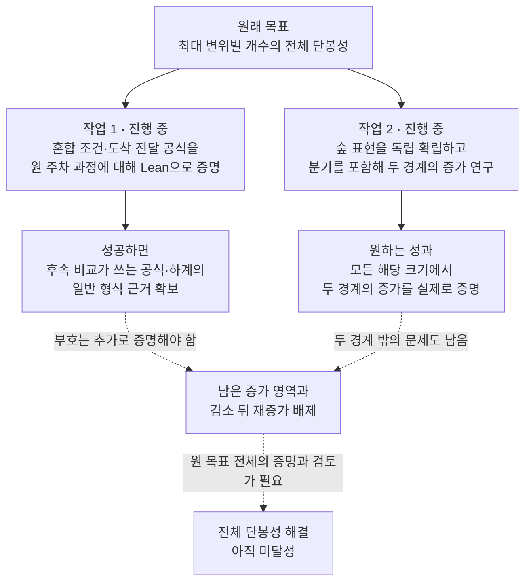

# 지금 진행하는 두 연구는 무엇을 하려는가

**2026년 10월 23일 12:01 KST 기준 설명이다.** 현재 두 작업 모두 GPT 6.1 Sol / xhigh에서 진행 중이며, 이 두 작업의 완료 결과는 아직 공개되지 않았다. 전체 단봉성 문제도 미해결이다. 이 글은 현재 인스턴스의 공개 결과·검토·배정 지시를 읽어 풀어 쓴 설명이며, 진행 중인 작업이 성공했다고 가정하지 않는다.

지금 하는 일은 두 가지다.

- **첫째:** 이미 수학적으로 검토한 세기 공식을, 원래 주차 과정을 정확히 세는 공식이라고 Lean으로 증명한다.
- **둘째:** 주차 기록을 숲 모양으로 바꿔 보고, 아직 풀리지 않은 특정 구간에서 개수가 증가하는 이유를 찾는다.

첫째는 여러 후속 증명이 함께 쓸 **공식의 근거를 완성하는 작업**이고, 둘째는 그 도구만으로 아직 얻지 못한 **새로운 부등식을 찾는 작업**이다. 둘 다 필요하지만 진척의 의미는 다르다. [현재 연구 현황][status] · [두 작업의 배정 원문][plan]

**1. 맨 처음 질문부터 다시 보면**

차가 자신의 선호 자리에서 시작해 오른쪽의 첫 빈자리에 주차한다. 차 한 대가 선호 자리에서 얼마나 밀렸는지를 ‘변위’라 하고, 모든 차 중 가장 멀리 밀린 거리를 ‘최대 변위’라 한다.

연구는 **최대 변위가 정확히 0, 1, 2, …인 성공 목록의 개수**를 차례로 놓는다. 이 개수를 $b_{n,\ell}$로 쓴다. $n$은 차의 수이고 $\ell$은 최대 변위다.

예를 들어 차가 4대일 때는 다음과 같다.

| 최대 변위 $\ell$ | 0 | 1 | 2 | 3 |
|---|---:|---:|---:|---:|
| 성공 목록의 개수 | 24 | 51 | 34 | 16 |

24에서 51로 증가한 다음 34, 16으로 감소한다. 연구 목표는 **차가 몇 대이든 이런 식으로 한 번 올라갔다가 내려가는가**다. 꼭대기가 평평하거나 처음부터 감소해도 허용한다.

실제로 풀어야 할 것은 이웃한 두 칸의 차이다.

$$
\Delta_{n,\ell}=b_{n,\ell+1}-b_{n,\ell}\qquad(\ell\ge1).
$$

양수면 다음 칸이 더 크고, 음수면 다음 칸이 더 작다. 전체 단봉성을 증명하려면 **감소가 나타난 뒤 나중에 다시 증가하는 일이 없다는 것**을 보여야 한다. 정본에서 $\Delta_{n,0}$은 정의하지 않으므로 첫 비교 $b_{n,1}-b_{n,0}$는 따로 다룬다.

현재는 차 1~14대의 전체 단봉성을 Lean으로 인증했고, 차의 수가 임의로 커져도 적용되는 일부 증가·감소 범위를 얻었다. 하지만 모든 크기와 모든 위치를 덮지는 못했다. [작은 크기와 일부 증가 범위의 검토][small-review]

**2. 최근에 증명한 ‘도착 번호 단조성’은 무엇인가**

목록을 더 잘게 나누기 위해 **최대 변위를 마지막으로 달성한 차가 몇 번 차인가**를 기록했다. 여러 차가 같은 최대 변위를 내면 그중 가장 늦게 도착한 차를 고른다.

예를 들어 변위가 $(0,1,1)$이면 2번과 3번 차가 함께 최대 변위 1을 냈으므로 마지막 달성 차량은 3번이다. 변위가 $(0,1,0)$이면 2번이다. 이렇게 하면 목록 하나가 정확히 한 묶음에 들어간다.

차가 3대일 때 실제 개수는 다음과 같다.

| 최대 변위 | 마지막 달성 차량 1번 | 2번 | 3번 | 합계 |
|---|---:|---:|---:|---:|
| 0 | 0 | 0 | 6 | 6 |
| 1 | 0 | 2 | 5 | 7 |
| 2 | 0 | 0 | 3 | 3 |

이 표는 설명을 위해 원 주차 규칙으로 27개 선호 목록을 직접 열거해 확인했다. 작은 예의 확인과 일반 증명은 구별한다.

최근 독립 검토까지 완료한 일반 정리는 **각 행을 왼쪽에서 오른쪽으로 읽으면 개수가 줄지 않는다**는 것이다. 예를 들어 최대 변위 1의 행에서는 $0\le2\le5$다. 일반적으로 마지막 달성 차량 번호를 $t$라 할 때

$$
b^{(t)}_{n,\ell}\le b^{(t+1)}_{n,\ell}
$$

임을 모든 $n\ge2,\ \ell\ge0,\ 1\le t<n$의 원 주차 목록에 대해 Lean으로 증명했다. [도착 번호 정리와 독립 검토][arrival-review]

그러나 원래 문제는 **오른쪽 합계 열을 위에서 아래로 읽을 때**의 모양이다. 이 예에서는 $(6,7,3)$이다. 각 행이 오른쪽으로 증가한다는 사실만으로 합계 열이 단봉이라는 결론은 나오지 않는다.

이것이 최근 진척을 이해할 때 가장 중요한 구분이다. **도착 순서라는 새로운 방향의 일반 구조를 알아냈지만, 목표인 최대 변위 방향의 모양까지 증명한 것은 아니다.**

**3. 첫 번째 진행 작업: ‘앞쪽 차와 뒤쪽 차의 조건이 다른 경우’도 정확히 나눠 센다**

기존 누적 개수 $A_{n,\ell}$는 모든 차에게 똑같이 “변위가 $\ell$ 이하”라는 조건을 준다. 최근에는 도착 순서를 활용하기 위해 조건을 두 부분으로 나눈다.

> 앞의 $j$대에는 변위 $\ell$까지 허용하고, 그 뒤의 차들은 변위가 $\ell$보다 작아야 한다.

이 조건을 만족하는 성공 목록 수가 **혼합 문턱 개수**다. 이름은 복잡하지만, 앞쪽과 뒤쪽의 허용 거리가 한 칸 다르다는 뜻이다.

차 3대, 문턱 1로 보면 더 쉽다. 변위는 정수이므로 “1보다 작다”는 것은 0이라는 뜻이다.

| $j$ | 각 차의 허용 최대 변위 | 조건을 만족하는 목록 수 | 직전 단계보다 늘어난 수 |
|---:|---|---:|---:|
| 0 | $(0,0,0)$ | 6 | — |
| 1 | $(1,0,0)$ | 6 | 0 |
| 2 | $(1,1,0)$ | 8 | 2 |
| 3 | $(1,1,1)$ | 13 | 5 |

한 차씩 제한을 풀 때 늘어나는 수 $(0,2,5)$가 바로 앞 표의 ‘최대 변위 1, 마지막 달성 차량별 개수’다. 합하면 최대 변위가 **정확히** 1인 목록 수 $7$이 된다. 마지막 행의 $13$은 최대 변위가 **1 이하**인 누적 개수이므로 서로 다른 수다.

현재 첫 번째 작업은 이런 혼합 조건의 개수를 **더 작은 두 주차 문제의 개수로 정확히 분해하는 일반 공식**을 Lean으로 증명하고 있다.

핵심은 마지막 차의 자리다. 마지막 차가 들어오기 직전 그 자리는 비어 있다. 따라서 앞서 주차한 차들은 그 빈자리를 건너서 주차할 수 없고, 왼쪽과 오른쪽의 두 작은 문제로 나눌 수 있다.

모든 차에게 같은 제한을 줄 때의 분해는 이미 Lean으로 증명했다. 이번에는 제한이 다른 앞쪽 차·뒤쪽 차, 그리고 최대 변위를 낸 특정 차의 표시까지 보존해야 한다. 그래서 다음을 모두 연결해야 한다.

- 앞쪽 차 중 몇 대가 왼쪽에 가고, 뒤쪽 차 중 몇 대가 왼쪽에 가는가?
- 각 작은 문제 안에서 원래의 도착 순서를 유지하는가?
- 두 작은 문제를 합치면 실제로 원 주차 규칙대로 성공하는가?
- 목록 하나를 중복해서 세거나 빠뜨리지 않는가?
- 왼쪽이나 오른쪽이 비어 있는 경우, 허용 거리가 0인 경우도 맞는가?

이 작업은 단순히 계산 코드를 다시 실행하는 검사가 아니다. **모든 크기와 모든 허용 거리에서 공식이 원 목록을 정확히 센다는 증명**이다. 일반 혼합·도착 전달 공식의 비형식 논증은 이미 독립 검토가 수용했지만, 그 전체 원 과정 연결의 Lean 증명이 남아 있었다. 두 후속 연구가 이 공식을 공통으로 사용하므로 지금 그 빈틈을 메우고 있다. [일반 전달의 기존 연구][transport] · [그 검토 범위][transport-review]

그 연결을 얻은 뒤에는 허용 거리를 하나 늘렸을 때의 변화량과, 그 변화량보다 작거나 같은 두 하계를 연결한다. 문서에 나오는 $Z^0,Z^1$은 그런 하계의 이름이다. 중요한 점은 다음과 같다.

> “이 값은 실제 증가량보다 작거나 같다”를 증명하는 것과, “이 값은 항상 0 이상이다”를 증명하는 것은 별개다.

첫 번째 작업이 완료되면 후속 부등식 연구가 쓸 일반 공식과 하계의 형식 근거가 강화된다. **그 자체로 앞 절반 증가나 전체 단봉성이 해결되지는 않는다.**

**4. 두 번째 진행 작업: 숲으로 바꿔서, 서로 상쇄되는 기여를 더 정확히 본다**

현재까지 여러 접근은 실제 차분을

> 양수 기여의 합 − 음수 기여의 합

으로 나눴다. 문제는 두 양을 각각 거칠게 추정하면 실제로는 양수인 차이도 음수처럼 보일 수 있다는 점이다.

가령 실제 계산이 $100-97=3$인데, 첫 양은 최소 95라고만 알고 둘째 양은 최대 99라고만 알면, 얻는 하계는 $95-99=-4$다. **음수 하계가 나왔다고 실제 차이가 음수인 것은 아니다.** 이 숫자는 원 주차 계수가 아니라 추정 실패를 설명하는 예다.

실제 연구에서도 그런 일이 일어났다. 강화한 하계가 실패했던 지점에서 더 정확한 전달을 계산하자 실제 하계와 원 차분은 양수였다. 다만 그 몇 지점의 정확 계산으로 일반 부호 문제를 해결하지는 못했다. [최근 공통 전달 연구의 검토][common-review]

새 Opus 탐구는 이 상쇄를 주차 목록의 **숲 모양**에서 보자고 제안했다. 여기서 숲은 여러 나무로 이루어진 유한 그래프다. 차 번호를 꼭짓점으로 쓰고, 각 차의 오른쪽에 있는 차 중 자신보다 늦게 온 가장 가까운 차를 부모로 정한다. 그런 차가 없으면 뿌리가 된다.

탐구가 제안한 그림은 “숲의 모양”과 “각 꼭짓점에서 고르는 변위”로 원 목록을 나타내는 것이다. 예를 들어 한 꼭짓점과 그 아래 자손이 모두 3개라면, 그 부분나무 크기는 3이다. 그 크기 안에서 변위를 고르는 식으로 세기를 바꾸려 한다.

**이 표현의 일반 전단사·가중합 연결은 아직 이번 연구에서 다시 확립해야 할 대상이다.** 탐구에 논증과 작은 계산이 있어도 그대로 수용된 정리로 쓰지 않는다. 원 목록과 숲 자료가 정말 일대일인지 증명하거나, 두 개수의 점화식과 초기값이 같다는 다른 일반 논증을 완성해야 한다. 두 종류의 연결을 혼동하지도 않는다. [탐구 원문][forest-explore] · [최신 정본의 숲·골격 정의][glossary]

**5. 왜 ‘골격’과 ‘두 경계’를 연구하는가**

숲의 모든 부분을 똑같이 복잡하게 볼 필요는 없다. 허용 거리보다 큰 영향을 줄 수 있는 큰 부분나무만 남겨 보자는 것이 **골격**이다. 정확히는 크기가 어떤 문턱 $x$보다 큰 부분나무의 뿌리들을 모은다.

큰 부분나무 두 개가 서로 겹치지 않고 나란히 있으려면 차의 수가 충분히 많아야 한다. 자리가 부족하면 그런 두 덩어리가 공존할 수 없고, 큰 부분나무들이 포함 관계로 이어지는 사슬 모양만 남는다. 그래서 특정 범위에서는 계산이 간단해질 가능성이 있다.

지금 선택한 핵심 비교는 다음 두 가족이다.

| 경계 | 실제로 보여야 할 것 | 첫 대상의 예 |
|---|---|---|
| 짝수 경계 | 모든 $\ell\ge7$에서 $b_{2\ell+2,\ell+1}\ge b_{2\ell+2,\ell}$ | 차 16대에서 최대 변위 7보다 8인 목록이 적지 않은가? |
| 홀수 경계 | 모든 $\ell\ge6$에서 $b_{2\ell+3,\ell+1}\ge b_{2\ell+3,\ell}$ | 차 15대에서 최대 변위 6보다 7인 목록이 적지 않은가? |

왜 여기서 조심해야 할까? 예를 들어 차가 16대이고 문턱 $x=7$이면, **크기 8인 서로 떨어진 두 부분나무**가 들어갈 수 있다. 하지만 $x=8$이면 서로 떨어진 두 큰 부분나무는 각각 적어도 9개씩 필요하므로 들어갈 수 없다.

즉 이 경계에서는 문턱이 한 칸 바뀌는 것만으로 **허용되는 큰 구조의 종류가 바뀐다.** 한 줄 사슬만 계산하는 공식을 모든 항에 적용하면, 낮은 문턱에서 가능한 분기를 놓칠 수 있다.

현재 두 번째 작업은 그 분기를 빠짐없이 세려고 한다. 두 큰 덩어리가 별도 나무인지, 공통 조상을 갖는지, 다른 작은 가지가 얼마나 붙을 수 있는지 등을 원 개수와 연결해야 한다. 위 크기 8의 예는 가능한 구조를 설명하는 예이지, 모든 구조의 분류를 대신하지 않는다.

그렇게 정확히 나눈 다음에도 최종 질문은 남는다.

> 여러 모양에서 생기는 증가 기여를 모두 합하면, 감소 기여를 모든 $\ell$에서 감당하는가?

각 숲 모양이 따로 증가해야 한다는 강한 조건을 요구하지 않는다. 일부 모양의 기여는 음수일 수 있고, **원 목표는 모든 모양을 합친 개수**에 관한 것이기 때문이다.

**6. 두 작업은 어떻게 함께 전체 문제를 향하는가**

[그림 PNG](diagrams/04-current-two-tasks.png) · [확대용 SVG](diagrams/04-current-two-tasks.svg)

두 연구는 서로의 미공개 결과를 기다리는 구조가 아니다. 각자 이미 공개된 기반에서 진행한다. 첫째는 혼합·도착 표현을 다지는 작업이고, 둘째는 숲 표현을 통해 새 부호 논증을 찾는 작업이다.

현재의 전체 증명 경로는 작은 크기의 결과에 더해 **앞 절반의 증가 L**과 **뒤 절반에서 감소 후 재증가하지 않는 성질 U**를 얻는 것이다. 두 경계가 모두 해결돼도 L의 내부 범위와 U는 남는다. L/U는 선택한 증명 경로이며, 다른 직접 증명이나 엄밀한 반증의 가능성을 배제하지 않는다.

**7. 앞으로 어떤 결과가 나오면 무엇이 진전된 것인가**

| 다음 보고에 나올 수 있는 말 | 실제 의미 |
|---|---|
| “혼합 재귀와 도착 전달의 일반 Lean 연결 완료” | 여러 연구가 의존하던 공식을 원 대상에서 형식적으로 증명한 성과. 전체 부호 해결은 아님 |
| “숲 표현과 원 개수의 일반 동일성 증명” | 새 표현으로 원 문제를 연구할 근거 확보. 부등식 자체는 남을 수 있음 |
| “경로·분기 보정의 정확한 식을 얻음” | 무엇을 비교해야 하는지 더 정확히 알게 됨. 식의 부호가 미증명이면 두 경계도 미해결 |
| “짝수 또는 홀수 경계의 전칭 증가를 증명” | 무한히 많은 원래 입력의 부호 문제를 실제로 해결한 성과. 새로 닫힌 범위를 명시해야 함 |
| “몇백·몇천까지 반례 없음” | 유한 관측. 모든 크기의 증명은 아님 |
| “보조 하계가 음수” | 해당 추정이 부족할 수 있음. 원 차분의 음수 또는 P의 반례와 구별해야 함 |

따라서 지금은 **“이미 만든 공식을 더 단단히 연결하는 일”과 “그 공식·새 표현으로 아직 모르는 부등식을 푸는 일”이 나란히 진행되는 시점**이다. 최근 도착 번호 정리의 형식화는 완료됐지만, 지금 연구 중인 일반 전달 공식과 숲 경계 부호는 아직 별개의 미완료 과제다.

기준 시각에는 실행기가 정상이며 두 연구가 진행 중이었다. 새 결과가 공개되면 Sol 독립 검토가 기본 medium으로 이어진다. 최종 판단은 공개된 논증·정리의 범위와 그 검토를 기준으로 해야 한다.

**읽을 자료와 설명의 범위**

- [현재 공개 색인][index]: 이후 결과와 검토가 추가되는 위치.
- [현재 연구 현황][status]: 두 작업과 남은 전체 의무.
- [두 작업의 배정 원문][plan]: 각 작업의 정확한 완료 조건.
- 이 글의 차 3대 표는 설명을 위해 새로 직접 계산했다. 일반 결과의 수용 여부는 연결된 연구·검토 기록을 따른다.
- 이 글은 진행 중 세션의 비공개 풀이를 평가한 문서가 아니다. 이전 run의 결과도 이 설명이나 현재 연구의 근거로 가져오지 않았다.

[index]: ../../../.skill-workspace/do-math/parking-unimodality-fresh-20261023-014524/knowledge/index.md
[status]: ../../../.skill-workspace/do-math/parking-unimodality-fresh-20261023-014524/knowledge/k7e91926ab4c342b3815022ec708f82bd/research-status.md
[plan]: ../../../.skill-workspace/do-math/parking-unimodality-fresh-20261023-014524/knowledge/ka372020d7f46458b80d8dfba3f339c14/output.json
[glossary]: ../../../.skill-workspace/do-math/parking-unimodality-fresh-20261023-014524/knowledge/k7e91926ab4c342b3815022ec708f82bd/glossary.md
[small-review]: ../../../.skill-workspace/do-math/parking-unimodality-fresh-20261023-014524/knowledge/kb196a5163fc74633b71d21d0bc248fa2/review.md
[arrival-review]: ../../../.skill-workspace/do-math/parking-unimodality-fresh-20261023-014524/knowledge/kf60b5d44129f444b9c13cfa739536768/review.md
[transport]: ../../../.skill-workspace/do-math/parking-unimodality-fresh-20261023-014524/knowledge/k3402f089d15b489eb2cbad3ffa444bb7/exposition.md
[transport-review]: ../../../.skill-workspace/do-math/parking-unimodality-fresh-20261023-014524/knowledge/kfd8c65fff6a84089ad0591255b0674a3/review.md
[common-review]: ../../../.skill-workspace/do-math/parking-unimodality-fresh-20261023-014524/knowledge/k9ec509cf72594adeb4ffac9e09a9f6bd/review.md
[forest-explore]: ../../../.skill-workspace/do-math/parking-unimodality-fresh-20261023-014524/knowledge/kb555148741aa4c0687e60906bd144e43/exploration.md
