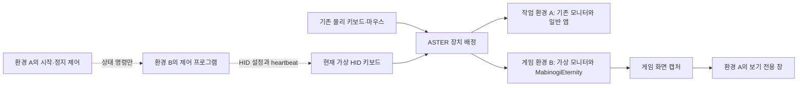

# 다른 창을 사용하면서 MabinogiEternity에만 HID 입력을 적용하는 방안

기준일: 2026-09-06, 한국 시간. 이 문서는 조사 결과와 후속 검증안이다. 설치·구매·보안 설정 변경을 확정하는 실행 지시가 아니다. 사실의 근거는 Microsoft API 문서, 제품 제작사의 문서와 공개 소스, 이 PC의 읽기 전용 관찰이다. 제품의 일반 지원, 이 PC에서의 실측, 조합에 대한 추론을 구분한다. 사용자 의도는 이 문서보다 현재 대화가 우선한다.

**가장 조건에 가까운 구성은 ASTER 멀티시트 + 제작사가 안내한 가상 모니터 + 현재 가상 HID다.** 같은 Windows에 작업용 환경과 게임용 환경을 만들고 입력 장치를 나누는 방법이다. 가상 머신과 추가 물리 장비는 필요하지 않는 구성을 설계할 수 있다. ASTER 제작사가 가상 모니터로 workplace를 만드는 절차를 실제로 공개했다. 다만 해당 절차 전체가 이 PC와 게임에서 검증된 것은 아니다. 특히 현재 Secure Boot가 켜져 있는데 ASTER v3 공식 제한은 해제를 요구하므로, 현 설정 그대로 적용할 수 있다고 추천하지 않는다. [ASTER 가상 디스플레이 구성](https://dokwiki.ibiksoft.com/en/v3/core/article/virtualdispalys), [ASTER v3 제한](https://dokwiki.ibiksoft.com/en/v3/core/faq/faq_limitations)

**1. 확정된 요구와 성공 기준**

사용자는 추가 PC·USB 장비를 사용할 수 없고, 자원 부족으로 가상 머신도 어렵다고 확정했다. 목표는 기존 F·B 반복과 F1 전환을 유지하면서 일반 작업 창을 계속 사용하는 것이다. 현재 주기는 F·B 눌림·해제 200초 → F1 한 번 → 정지 500초 → F1 한 번 → 반복이다. 정확히 200초 동안 키를 계속 누르고 있는 동작이 아니다. [현재 주기 코드](../driver/repeat_cycle.h)

이 조사에서 HID 경로 유지란 **가상 장치가 생성한 보고서를 Windows 장치 입력 경로로 소비하는 것**이다. 현 드라이버도 소프트웨어가 만든 UMDF 2 가상 HID이므로 물리 스위치가 눌린 사건은 아니다. 게임에 `SendInput`, `PostMessage(WM_KEYDOWN/WM_INPUT)`, 가짜 키 상태 또는 가짜 Raw Input 버퍼를 직접 공급하는 것을 동등한 해결로 보지 않는다. 현 보고서 구조에는 대상 PID나 창 핸들 필드가 없다. [보고서 구조](../driver/inc/common.h), [드라이버](../driver/vhidmini.c)

판정할 조건은 다음과 같다.

- 작업 창을 클릭하고 타이핑해도 게임 반복이 유지된다.
- 자동 F·B·F1이 작업 창의 문자, 단축키, Raw Input 처리에 섞이지 않는다.
- 사용자가 직접 누른 F·B와 한글 조합, Shift/Ctrl/Alt 조합, 마우스 조작은 작업 창에서 정상 동작한다.
- 게임 반복 입력은 원래 HID 보고에서 유래하고, 게임에 키 메시지나 읽기 결과를 만들어 전달하지 않는다.
- 정지·게임 종료·장치 재배정·제어 연결 단절 시 잘못된 환경으로 입력을 계속 보내지 않는다.

다른 창에서 F와 B가 우연히 아무 기능도 하지 않는 것, 게임 창으로 잠깐씩 포커스를 옮기는 것, 작업용 키보드 전체를 잠그는 것은 성공으로 세지 않는다.

**2. 직접 확인한 환경과 실험**

| 대상 | 관찰 | 해석 한계 |
|---|---|---|
| 운영체제 | Windows 11 Pro, 빌드 22631 | 다른 Windows 판본의 동작으로 확대하지 않음 |
| 자원 | i5-4570 4코어/4스레드, RAM 약 16 GiB, GTX 970 | 별도 세션의 충분한 성능을 보장하지 않음 |
| 화면 | WmiMonitorID에서 활성 항목 1개 | 모든 논리 디스플레이를 세는 API는 아님 |
| Secure Boot | `UEFISecureBootEnabled=1` | 레지스트리 상태 관찰. 해제하지 않음 |
| Raw Input 등록 | 자기 프로세스 창: 성공. 다른 프로세스 창: 실패, 오류 87 | 독립 시험 프로세스 두 개에서 실측. 게임을 대상으로 시험하지 않음 |
| 게임 실행 파일 | Raw Input, 키 상태, 포커스, XInput 함수 import 확인 | 실제 조작 경로·게임패드 지원·백그라운드 수신의 증명은 아님 |
| 게임 저장 설정 | 열람한 INI에서 background/focus/gamepad/raw-input 옵션 미발견 | 엔진 기본값이나 게임 내부 설정의 부재를 뜻하지 않음 |

실험 코드는 [probe_raw_registration.py](probe_raw_registration.py), 결과는 [observations.json](observations.json)에 보존했다. 이 코드는 자기 프로세스와 자식 프로세스에 숨겨진 창을 만들고 `RIDEV_INPUTSINK` 등록만 시도한다. 키를 생성·기록·차단·전달하지 않는다. 양성 대조인 자기 창 등록이 성공했기 때문에, 다른 창 등록 실패를 단순한 실행 환경 오류와 구분할 수 있다.

게임의 [선별 import 기록](game-input-imports.txt)은 로컬 실행 파일을 `dumpbin /imports`로 읽은 것이다. 검사 대상 SHA-256은 `8615BC2D35FE5A0765F362FEDDBD62BFBC3450C434F7DD83CC3ADF64643AB0A2`다. 프로세스 내부 코드를 실행하거나 메모리를 수정하지 않았다.

**3. 후보를 가르는 Windows 입력 구조**

일반 키보드 메시지는 포커스를 가진 창으로 간다. Raw Input은 별도의 수신 등록이며, `RIDEV_INPUTSINK`로 등록한 앱은 백그라운드에서도 받을 수 있다. 이는 앱의 수신 기능이지, 송신 장치에 특정 게임을 목적지로 붙이는 기능이 아니다. 이 PC의 무입력 실험에서는 다른 프로세스의 숨은 시험 창 HWND를 등록하는 호출이 오류 87로 실패했다. 게임 창을 직접 대상으로 한 결과는 아니므로, 이 관찰만으로 모든 창·권한 조합의 불가능을 입증했다고 쓰지는 않는다. 외부 프로그램에서 게임 HWND만 지정하면 된다는 방안을 채택할 긍정 근거는 얻지 못했다. [키보드 포커스](https://learn.microsoft.com/en-us/windows/win32/inputdev/about-keyboard-input#keyboard-focus-and-activation), [Raw Input 등록](https://learn.microsoft.com/en-us/windows/win32/api/winuser/nf-winuser-registerrawinputdevices)

`RIDEV_NOLEGACY`는 등록한 앱에 대한 기존 키 메시지를 제어한다. 작업 중인 모든 다른 앱의 입력을 해당 게임 대신 차단해 주지 않는다. `RIDEV_EXINPUTSINK`도 전경 앱의 Raw Input 사용 여부에 의존하므로 어느 작업 창을 쓰든 동일하게 동작해야 한다는 기준에 맞지 않는다. [RAWINPUTDEVICE 플래그와 Remarks](https://learn.microsoft.com/en-us/windows/win32/api/winuser/ns-winuser-rawinputdevice)

키보드 장치는 Windows Raw Input Manager가 독점 접근하는 장치 범주다. 따라서 게임 프로세스만 HID 장치 파일을 열도록 허용하는 방화벽 모델을 키보드 입력 라우팅과 동일시할 수 없다. 드라이버 단계에서 보고서를 아예 버리면 게임이 소비해야 할 보고서도 사라질 수 있다. [Microsoft HID 구조](https://learn.microsoft.com/en-us/windows-hardware/drivers/hid/hid-architecture)

**4. 후보 비교**

| 방안 | 요청 조건 적합성 | 판정 |
|---|---|---|
| ASTER + Rust 가상 모니터 + 현재 가상 HID | 별도 OS 없이 입력 환경을 나눌 수 있음. 게임에는 HID 경로를 유지하는 설계 | 우선 검증 후보. 공식 기본 구성 있음. Secure Boot·현 HID·게임·성능 미결 |
| 게임의 원래 백그라운드 키보드 입력 + 선택적 차단 | 합성 키 전달을 피할 가능성 | 게임 수신과 작업 창 차단 모두 미검증. 완성안으로 추천 불가 |
| 가상 게임패드 + 게임의 기본 버튼 매핑 | 장치 입력 유지 가능. F/B 문자 누출은 피하기 쉬움 | 게임의 동작 매핑·백그라운드 지원 미확인. 키보드 유지 요구를 바꾸는 대안 |
| ProtoInput/Nucleus의 기본 입력 전달 | 장치 구분과 비활성 게임 지원 사례 있음 | 소스상 메시지 재전달·키 상태 대체가 있어 현재 조건과 불일치 |
| 포커스 관련 처리만 바꾸는 최소 호환층 | 키 값 자체를 합성하지 않는 설계는 가능 | 수신 경로와 작업 창 누출은 따로 해결해야 함. 게임 내부 개입과 호환성 미결 |
| Interception·HidHide·커널 키보드 필터만 추가 | 장치 식별·차단 기능은 관련 있음 | 단독으로 비활성 게임을 목적지로 만들지 못함 |
| 일반 가상 데스크톱·숨은 Win32 desktop | 추가 장비 없이 창을 분리 | 입력 desktop은 한 번에 하나이므로 독립 입력 환경이 되지 않음 |
| 주기적으로 게임을 활성화했다가 복원 | 구현 가능성은 높음 | 다른 창을 계속 사용한다는 조건 위반 |
| VM·추가 PC·외부 USB HID 장치 | 환경 격리는 가능 | 사용자가 제외함 |

**5. 주력 구성: ASTER로 게임의 포커스 범위를 분리한다**

ASTER는 한 Windows에서 여러 workplace를 만들고 키보드·마우스를 배정한다. 제작사의 가상 디스플레이 가이드는 MolotovCherry의 Rust 가상 모니터를 생성하고 이를 별도 workplace에 배정하는 과정을 명시한다. 따라서 추가 모니터가 반드시 물리 장비여야 한다고 결론내릴 근거는 없다. 문서의 드라이버는 [MolotovCherry/virtual-display-rs](https://github.com/MolotovCherry/virtual-display-rs)이며, 비슷한 이름의 다른 Virtual Display Driver 제품과 혼동하지 않는다. [ASTER 구성 원문](https://dokwiki.ibiksoft.com/en/v3/core/article/virtualdispalys)

제안 구조는 다음과 같다. 화살표는 설계상 데이터 흐름이며, 전체 구성을 실기 검증했다는 뜻은 아니다.

작업 창은 환경 A에서 자유롭게 활성화한다. 게임은 환경 B에서 활성 창을 유지한다. 자동 키보드는 B에만, 물리 키보드·마우스는 A에만 배정한다. **게임 자체를 비활성으로 만든 뒤 입력을 강제로 받게 할 필요를 줄이는 구성**이다. ASTER의 장치 배정 기능에서 도출한 설계이며 현재 가상 HID에 대한 검증이 필요하다. [장치 배정과 workplace 시작](https://dokwiki.ibiksoft.com/en/v3/core/ugd/ugd_config)

가상 모니터만 설치하면 이 구조가 생기지는 않는다. IDD는 표시 장치를 만들며, 별도 입력 환경은 ASTER가 맡는다. 가상 모니터 둘을 같은 일반 데스크톱에 놓으면 기존 포커스 문제는 남는다. [Microsoft IDD 모델](https://learn.microsoft.com/en-us/windows-hardware/drivers/display/indirect-display-driver-model-overview)

**같은 PC에서 게임 화면을 보는 경로.** ASTER 공식 가이드는 별도 원격 PC의 Parsec 접속을 예로 들므로 이를 그대로 완료안으로 쓰면 추가 PC 금지에 어긋난다. 여기서는 게임 환경에서 사용자 앱 모드의 UltraVNC 서버를 실행하고, 작업 환경에서 loopback 연결로 화면만 보는 변형을 후보로 둔다. ASTER는 추가 workplace의 UltraVNC 사용을 설명하며, UltraVNC는 같은 PC 연결과 viewer 입력 차단 기능을 제공한다. 이 기능들의 결합은 근거 있는 **추론**이다. 현재 Windows·가상 화면·게임 렌더러를 정확히 캡처하는지는 시험해야 한다. [ASTER의 원격 접근 설명](https://dokwiki.ibiksoft.com/en/v2/core/faq/faq_terminals), [UltraVNC loopback와 입력 차단](https://uvnc.com/docs/ultravnc-server/49-ultravnc-server-configuration.html)

VNC를 반복 입력 송신기로 쓰지 않는다. 서버의 viewer 입력을 차단하고 보기만 허용한다. 연결은 로컬 PC 안으로 한정한다. 초기 로그인·게임 실행 조작이 필요하면 반복을 정지한 상태에서 기존 물리 키보드·마우스를 잠시 게임 환경에 배정하는 방식을 먼저 시험한다. 다시 작업 환경에 돌려놓은 뒤에만 반복을 시작한다. 이 초기 조작과 화면 확인이 실제로 가능해야 전체 사용성이 성립한다.

**현 제어 프로그램에 필요한 변경.** F8/F9는 현재 제어 프로그램이 자기 환경에서 키 상태를 읽는 방식이다. 물리 키보드를 A에만 배정하면 B의 제어 프로그램이 A의 F9를 자동으로 보게 된다고 가정할 수 없다. 따라서 A에 시작·정지 UI를 두고 B의 제어기와 로컬 IPC로 상태 명령을 주고받는 변경이 필요하다. 이 IPC는 키 입력을 게임에 보내는 API가 아니라, 현재 드라이버의 활성 상태를 조절하는 통신이다. [현 제어 프로그램](../controller/Program.cs)

기본적으로 시작은 명시 동작으로 하고, 제어 연결이 끊어지면 정지한다. 현 1.5초 heartbeat 중단 보호를 유지하되, 게임 환경의 제어기가 작업 환경과 단절된 채 계속 heartbeat를 보내지 않게 한다. 장치 재배정과 ASTER 비상 복구 단축키는 별도 검증 대상이다. 공식 문서는 Ctrl+F12가 장치 배정을 복구할 수 있다고 설명하므로, 반복 중 이 동작으로 가상 HID가 작업 환경에 옮겨오는 경우를 반드시 시험한다. 관찰 수단이 없어 이를 막을 수 없다면 자동 재배정과 반복을 함께 쓰는 구성을 승인하지 않는다. [ASTER 키보드 배정](https://dokwiki.ibiksoft.com/en/v3/core/ugd/ugd_config)

**적용을 막는 현재의 선결 조건.** ASTER v3 제작사는 Secure Boot 해제와 Memory Integrity 비호환을 명시한다. 이 PC는 Secure Boot 레지스트리 값이 1이다. HVCI 상태는 이번 조회에서 확정하지 못했다. 따라서 ASTER를 단순히 설치하면 되는 가벼운 설정 변경으로 설명하면 부정확하다. 현재 보안 설정에서 지원되는 판본이나 공식 대안이 확인되지 않으면 보안 설정을 유지한 채 이 후보를 적용할 수 있다고 주장하지 않는다. 이 조사는 설정을 바꾸지 않았다. [ASTER v3 요구](https://dokwiki.ibiksoft.com/en/v3/core/faq/faq_limitations), [현 환경 관찰](observations.json)

ASTER는 유료 제품이며 제작사 문서는 기능 시험 기간을 제공한다고 설명한다. 구매는 검증 통과 뒤의 선택이다. 추가 Windows 사용자 환경·화면 캡처의 메모리와 CPU/GPU 사용량은 0이 아니며, 이 PC에서 충분한지는 측정 전에는 알 수 없다. [ASTER 시험 사용 안내](https://www.dokwiki.ibiksoft.com/en/v2/core/ugd/ugd_licensing)

**6. 같은 세션 안의 대안과 배제 이유**

**기존 백그라운드 수신 활용.** 게임이 원래 비활성 상태에서 HID 키보드를 처리한다면 게임 수신 조건 하나는 충족된다. 그러나 작업 창에 전달되는 자동 키와 사용자의 실제 타이핑을 구분해 차단하는 문제는 남는다. Low-level keyboard hook의 구조체에는 Raw Input의 `hDevice`가 없다. F/B/F1이라는 키 값만 보고 차단하면 사용자가 직접 누른 같은 키까지 막는다. 시간 근접성으로 두 이벤트를 짝짓는 방안도 동시 입력에서 잘못 짝지을 수 있다. [KBDLLHOOKSTRUCT](https://learn.microsoft.com/en-us/windows/win32/api/winuser/ns-winuser-kbdllhookstruct)

저수준 훅의 차단과 게임의 Raw Input 수신이 어떤 순서로 상호작용하는지도 이 환경에서 미검증이다. 훅에서 차단하면 작업 창만 사라지고 게임 수신은 보존된다고 단언하지 않는다. 입력 태그를 다는 전용 필터를 만들더라도, 이는 장치 구별을 돕는 것일 뿐 특정 게임으로의 전달을 증명하지 않는다. 다른 Raw Input 소비자까지 포함한 차단 여부가 추가로 필요하다. [LowLevelKeyboardProc의 반환·실행 조건](https://learn.microsoft.com/en-us/windows/win32/winmsg/lowlevelkeyboardproc)

**가상 게임패드.** 현재 게임 바이너리에 `XInputGetState`가 있다는 점에서 조사 가치가 있다. 상호작용·줍기·F1로 수행하는 동작을 게임이 기본 게임패드 버튼에 매핑하고 백그라운드에서도 처리한다면 키보드 문자 누출 문제를 줄일 수 있다. 하지만 import만으로 이 세 조건이 입증되지는 않는다. 일반 HID 게임패드 descriptor를 만들었다고 XInput 장치가 되는 것도 아니다. 이 대안은 F/B/F1이라는 키 자체의 유지보다 같은 게임 동작을 목표로 바꾸는 선택이므로 사용자 결정 없이 적용하지 않는다. 널리 쓰였던 ViGEmBus는 제작사가 유지 종료를 선언했으므로 새로 유지되는 기반처럼 추천하지 않는다. [현 import](game-input-imports.txt), [ViGEm 유지 종료](https://docs.nefarius.at/projects/ViGEm/End-of-Life/)

**ProtoInput/Nucleus.** 실제 키보드별 분리와 포커스 호환 처리가 가능한 공개 구현이다. 그러나 열람한 커밋 `e18e06bb345b86540e7464f7355c649bfdd17f38`의 `RawInput.cpp`는 받은 보고서를 자체 버퍼에 저장하고 서명값을 붙여 `PostMessageW(WM_INPUT, ...)`로 전달한다. `GetRawInputDataHook.cpp`는 그 서명값을 인식해 자체 버퍼를 반환한다. 키보드 메시지를 별도로 보내는 경로도 있다. 따라서 도구 이름에 Raw Input이 들어간다는 이유로 원래 Windows HID 수신과 동일시할 수 없다. [RawInput.cpp](https://github.com/SplitScreen-Me/splitscreenme-protoInput/blob/e18e06bb345b86540e7464f7355c649bfdd17f38/src/ProtoInput/ProtoInputHooks/RawInput.cpp), [GetRawInputDataHook.cpp](https://github.com/SplitScreen-Me/splitscreenme-protoInput/blob/e18e06bb345b86540e7464f7355c649bfdd17f38/src/ProtoInput/ProtoInputHooks/GetRawInputDataHook.cpp)

포커스 관련 함수만 바꾸는 최소 호환층은 입력 값을 합성하지 않는 방향으로 별도 설계할 수 있다. 그래도 게임의 실제 입력 수신과 작업 창 누출을 자동으로 해결하지 못한다. 게임 프로세스 내부에 코드를 넣는 변경이기도 하므로, 게임의 명시적 지원이나 허용된 확장 경로 없이 안정성과 호환성을 보장할 수 없다. 현재 MabinogiEternity에 이를 실행하지 않았으며, 기존 마비노기의 보안 모듈 자료를 이터니티의 확정 사양으로 옮기지 않았다. [FocusHook.cpp](https://github.com/SplitScreen-Me/splitscreenme-protoInput/blob/e18e06bb345b86540e7464f7355c649bfdd17f38/src/ProtoInput/ProtoInputHooks/FocusHook.cpp)

**창 스타일·다른 데스크톱.** `WS_EX_NOACTIVATE`는 클릭 시 활성화를 피하는 스타일이고 두 개의 독립 키보드 포커스를 만드는 기능이 아니다. `AttachThreadInput`도 입력 처리 상태를 결합한다. 별도 Win32 desktop은 만들 수 있지만 표준 대화형 window station에서 입력 desktop은 한 번에 하나다. 따라서 일반 창을 그대로 사용하면서 숨은 desktop의 게임에만 표준 HID를 주는 완성안이 되지 않는다. [창 스타일](https://learn.microsoft.com/en-us/windows/win32/winmsg/extended-window-styles), [AttachThreadInput](https://learn.microsoft.com/en-us/windows/win32/api/winuser/nf-winuser-attachthreadinput), [Desktops](https://learn.microsoft.com/en-us/windows/win32/winstation/desktops)

**7. 후속 실행 순서와 통과 조건**

아래는 선택한 방안을 실제 검증할 때의 절차안이다. 이번 연구에서 실행한 범위는 위의 읽기 전용 관찰과 무입력 등록 실험까지다. 새로운 드라이버 설치, ASTER 활성화, 재부팅, 계정 생성, 게임 내부 개입은 수행하지 않았다.

| 단계 | 수행 내용 | 통과 기준 | 실패 시 다음 행동 |
|---|---|---|---|
| 0. 적용 조건 확인 | 현재 Windows·Secure Boot 설정을 지원하는 ASTER 판본, 정확한 Rust VDD 배포본과 체험 조건 확인 | 사용자가 수용하는 설정 범위에서 시작 가능 | 해당 설정을 지원하는 근거가 없으면 설치 보류. 보안 설정을 임의로 변경하지 않음 |
| 1. 두 환경만 생성 | 게임을 실행하지 않고 가상 모니터 1개와 추가 workplace 1개 생성. B용 계정·자동 로그인과 사용자 모드 캡처 앱의 시작을 미리 구성 | 기존 모니터의 작업 환경을 유지하며 B가 시작됨 | 복원 후 이 조합의 버전·장치 지원 확인 |
| 2. 화면 확인·초기 조작 | B에서 사용자 모드 캡처, A에서 loopback 보기 전용 연결. 반복 정지 중 물리 입력의 임시 배정/복귀 확인 | 한 화면에서 B의 창을 식별·준비할 수 있고 A의 작업 포커스 정상. 반복 중 VNC 키 전달 0 | 화면이 잘못된 세션을 보거나 로컬 입력이 섞이면 캡처·배정 단계 수리 |
| 3. 입력 분리 | 가상 HID를 B에만, 기존 키보드·마우스를 A에 배정. 2단계의 화면·조작 경로로 B에 자체 시험 창을 열어 짧은 입력만 검사 | B에서 자동 F/B/F1 수신. A의 시험 편집기와 Raw Input 관찰기에 자동 입력 0. A의 실제 F/B와 한글 입력 정상 | 현 UMDF 장치가 인식되지 않거나 누출되면 게임 실행으로 넘어가지 않음 |
| 4. 게임 적용 | B에서 게임 한 개 실행. 실제 HID로 동작 확인하고 A의 작업 창을 계속 사용 | 게임의 실제 동작 지속, A의 입력 오염 없음, 게임 세션 정상 | 게임 실행 거부·입력 누락이면 해당 조합 미지원으로 기록. 게임 보호 기능을 우회하는 단계로 전환하지 않음 |
| 5. 제어·장시간 검증 | A↔B 시작·정지 제어, 전체 700초 주기 두 번, 종료·단절·장치 재배정·Ctrl+F12 복구 검사 | 200/700/900/1400초 전환과 키 해제 정상. 작업 환경으로 자동 입력 0. 비상 정지 유효 | 한 항목이라도 실패하면 실사용에 투입하지 않고 그 경계를 수정하거나 후보 철회 |
| 6. 자원 비교 | 현재 게임+작업 기준선과 추가 환경·캡처 포함 구성을 같은 작업으로 비교 | 타이핑·포커스·게임 진행을 유지하며 메모리 부족이나 지속적 작업 지연이 발생하지 않음 | 표시 해상도·캡처 빈도를 낮춰 재평가. 그래도 부족하면 이 PC에서 부적합 |

단계 3의 관찰기는 가상 HID 장치의 보고만 세고 일반 타이핑 내용은 저장하지 않도록 설계한다. 단계 5에서 게임 내부의 창 전환·오류 대화상자도 살핀다. 입력 환경 B에 귀속된다는 것은 B의 어느 창이 활성화돼도 반드시 게임으로 간다는 뜻이 아니므로, 게임이 B의 전경 창인지 확인할 수 없으면 반복을 정지하는 제어가 필요하다.

먼저 장치 분리의 성립 여부를 시험한 뒤 제어기를 확장하는 순서가 적절하다. ASTER가 현재 가상 HID를 배정하지 못하는 상황에서 제어 UI부터 만드는 것은 핵심 불확실성을 해소하지 못한다.

**8. 현재 결론**

프로그램만으로 시도할 근거가 가장 분명한 방향은 **공식 가상 모니터 구성 위에 ASTER의 입력 장치 배정을 적용하는 것**이다. 동일 세션의 게임 HWND를 겨냥하는 기능을 현재 드라이버에 추가하는 방안은 Windows 입력 구조와 이번 실험으로 뒷받침되지 않는다.

남은 결정은 ASTER의 현재 보안 설정 요구와 소프트웨어 비용을 수용할지다. 남은 기술 검증은 현재 가상 HID의 workplace 배정, 로컬 보기 전용 화면, 게임 실행·입력 호환성, 자원 사용량이다. 이 네 항목을 통과하기 전에는 MabinogiEternity에 대한 작동 보장을 하지 않는다. 주력 구성의 환경 변경을 수용할 수 없다면, 게임 자체 백그라운드 수신이나 기본 게임패드 경로를 확인하는 단계로 돌아가야 하며 현재 근거만으로 다른 확실한 완성안을 제시할 수는 없다.

보충 자료는 [격리 방식별 원문 조사](isolation-sources.md)에 있다. 그 문서는 개별 제품의 근거를, 이 문서는 사용자 조건에 맞춘 종합 판단과 실행 순서를 맡는다.
