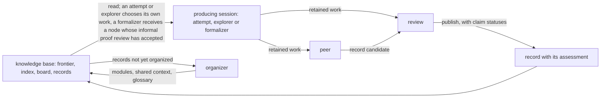

The diagram shows one pipeline and the organizer's loop. Every box except the knowledge base and the record is a session that the runner launches as a fresh conversation; the arrows carry files from one session to the next, and no two sessions converse.

