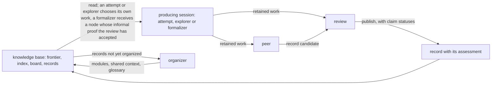

## How the research is organized

### Instances, roots and nodes

Each run of do-math is an **instance**: a directory with its own Git repository. It holds the statement to be settled in `root.md`, the models and scheduling in `settings.json`, a directory for every session that has run, and `knowledge/`, the knowledge base in which reviewed records accumulate. The statement in `root.md` is called the **root** of the instance. It never changes while the instance runs; to work on a different statement, you start a different instance.

The root is the first of the instance's **nodes**. A node is an exact mathematical statement, with its objects, assumptions, domains and quantifiers all fixed, that the research is trying to settle. As the sessions work they find further statements worth settling, such as a lemma that would imply the root, and each of these becomes a node of its own. A node is **settled** once either it or its negation has been proved. Proofs come at two levels of assurance, informal and formal, which the section "What counts as established" defines, and the run as a whole is finished only when the root has been settled at the formal level.

A new node always enters through a **relation**, a reviewed implication between nodes. Suppose a session working on a node P proves that some statement Q implies P. Its record can then propose Q as a new node together with the relation "Q implies P", and Q is admitted once a review session has checked both the implication and the exact wording of Q. In the same way, a record that settles part of what a node asserts can propose the parts as nodes, with the relation that the parts together cover the whole. An implication that is merely conjectured does not create a node; it stays in the record for a later session to investigate.

### Six roles and the pipeline

Six roles share the work, and the runner starts a new session for each piece of it. Three roles produce mathematics: an **attempt** tries to settle a node, an **explorer** works to understand the problem, and a **formalizer** builds a Lean proof. Two roles process what the producing roles leave behind: a **peer** develops it into a record, and a **review** assesses that record. The sixth role, the **organizer**, keeps the knowledge base navigable. A producing session together with its peer and its review is called a **pipeline**.

| Role | What it receives | What it leaves |
|---|---|---|
| attempt | The knowledge base; it chooses a node to settle | Its retained work on that node |
| explorer | The knowledge base; it works to understand one question about the problem | Its retained work on that question |
| formalizer | A node whose informal proof the review has accepted | Its retained work: Lean sources, complete or partial |
| peer | One producing session's complete retained work | A record candidate: exposition, claims and proposals |
| review | The candidate and the producing session's retained work | Its assessment and feedback: claim statuses, a publication decision and any concerns |
| organizer | The published records not yet organized | Modules, shared-context selection, glossary decisions, merges |

The diagram shows one pipeline and the organizer's loop. Every box except the knowledge base and the record is a session, started by the runner as a new conversation. The arrows are files passed from one session to the next; no two sessions ever converse.

What a producing session leaves behind is its **retained work**: the files it keeps in its own directory while it works. They hold the definitions and assumptions it relied on, its arguments and partial results, its computations together with their code and output, the literature it drew on and the conditions under which each source applies, the approaches that failed and what each failure actually rules out, and the steps that still have to be proved.

### The choice of work: frontier, sections and leases

An attempt is handed no node and no task. The user's standing inputs may state priorities, but the choice of what to work on stays with the session. To make that choice, the attempt reads three views of the knowledge base. The **frontier** lists the current nodes with their statements, their states and the relations between them. The **index** lists the published records, each with its own description and the review's short assessment beside it. The **board** shows what other sessions are working on right now. Having read these, the attempt picks a node and a **section** of it, an exact part of what the node asserts, which may be the whole node.

While an attempt is choosing, it holds the node's **lease**, so that only one session at a time can be choosing a section on that node. The lease has no time limit; it ends when the session registers its section, releases the lease, or ends. Registering a section is how the attempt declares what it has taken on, and the section counts as occupied until the work has passed through peer and review and become a record. The reason is that until then the work exists only in the attempt's own files, where no other session can see it, and a second attempt on the same part would repeat the work without knowing.

Sessions coordinate through information rather than enforcement. The board shows which sections are occupied, the guide that each role receives, its **role guide**, explains how to respect that, and the sessions are trusted to follow the guide. The coordination tools refuse only what a program can decide on its own: registering a statement identical to an existing section, registering a whole node while another session holds part of it, or leaving out the reason a new section does not overlap an existing one. Whether two differently worded sections overlap is a mathematical judgment, and the session registering the new section makes it and records its reason.

### The end of a session

An attempt has no time cap, and the runner does not close it the moment its conversation stops. A separate process called the **session host**, started with the session and alive for as long as the session is, resumes the same conversation and asks the session to reconsider ending under its role guide, up to three times by default. Each time, the session either continues or submits an explicit decision that its work is complete or that it sees no way forward.

A session interrupted from outside, by a provider's usage limit for example, is treated the same as one that ended on its own. In either case, if the session had begun research, its retained work goes on to a peer and a review; a session that only checked for available work and found none ends without them.

### Peer, review and the published record

A **peer** is a new session that receives the producing session's complete retained work, including the full conversation, and develops it into a **record candidate**: an exposition written for a reader who cannot open the producing session's directory, together with a structured list of the claims the exposition makes. The peer is asked to work the mathematics itself: to complete an argument the producer left unfinished where it can, to look for the counterexample or the identity that the producer passed over, and to keep its own additions distinguishable from the producer's. It also decides what the record proposes for the frontier and the glossary: new nodes, relations, proofs of nodes, questions and terms.

A **review** is another new session. It receives both the candidate and the producer's retained work and compares them in both directions, looking for results the producer established that the candidate dropped and for claims the candidate makes without support. It gives each claim one of three statuses. A claim is *supported* when the offered evidence establishes it, *unsupported* when the review has found that it does not, and *undetermined* when the review could not complete the assessment. Separately, the review decides whether the record has enough useful content to be published at all. A review may reason and compute to check an argument, but if accepting a claim would require an essential proof that the candidate does not contain, it is asked to report the gap rather than write the proof and certify its own work.

By default the peer and review roles prefer a different model from the one the producing roles prefer. Each role's model setting is an ordered list with fallbacks, so a launch made while the preferred model is unavailable may end up using the same model as the producers.

When the review finds material worth keeping, the runner publishes the candidate as a **record**: the exposition, its evidence, its description and its terminology, together with the review's assessment and feedback, all committed to the instance's Git repository. The record never changes afterwards. If a later review session, whether reviewing another candidate or examining published evidence, finds a defect in it or confirms a result, it appends a **finding** to the record, so that the original claim and what later happened to its standing are both visible. The frontier, the index, the board and the shared glossary are rendered from the repository; no session writes a separate account of the current state.

### Relations, propagation and the standing of nodes

The runner applies each accepted relation in every direction that propositional logic allows, and the frontier shows the result. A relation says that its premises cannot all hold while its conclusion fails. So a proof of Q together with "Q implies P" proves P, and a refutation of K together with "P implies K" refutes P, without anyone having to write the contrapositive as a second relation. If accepted arguments currently support both a node's statement and its negation, the node is marked *contested*; it then counts neither as work available to attempts nor as settled, until a review locates the failure.

The frontier also marks how each node stands to the root. A node is on a **route** to the root when a chain of relations lets a proof of the node contribute to settling the root; it is a necessary condition of the root when only its refutation can contribute. Formalization is requested only for outcomes that can reach the root in this sense.

### Questions and progress

Beside its nodes, the frontier keeps **questions**: things the research wants to understand that no theorem statement captures, such as why several methods stall at the same scale, or what an object looks like at the point where every estimate loses its margin. An explorer takes up one question, with question 0 standing for the root problem as a whole, and works to understand it without any predetermined theorem to produce. Its retained work goes through a peer and a review just as an attempt's does.

Questions enter the frontier the way nodes do, through a record's proposal and a review's judgment. The operator can also place questions on the frontier directly with a runner command, without peer or review, and the frontier then shows the operator as their source. A question is resolved when a published record gives an account of it that the review judges to settle it.

The role guides measure progress by the change a piece of work makes to what is known: it closes something, it lets the research see something it could not see before, it changes how the problem is approached, and the like. Extending the range over which a statement has been checked, without any such change, does not count as progress.

### Two documents on research and writing

Besides their role guides, attempt, explorer, peer, review and organizer sessions receive two documents in their starting context, in every instance started with the current do-math. One is an essay on what mathematicians have sought in their work. This repository's author and an operator session wrote it after reading the records of an earlier instance that had worked on the same problem under a previous implementation, and it draws its examples from the history of mathematics rather than from that instance. The other describes the writing the author prefers, with the scenes in which those preferences became clear. Both are offered as understanding rather than as rules, and both are files in the skill's reference folder that a user can edit.

### Formalizers, organizers, the runner and the broker

A **formalizer** receives a node whose informal proof the review has accepted and works to build a Lean proof of the exact statement, filling gaps or changing strategy as needed while the statement itself stays fixed. Its work goes through a peer and a review like any other, and another formalizer can continue from a published partial development; there is no cap on the number of rounds. An **organizer** groups the published records into modules, each described the way a section of a survey would be, selects the records that every new session should see as shared context, decides which locally introduced terms become shared vocabulary, and merges nodes or questions that turn out to be the same.

The **runner** starts all of these as new CLI conversations under the user's existing authentication. When several kinds of work are waiting, it starts them in the order review, peer, formalizer, organizer, explorer, attempt; by default it runs eight sessions at a time and starts new attempts or explorers at least three minutes apart. All Lean compilation goes through one **Lean broker** per instance, a separate process that admits compiles within a limit on the total memory and threads they may use at once, and that keeps each compile's result so that a session can collect it even after its shell command has stopped waiting. Sessions inherit none of the user's personal instructions, hooks or memories; everything they read is supplied by do-math and saved in the session's directory at launch.

## What counts as established

A published record is not a certificate for everything it says. Each claim in a record carries the status the review gave it. *Supported* means that the review found the offered evidence to establish the claim as stated; a claim that states a conjecture together with its grounds can be supported as that statement while the conjectured proposition remains unproved. The records also distinguish the kinds of support a proof rests on. The frontier keeps the informal and the formal level apart, and it counts a proof that includes computer-assisted steps as informal.

| Support | What it means | What it does not mean |
|---|---|---|
| Informal proof | An AI review session accepted a human-readable proof, or the runner derived the statement through accepted relations | Checked by a person or by a proof checker |
| Computer-assisted step | A step rests on a computation whose inputs, range, arithmetic, code and output the record states | Anything beyond the range the computation covers; for a binary64 step, proof independent of the assumed error model |
| Formal proof | A Lean proof that a review session recompiled, audited for axioms and matched to the exact statement | Formal standing for what the frontier derives from it through relations, which stays informal |

### Informal proofs

A node is **informally proved** when a review accepts a human-readable proof of its statement, or when the runner derives the statement from accepted proofs of other nodes through accepted relations; it is informally refuted in the same ways for the negation. "Informal" here means that the argument is written in ordinary mathematical language, with any computer-assisted steps stated as such, and that it was checked by an AI review session reading the candidate against the producer's retained work, not by a person and not by a proof checker. An informal proof removes the node from the work that new attempts take up, and later work may use the result for the cases the review supported. A proof that the frontier derives through relations is always informal, even when every premise has a Lean proof, because the relation itself has not been formalized.

### Computer-assisted steps

Some arguments rest on computation. A record is required to state what a computation established: its inputs, its range, its arithmetic, its code and its output. The records distinguish two kinds of arithmetic. Exact integer arithmetic, interval arithmetic and floating point with directed rounding control their own rounding. Binary64 floating point with an error model assumed in advance does not: margins added to the results are trusted to cover the rounding error rather than tracked by the arithmetic. The reviews in the first run accepted proofs with steps of the second kind as computer-assisted proofs and named the dependence in their assessments; a reader who does not accept an assumed error model should treat the results that depend on it as unproved. A finite verification proves the finite claim it covers and nothing beyond it. On the frontier, a proof with computer-assisted steps stands at the informal level.

### Formal proofs

A node is **formally proved** only after a Lean proof has passed three checks that the review session carries out itself. It recompiles the final sources through the broker, forcing the target to be compiled fresh. It prints the theorem's transitive axioms and compares them with the allowed list, by default `propext`, `Classical.choice` and `Quot.sound`, with `sorryAx` never allowed. And it compares the theorem's statement with the node, object by object and quantifier by quantifier, so that a compiled proof of a weaker or differently indexed statement does not count. The run is complete only when the root is proved or refuted at this level.

### Concerns and findings

A **concern** is a challenge to the support for a claim, reported by a review session in its assessment. A pending concern changes nothing by itself: the claim and everything derived from it keep their standing, marked as resting on a questioned claim, until a **comprehensive review** issues a finding that withdraws or reaffirms the claim. A comprehensive review is a review session assigned to examine published evidence and its actual uses; the runner launches one when a concern is reported, when a node becomes contested, or when the operator requests one with a runner command. A withdrawal removes every outcome derived through the claim, and a node that depended on it becomes unresolved again.

## The first run: unimodality of the maximum-displacement distribution of parking functions

A **parking function** of length n describes n cars arriving one at a time at n parking spots in a row. Each car has a preferred spot; it parks there if the spot is free, and otherwise drives on and takes the first free spot beyond it. A list of preferences under which every car finds a spot is a parking function, and there are (n+1)ⁿ⁻¹ of them. The **maximum displacement** of a parking function is the largest distance any of its cars had to drive past its preferred spot. Write b(n, ℓ) for the number of parking functions of length n with maximum displacement ℓ. The root of the run asks whether, for every n ≥ 1, the sequence b(n, 0), b(n, 1), …, b(n, n−1) is unimodal: non-decreasing up to some index and non-increasing after it, with a flat peak allowed. The [full account of the run](docs/do-math/first-run-parking-unimodality.md) states the problem exactly and describes the run's setup, its size, both routes to the root in outline, and every intervention by the user and the operator.

The instance was created on 5 November 2026 by the author of this repository, and on 11 November at 16:14 Korean time the root became informally proved. Two routes lead to it. A sequence fails to be unimodal exactly when it goes down at some step and up again at a later one. The first route splits that failure into four cases according to where the two steps lie relative to the middle index ⌈n/2⌉, and each case has a reviewed informal proof. The second route shows that a weaker property suffices: a log-concavity required only at steps where the sequence has already started to decrease, which implies that the sequence cannot rise again once it has started to fall. That property was settled on each side of the middle. Both routes pass through one statement, that the sequence increases below the middle, and this statement was the last part to close. The record that closed it, r5909c9e7, inherits computer-assisted inputs from earlier records: several binary64 computations with error models assumed in advance, and a certification in integer interval arithmetic that the root holds for all n ≤ 20000.

There is no Lean proof of the root. The user paused all formalization on 9 November so that the research could finish first, and the pause is still in force. One node does have a formal proof: record r0af7f414 contains the Lean theorem `Parking.critical_increment_unconditional`, whose transitive axioms are exactly `propext`, `Classical.choice` and `Quot.sound` and whose statement the review matched to the node. The node is a necessary condition of the root, a limit that unimodality for every n implies; its refutation would have refuted the root, while its proof leaves the root open.

The complete `knowledge/` directory of the instance is published on Zenodo under the concept DOI [10.5281/zenodo.24110810](https://doi.org/10.5281/zenodo.24110810), which resolves to the latest version. Version 2, [10.5281/zenodo.24142218](https://doi.org/10.5281/zenodo.24142218), was compressed on 12 November at 01:52 Korean time, after the root had been informally proved, and holds 300 records; version 1, [10.5281/zenodo.24110811](https://doi.org/10.5281/zenodo.24110811), was taken on 11 November at 00:19 Korean time, while the root was still unresolved. A third version, taken later on 12 November, is being deposited: `[placeholder: version 3 DOI, compression time and record count]`. To check the result, open `index.md`, go to `frontier.md` for the root's two routes and the records they cite, open record r5909c9e7 with its `review/feedback.md`, and continue into the records its proof uses.

The result has limits. Every review was an AI session, and no person has refereed the records. Several records on the routes rest on binary64 computations with error models assumed in advance, so a reader who does not accept those models should treat whatever depends on them as unproved. No Lean work on the routes to the root has been published. Whether do-math's mechanisms changed the quality of the research has not been measured, and no figures were collected on cost or on how often reviews rejected or corrected claims. The research is not finished: at 23:15 Korean time on 12 November the run had launched 1,237 sessions and published 340 records, the frontier held 108 nodes, and ten pipelines were still working on nodes and questions beside the root.

Several artifacts of the run are being prepared and are not yet public.

- `[placeholder: link to the Lean formal proof of the root; none exists yet, because formalization has been paused by the user since 9 November and will resume when the pause is lifted]`
- `[placeholder: link to the proof manuscript, in Korean with an English translation; a manuscript that writes out the two routes to the root step by step from the records is being written]`
- `[placeholder: link to the expository account of the research, in Korean with an English translation; the Korean text is finished and its publication form is not yet decided]`
- `[placeholder: link to the film of the run; a 191-second rendering of the instance's nodes, questions and sessions over its first six days exists and its hosting is not yet decided]`
- `[placeholder: link to the bundle of computational evidence; the code, inputs and outputs behind the computer-assisted steps are in the records' evidence folders in the knowledge base, and a bundle collected from them will be distributed with the manuscript]`
